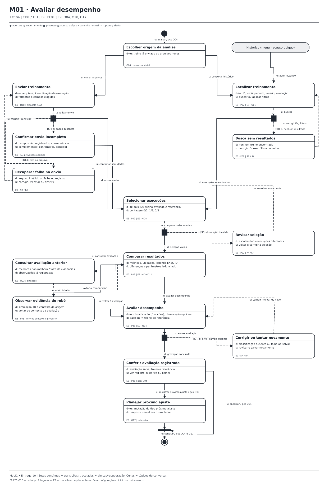
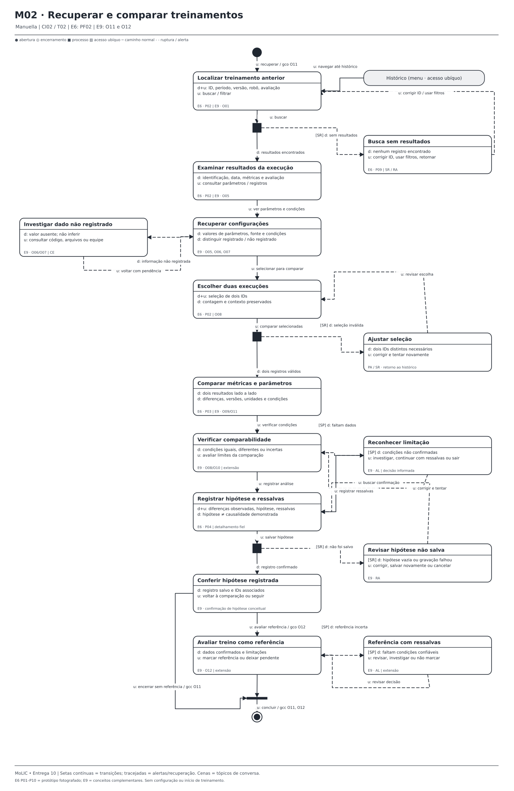
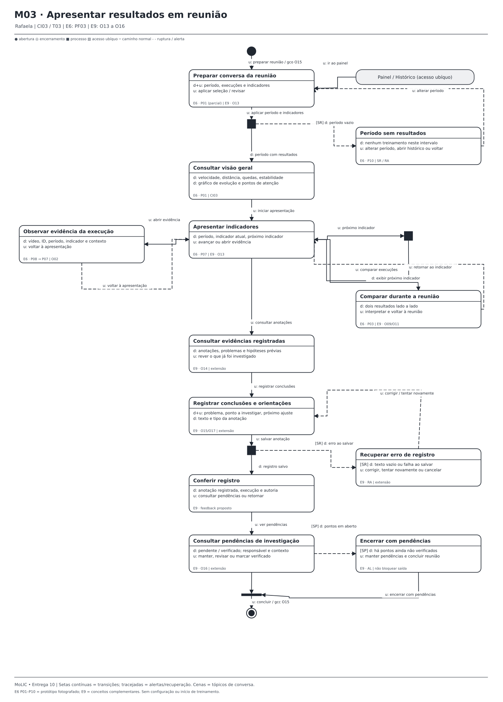

# Entrega 10 — MoLIC

**Data:** 15/11/2026  
**Status:** 🟨 Modelagem elaborada — validação com o professor pendente  
**Responsabilidade:** 1 solução completa por integrante  
**Equipe 27:** Letizia Lowatzki Baptistella; Manuella Filipe Peres; Rafaela Altheman de Campos.

## Objetivo da atividade

Modelar a interação como uma **conversa entre usuário e preposto do designer**, oferecendo visão global dos caminhos que permitem ao usuário atingir seus objetivos — incluindo alternativas e rupturas relevantes. MoLIC não deve ser reduzida a um fluxograma de telas.

> Use a **notação MoLIC ensinada na disciplina**. Este documento segue os critérios do professor e a notação apresentada em aula.

Neste projeto, buscamos modelar a interação da plataforma de análise dos treinamentos do robô humanoide como uma **conversa entre o usuário e o preposto do designer**, explicitando os caminhos necessários para atingir objetivos, os diálogos, as decisões, as alternativas e a recuperação de rupturas comunicativas.

Os modelos partem das **três tarefas T01–T03 e das telas P01–P10 da Entrega 6**, articuladas aos **cenários CI01–CI03, objetivos O01–O18, tópicos, falas e signos da Entrega 9 revisada em 14/11/2026**. As telas são referências de estados já prototipados; os elementos acrescidos na Entrega 9 são conversas conceituais para a próxima iteração da interface, e **não são apresentados como telas fotografadas ou testadas**.

A interface consulta e interpreta treinamentos **já realizados**. Ela não altera parâmetros de execução, não configura nem inicia treinamentos no simulador.

## Atenção a TCCs sem interface original

O MoLIC não modela o algoritmo por dentro. Ele modela a **conversa de interação necessária para que uma pessoa use a contribuição**. Nesta solução, isso envolve enviar arquivos já produzidos, localizar treinamentos, consultar registros, comparar duas execuções, avaliar desempenho e registrar conclusões.

Também são modeladas rupturas plausíveis: arquivos inválidos, dados ausentes, filtros sem resultado, comparação inconclusiva, falta de evidência, falha ao salvar e cancelamento ou retorno à análise.

## Notação MoLIC adotada

A notação foi organizada conforme os exemplos da disciplina baseados em **Barbosa e Silva (2010)**, sobretudo as partes A e B das aulas de MoLIC.

| Símbolo/convenção | Significado e emprego |
|---|---|
| **●** | Ponto de abertura da interação; dá início à conversa sobre um objetivo. |
| **Retângulo arredondado com linha divisória** | **Cena**: assunto da conversa (parte superior) e diálogos/signos `d+u` (parte inferior). Não corresponde obrigatoriamente a uma única tela. |
| **`u:`** | Fala, escolha ou ação comunicada pelo usuário. |
| **`d:`** | Fala, dado, explicação ou feedback do preposto do designer. |
| **`gco:`** | *Goal-related conversation opening*: início da conversa relativa a uma meta. |
| **`gcc:`** | *Goal-related conversation closing*: conclusão da conversa relativa à meta, indicada antes do encerramento. |
| **■** | Processamento do sistema, após uma solicitação do usuário; dele podem partir resultados e rupturas. |
| **Retângulo cinza arredondado** | Acesso ubíquo, disponível pela navegação e não obrigatório como etapa da tarefa. |
| **Seta contínua com ponta** | Mudança normal de tópico indicada por fala `u:` ou `d:`. |
| **Seta tracejada com ponta** | Alerta, ruptura ou retorno de recuperação, rotulado para esclarecer o motivo e a reação. |
| **◎** | Ponto de encerramento da conversa. |

Nos diagramas, **todos os contornos, textos e setas usam a mesma cor escura**. A distinção semântica depende dos **símbolos, rótulos e estilos de linha**, não de cores. A legenda usa `[SP]` para prevenção apoiada/alerta, `[SR]` para ruptura com recuperação apoiada e `[CE]` para captura de erro que requer consulta à fonte externa.

### Checklist geral exigido na atividade

- [x] Existe **ponto de abertura** coerente com o início do objetivo.
- [x] As **cenas de conversa** representam tópicos/assuntos, não nomes de páginas apenas.
- [x] As transições/falas deixam claro o que o usuário ou o sistema comunica.
- [x] Há **ponto(s) de encerramento** para objetivos concluídos ou abandonados, quando aplicável.
- [x] Processamentos do sistema são representados conforme a notação da aula, sem inventar fala do usuário.
- [x] Rupturas relevantes têm feedback e caminho de recuperação, não becos sem saída.
- [x] Acessos ubíquos/atalhos aparecem apenas quando semanticamente justificáveis.
- [x] Os diagramas cobrem caminhos alternativos importantes, não apenas o caminho ideal.
- [x] Objetivos, tópicos e signos são coerentes com a Entrega 9.
- [ ] Confirmar a legibilidade dos SVGs em tamanho normal no GitHub.
- [x] O MoLIC representa a conversa usuário–sistema, não o fluxo interno do algoritmo.
- [x] Processamento, filtros, históricos e registros possuem retornos/rupturas quando relevantes.

---
## M01 — Avaliar desempenho de um treinamento

**Autora:** Letizia Lowatzki Baptistella — **22.125.063-2**  
**Persona:** Rafael Martins — P01  
**Cenário de interação:** CI01 — Análise do desempenho do robô  
**Tarefa relacionada:** T01 / PF01 — Avaliar se houve melhora real no desempenho  
**Objetivo final:** **O04 — Avaliar desempenho do treinamento**  
**Objetivos associados:** O01, O02, O03, O07, O08, O09, O11, O17 e O18  
**Signos:** arquivos de treinamento, identificação da execução, informações ausentes, filtros, velocidade média, distância, taxa de quedas, estabilidade, localização, visualização da simulação, avaliação anterior, dois treinos selecionados, referência (*baseline*), classificação, observação e próximo ajuste.

### Diagrama



**Fonte editável:** [molic_m01.drawio](molic_m01.drawio) — [imagem PNG](molic_m01.png)

### Leitura do diagrama

#### Caminho principal

1. **Abertura (`gco: O04`) — origem da análise:** Rafael inicia a avaliação. Pode localizar a execução no histórico (**P02**) ou enviar arquivos de um treinamento já realizado (**O18**, conversa conceitual introduzida na Entrega 9).
2. **Envio ou localização:** no envio, informa ID e arquivos; o sistema os valida e, se faltarem dados, apresenta confirmação explícita. No histórico, busca por identificação ou filtros; **P09** representa a pesquisa sem resultados e permite correção.
3. **Seleção e comparação:** Rafael seleciona exatamente duas execuções (**P02**) e observa diferenças de indicadores, parâmetros e condições lado a lado (**P03**, objetivos O08, O09 e O11). Pode consultar a avaliação anterior (**O03**).
4. **Consulta ao comportamento:** pode examinar a evidência de simulação (**P08 / O02**) e retomar o contexto da avaliação. A volta ao tópico que originou a consulta é definida como continuidade conversacional, sem exigir outra tela antiga.
5. **Avaliação:** com a execução e a referência identificadas (**P05**), o usuário seleciona **melhora, não melhora ou falta de evidências** e pode adicionar **observação opcional**, conforme a redação da Entrega 9 revisada. O sistema não conclui automaticamente que velocidade maior significa treino melhor.
6. **Salvamento e confirmação:** o preposto valida a classificação, salva o registro e confirma a associação entre avaliação, execução e referência (**P06**, encerramento de O04). Rafael pode ainda registrar um **próximo ajuste como anotação** (O17), sem modificar o simulador.

#### Alternativas, rupturas e recuperação

| Situação | Conversa/estado | Feedback `d:` | Recuperação do usuário `u:` |
|---|---|---|---|
| Arquivo inválido ou falha no envio | O18, envio conceitual | `[SR]` Arquivo não aceito / registro não concluído. | Corrigir o arquivo, reenviar ou cancelar. |
| Dados ausentes no envio | O18, confirmação | `[SP]` Parte das informações não foi encontrada; deseja continuar? | Adicionar arquivos, confirmar envio incompleto ou cancelar. |
| Busca sem resultados | **P09** | `[SR]` Nenhum treinamento encontrado com esse ID/filtro. | Corrigir ID, usar filtros e voltar ao histórico **P02**. |
| Menos de dois treinos, ou IDs repetidos | **P02** | `[SR]` Selecione duas execuções distintas. | Revisar a seleção. |
| Registro visual não disponível | **P08 / O02** | `[CE]` Evidência indisponível neste registro. | Continuar pelas métricas ou consultar a origem dos arquivos. |
| Classificação não selecionada ou falha ao salvar | **P05 / P06** | `[SR]` Selecione a classificação / não foi possível salvar. | Corrigir a escolha e tentar novamente. |

#### Equivalência com a Entrega 6

**PF01:** `P02 (Histórico) → P03 (Comparação) → P05 (Avaliação) → P06 (Confirmação)`. A busca vazia usa `P09`. O comportamento consultado usa a referência conceitual de `P08`. **Upload (O18), consulta de avaliação anterior (O03) e planejamento por anotação (O17)** são desenvolvimentos da Entrega 9 revisada; não são apresentados como novas fotografias da Entrega 6.

#### Falas de referência da Entrega 9 preservadas

As falas abaixo mantêm a redação dos tópicos de CI01 na Entrega 9. No desenho, frases longas são abreviadas apenas para preservar legibilidade; os rótulos `u:`/`d:` mantêm a intenção comunicativa.

| Tópico de conversa | Fala do usuário (`u:`) | Fala do preposto (`d:`) |
|---|---|---|
| Enviar treinamento | U: Quero enviar os resultados do treinamento que acabei de realizar. | D: Selecione os arquivos do treinamento e informe a identificação. Algumas informações não foram encontradas nos arquivos: confirma o envio mesmo assim? |
| Avaliar desempenho | U: Quero verificar se o treinamento melhorou a caminhada do robô. | D: Consulte os indicadores e o comportamento do robô nesta execução. Depois, classifique o treinamento como melhora, não melhora ou falta de evidências e, se quiser, registre uma observação. |
| ↳ Consultar métricas | U: Quero analisar a velocidade, a distância, as quedas, a localização e a estabilidade. | D: Estes são os indicadores registrados para esta execução, reunidos em uma mesma tela. |
| ↳ Observar comportamento | U: Quero verificar como o robô se comportou durante a execução. | D: Consulte a visualização correspondente ao treinamento. |
| Consultar avaliações | U: Quero verificar se o resultado atingiu melhora. | D: Verifique qual foi a avaliação daquele treinamento: melhora, não melhora ou falta de evidências, e leia as observações registradas. |
| Comparar treinamentos | U: Quero comparar esta execução com uma anterior. | D: Escolha os dois treinamentos que deseja comparar; os resultados e as configurações serão exibidos lado a lado, na mesma tela. |
| ↳ Verificar diferenças | U: O que mudou entre os treinamentos? | D: Consulte as diferenças entre as métricas e os parâmetros disponíveis. |
| ↳ Considerar informações disponíveis | U: Tenho informações suficientes para comparar estas execuções? | D: Verifique os registros disponíveis para cada treinamento e considere os dados que não foram registrados. |
| Planejar ajustes | U: Quero decidir o que devo ajustar no próximo treinamento. | D: Considere o conjunto das métricas, o comportamento observado e as diferenças entre as execuções. Registre os próximos ajustes como anotação. |

### Checklist específico de modelagem — M01

- [x] Ponto de abertura, cenas com signos, processamentos e encerramento.
- [x] `gco`/`gcc` e transições rotuladas com `u:`/`d:`.
- [x] Fluxo fotografado da E6 e ampliações conceituais da E9 identificados.
- [x] Seleção de dois treinos, busca vazia, alerta de dados ausentes e salvamento com recuperação.
- [x] Nenhuma etapa configura ou inicia um treinamento.
- [ ] Conferência do SVG no GitHub e validação da notação com o professor.

---
## M02 — Recuperar informações e comparar treinamentos anteriores

**Autora:** Manuella Filipe Peres — **22.224.029-3**  
**Persona:** Marina Oliveira — P02  
**Cenário de interação:** CI02 — Recuperação da configuração de um treinamento anterior para comparação  
**Tarefa relacionada:** T02 / PF02 — Localizar duas execuções, comparar e registrar hipótese  
**Objetivos finais:** **O11 — Comparar treinamentos**; **O12 — Avaliar treinamento como referência**  
**Objetivos associados:** O01, O05, O06, O07, O08, O09 e O10  
**Signos:** ID, filtros, data, versão, métricas, parâmetros utilizados, valores, fonte dos registros, condições de execução, informação não registrada, execuções selecionadas, diferenças observadas, hipótese, ressalvas, comparabilidade e referência (*baseline*).

### Diagrama



**Fonte editável:** [molic_m02.drawio](molic_m02.drawio) — [imagem PNG](molic_m02.png)

### Leitura do diagrama

#### Caminho principal

1. **Abertura (`gco: O11`) — recuperar treinamento:** Marina procura uma execução antiga pelo ID ou por filtros de robô, período, versão e avaliação (**P02 / O01**).
2. **Examinar o resultado:** consulta identificação e desempenho, bem como os parâmetros e as condições de execução (**O05**). Para valores ausentes, o sistema apresenta **“não registrado”** e indica registros complementares a consultar (**O06–O07**), sem inferir valores.
3. **Escolher e comparar:** seleciona exatamente duas execuções (**P02**) e visualiza métricas, diferenças e configurações lado a lado (**P03 / O08–O11**), sem atribuir causalidade automaticamente.
4. **Verificar comparabilidade:** observa se condições são confirmadas, diferentes ou desconhecidas (**O10**). Se não puder confirmar, o sistema alerta, e a usuária pode investigar mais ou prosseguir com ressalvas.
5. **Registrar análise:** na conversa apoiada pela **P04**, Marina distingue **diferenças observadas**, **hipótese explicativa** e **ressalvas/limitações**. O sistema confirma o salvamento ou devolve a correção ao mesmo assunto.
6. **Avaliar referência (`gco: O12`)**: considera os dados e suas limitações e decide marcar a execução como referência ou deixar a escolha pendente. A conversa se fecha por `gcc: O11/O12`, sem configurar novos treinamentos.

#### Alternativas, rupturas e recuperação

| Situação | Conversa/estado | Feedback `d:` | Recuperação do usuário `u:` |
|---|---|---|---|
| Identificador não encontrado | **P09** | `[SR]` Nenhum treinamento encontrado. | Corrigir o ID ou utilizar filtros em **P02**. |
| Valor de parâmetro não registrado | **O06–O07** | `[CE]` Informação não disponível nos registros consultados. | Consultar arquivos de configuração, histórico de código ou responsáveis; prosseguir com a lacuna explícita. |
| Seleção inválida para comparar | **P02** | `[SR]` Selecione dois IDs distintos. | Corrigir a seleção. |
| Condições não confirmadas | **O10** | `[SP]` Comparabilidade incerta; a interpretação pode ser limitada. | Buscar dados adicionais, selecionar outro treino ou registrar ressalvas. |
| Hipótese vazia ou erro de gravação | **P04** | `[SR]` Informe a hipótese / falha ao salvar. | Corrigir ou repetir o salvamento. |
| Referência com informações insuficientes | **O12** | `[SP]` Há parâmetros ou condições ainda não confirmados. | Reavaliar, deixar como pendência ou continuar com decisão informada. |

#### Equivalência com a Entrega 6

**PF02:** `P02 (Histórico) → P03 (Comparação) → P04 (Hipótese e ressalvas)`, com `P09` como alternativa de busca vazia. A consulta complementar de configurações e a decisão de marcar referência respondem ao **CI02/O05–O12 da Entrega 9** e integram a modelagem conceitual da próxima etapa, sem exigir alteração das folhas fotografadas.

#### Falas de referência da Entrega 9 preservadas

| Tópico de conversa | Fala do usuário (`u:`) | Fala do preposto (`d:`) |
|---|---|---|
| Recuperar treinamento | U: Quero encontrar um treinamento realizado anteriormente. | D: Consulte os registros e os arquivos das execuções disponíveis. |
| ↳ Localizar execução | U: Quero encontrar o treinamento que apresentou menor frequência de quedas. | D: Busque pela identificação do treinamento ou use os filtros (robô, período, versão ou avaliação) para encontrar a execução com esse resultado. |
| Consultar resultados | U: Quero verificar o desempenho desse treinamento. | D: Estes são os resultados registrados para a execução selecionada. |
| Recuperar configurações | U: Quero saber quais parâmetros foram utilizados. | D: Consulte as configurações e os registros disponíveis para esta execução. |
| ↳ Consultar registros complementares | U: Quero verificar se existem outras informações sobre essa configuração. | D: Consulte as anotações da equipe, os arquivos de configuração e o histórico do código enviados com o treinamento. |
| ↳ Identificar dados ausentes | U: Por que não aparece o valor deste parâmetro? | D: Esta informação não está disponível nos registros consultados. |
| Comparar execuções | U: Quero comparar esse treinamento com outro mais recente. | D: Consulte as métricas, os parâmetros e as condições disponíveis para cada execução. |
| ↳ Verificar condições | U: Os treinamentos foram realizados nas mesmas condições? | D: Verifique as informações disponíveis. Quando os registros não forem suficientes, será necessário buscar esclarecimentos com os responsáveis pelos experimentos. |
| Avaliar referência | U: Posso utilizar esse treinamento como referência? | D: Considere as configurações e as condições registradas. Se faltarem informações, avalie a necessidade de obter dados adicionais ou realizar uma nova execução. Se decidir usá-lo, marque o treinamento como referência. |

### Checklist específico de modelagem — M02

- [x] Cena inicial ligada à busca no histórico e objetivo `gco: O11`.
- [x] Consulta de parâmetros e condições com indicação de dados ausentes.
- [x] Comparação de duas execuções, verificação de comparabilidade e cena de hipótese/ressalvas.
- [x] Salvamento, marcação de referência e opção de manter a decisão pendente.
- [x] Falas `u:` e `d:`, processamento, alertas, ruptura/retorno e fechamento `gcc`.
- [ ] Conferência do SVG no GitHub e validação da notação com o professor.

---
## M03 — Apresentar resultados e registrar conclusões da reunião

**Autora:** Rafaela Altheman de Campos — **22.125.062-4**  
**Persona:** Carlos Almeida — P03  
**Cenário de interação:** CI03 — Avaliação de treinamentos em reunião de orientação  
**Tarefa relacionada:** T03 / PF03 — Consultar síntese, comunicar resultados e investigar evidências  
**Objetivo final:** **O15 — Registrar conclusões da reunião**  
**Objetivos associados:** O02, O09, O11, O13, O14, O16 e O17  
**Signos:** período, identificação da execução, indicadores selecionados, velocidade média, distância, estabilidade, quedas, gráfico de evolução, pontos de atenção, indicador atual/próximo, evidência, contexto de retorno, anotações, conclusões, tipo de anotação, situação de pendências e próximo ajuste.

### Diagrama



**Fonte editável:** [molic_m03.drawio](molic_m03.drawio) — [imagem PNG](molic_m03.png)

### Leitura do diagrama

#### Caminho principal

1. **Abertura (`gco: O15`) — preparar reunião:** Carlos ou a estudante seleciona execuções, período e indicadores para a apresentação (**O13**). O sistema valida a seleção e carrega a síntese (**P01**).
2. **Consultar visão geral:** examina os indicadores, o gráfico de evolução e pontos de atenção. Se não houver resultados, o preposto apresenta **P10**, permitindo alterar o período ou consultar o histórico.
3. **Apresentar indicadores:** a reunião usa **P07** para observar as métricas, avançar para o **próximo indicador** e manter claro o indicador atual e o seguinte.
4. **Aprofundar evidências:** se houver dúvida, Carlos abre a visualização e os detalhes da execução em **P08**; ao escolher **“Voltar à apresentação”**, retorna ao mesmo período, execução e indicador em **P07**. Também pode consultar a comparação **P03** e retornar à discussão.
5. **Rever anotações:** consulta evidências e problemas anteriormente registrados (**O14**), distinguindo o que já foi investigado do que ainda exige confirmação.
6. **Registrar conclusões:** o usuário registra problemas, pontos de investigação e próximos ajustes como anotações (**O15 e O17**). O sistema valida e confirma o registro, sem alterar parâmetros de treinamento.
7. **Consultar pendências e encerrar:** verifica situações **pendente/verificado** (**O16**). Havendo assuntos não resolvidos, o preposto alerta sem impedir o encerramento, mantendo-os para a reunião seguinte. Encerra por `gcc: O15`.

#### Alternativas, rupturas e recuperação

| Situação | Conversa/estado | Feedback `d:` | Recuperação do usuário `u:` |
|---|---|---|---|
| Período sem execuções | **P10** | `[SR]` Não há resultados neste intervalo. | Alterar o período em **P01** ou abrir histórico **P02**. |
| Evidência não disponível | **P08** | `[CE]` Não há visualização correspondente à execução. | Voltar para **P07** e consultar indicadores ou outros registros. |
| Duas execuções não comparáveis | **P03 / O09–O11** | `[SP]` As condições disponíveis limitam a comparação. | Voltar à apresentação ou registrar a necessidade de investigar. |
| Campo de conclusão vazio / falha de salvamento | **O15** | `[SR]` Informe a anotação / não foi possível salvar. | Corrigir e repetir o registro. |
| Pontos de investigação ainda abertos | **O16** | `[SP]` Existem pendências não verificadas. | Mantê-las registradas e encerrar a reunião. |

#### Equivalência com a Entrega 6

**PF03:** `P01 (Painel) → P07 (Reunião) → P08 (Evidência) → P07 (Retorno à apresentação)`. A consulta de período sem dados corresponde a **P10**. A preparação detalhada de indicadores, as anotações e o acompanhamento de pendências são **desdobramentos do CI03 e dos O13–O17 da Entrega 9**, não novas fotografias atribuídas à Entrega 6.

#### Falas de referência da Entrega 9 preservadas

| Tópico de conversa | Fala do usuário (`u:`) | Fala do preposto (`d:`) |
|---|---|---|
| Preparar apresentação | U: Quero apresentar os resultados mais relevantes do treinamento. | D: Consulte a execução e selecione os indicadores que serão discutidos na reunião. |
| Consultar visão geral | U: Quero entender rapidamente como foi o desempenho. | D: Consulte os principais indicadores registrados para esta execução. |
| ↳ Analisar métricas | U: A velocidade aumentou. Isso significa que a caminhada melhorou? | D: A velocidade deve ser analisada junto à distância, estabilidade e frequência de quedas. |
| ↳ Observar execução | U: Quero ver como o robô se comportou. | D: Consulte a visualização da execução correspondente no simulador. |
| Comparar resultados | U: Como esse treinamento se compara ao anterior? | D: Consulte as diferenças entre os indicadores e as configurações das execuções. |
| Consultar detalhes | U: Quero entender quais alterações foram realizadas. | D: Consulte os parâmetros e as informações registradas para cada execução. |
| Registrar orientação | U: Quero guardar os pontos discutidos para a equipe. | D: Registre os problemas identificados, os pontos que precisam de investigação e os próximos ajustes nas anotações da reunião. |
| Planejar próximos passos | U: O que ainda precisamos investigar antes de iniciar outro treinamento? | D: Consulte os pontos identificados durante a reunião e as informações que ainda precisam ser verificadas. |

### Checklist específico de modelagem — M03

- [x] Ponto de abertura e retorno à apresentação sem perder o contexto.
- [x] `Próximo indicador`, acesso à evidência e retorno **P08 → P07** explícitos.
- [x] Tratamento do período vazio **P10** com recuperação.
- [x] Consulta de anotações, registro de conclusões e acompanhamento de pendências.
- [x] Falas, processos, `gco`/`gcc`, alertas, retornos e encerramento modelados.
- [ ] Conferência do SVG no GitHub e validação da notação com o professor.

---
## Consolidação da equipe

### Cobertura e rastreabilidade dos objetivos da Entrega 9

| Objetivo | MoLIC que cobre | Lacunas/duplicidades | Decisão |
|---|---|---|---|
| **O01** Localizar treinamento anterior | M01, M02 | Histórico compartilhado; P02/P09 | Reutilizar filtros e recuperação de busca vazia. |
| **O02** Observar comportamento | M01, M03 | Evidência P08 usada em contextos diferentes | Retornar ao assunto e contexto de origem. |
| **O03** Consultar avaliação registrada | M01 | Conceito de CI01 não detalhado na E6 | Consultar classificação e observação registradas. |
| **O04** Avaliar desempenho | M01 | P05/P06; resultados também discutidos em M03 | Registrar classificação e confirmar salvamento. |
| **O05** Consultar condições de execução | M02 | P03 contempla parte dos dados | Exibir condições e sua origem, sem inventar valores. |
| **O06** Consultar registros complementares | M02 | Extensão conceitual de CI02 | Permitir consulta a anotações e arquivos associados. |
| **O07** Identificar informações não registradas | M01, M02 | Ocorrência no upload e nas configurações | Utilizar o mesmo signo “não registrado”. |
| **O08** Verificar informações disponíveis | M01, M02 | Análise antes de comparar | Informar dados ausentes e suas limitações. |
| **O09** Verificar diferenças | M01, M02, M03 | Comparação P03 compartilhada | Exibir diferenças com unidades e identificação. |
| **O10** Verificar comparabilidade | M02 | Extensão de CI02 | Alertar se condições não forem confirmadas. |
| **O11** Comparar treinamentos | M01, M02, M03 | Comparação usada em três objetivos | Selecionar sempre duas execuções distintas. |
| **O12** Avaliar treinamento como referência | M02 | Decisão sem tela exclusiva na E6 | Registrar decisão ou manter pendente. |
| **O13** Selecionar execuções e indicadores | M03 | Preparação detalhada acrescentada na E9 | Preservar filtros e contexto durante a reunião. |
| **O14** Consultar anotações de evidências | M03 | Conexão com conclusões | Mostrar os registros disponíveis. |
| **O15** Registrar conclusões da reunião | M03 | Extensão do CI03 | Validar e confirmar anotação. |
| **O16** Consultar pendências | M03 | Extensão do CI03 | Diferenciar pendente e verificado. |
| **O17** Planejar próximos ajustes | M01, M03 | Mesmo conceito em análise e reunião | Registrar proposta como anotação, sem executar treino. |
| **O18** Fazer upload de treinamento | M01 | Nova conversa da E9, ausente nas fotos E6 | Validar ID/arquivos e alertar sobre dados ausentes. |

Os objetivos compartilhados adotam o **mesmo significado dos signos** nas diferentes conversas. A comparação é sempre entre **dois treinamentos**; o preposto informa o que foi registrado, mas **não decide a melhoria nem presume valores faltantes**. O usuário mantém a responsabilidade pela avaliação e pela definição dos próximos experimentos.

### Equivalência das dez telas da Entrega 6

| Tela | Estado fotografado na E6 | Conversa na Entrega 10 |
|---|---|---|
| P01 | Painel geral de desempenho | M03: visão geral e preparação de apresentação. |
| P02 | Histórico de execuções | M01 e M02: localização, filtros e seleção. |
| P03 | Comparação de execuções | M01, M02 e M03: diferenças e indicadores lado a lado. |
| P04 | Registro de hipóteses e ressalvas | M02: hipótese separada de evidências e limitações. |
| P05 | Avaliação do resultado do treinamento | M01: referência, classificação e observação. |
| P06 | Confirmação do registro | M01: retorno explícito após salvar avaliação. |
| P07 | Reunião/apresentação | M03: indicadores e “Próximo indicador”. |
| P08 | Evidência detalhada | M01 e M03: observação e retorno ao contexto de origem. |
| P09 | Busca sem resultados | M01 e M02: correção de ID ou filtros. |
| P10 | Painel sem dados no período | M03: alterar período ou consultar histórico. |

### Preparação para o Figma

| Unidade de apresentação / estado | Referência | Comportamento necessário |
|---|---|---|
| Painel geral e seus filtros | P01 | Período, resumo, gráficos, pontos de atenção e estados de carregamento. |
| Histórico, busca e seleção | P02 | Buscar por ID/filtros; indicar 0/2, 1/2 e 2/2 escolhidos. |
| Busca vazia | P09 | Mensagem e ações “Corrigir ID”, “Usar filtros” e “Voltar”. |
| Comparação | P03 | Dois IDs, legendas, unidades, indicadores, parâmetros e diferenças. |
| Hipótese e ressalvas | P04 | Distinguir evidência observada, hipótese e limitação; permitir corrigir/salvar. |
| Avaliação e confirmação | P05/P06 | Três classificações, identificação da referência e feedback após registro. |
| Reunião e evidência | P07/P08 | Próximo indicador explícito e retorno contextual ao indicador anterior. |
| Período sem resultados | P10 | Alterar intervalo, consultar histórico ou retornar ao painel. |
| Envio de arquivos de treinamento | Novo conceito O18 | Validar ID/arquivos; informar ausências; confirmar envio incompleto. |
| Consulta de avaliações/condições/registros | CI01/CI02 | Disponibilizar valores, fontes e “não registrado”. |
| Comparabilidade e referência | CI02 O10/O12 | Alerta de incerteza, parecer e marcação consciente de referência. |
| Anotações, conclusões e pendências | CI03 O14/O15/O16/O17 | Registro, confirmação, tipo de anotação e situação pendente/verificado. |

**Princípio de design:** o MoLIC especifica conversas e significados antes de determinar a quantidade final de telas. O Figma deve concretizar essas cenas, e não introduzir uma navegação incompatível com a modelagem.

### Regras de consistência adotadas

1. **Treinamento**, **execução**, **identificação**, **indicadores** e **referência** preservam o significado definido na Entrega 9.
2. O termo *baseline* deve aparecer explicado ao usuário como **treinamento de referência**, sem modificar o significado do signo presente na E9.
3. Os dados e métricas são sempre vinculados a uma execução identificável; quando não disponíveis, o sistema mostra **“não registrado”**, e não zero fictício.
4. Os resultados da comparação não são interpretados automaticamente como relação causal ou melhoria geral.
5. A classificação da avaliação utiliza exatamente **“melhora”, “não melhora” ou “falta de evidências”** e o registro de observação segue a redação da Entrega 9.
6. As anotações de próximo ajuste são propostas registradas para decisões futuras, **não comandos enviados ao robô ou ao simulador**.
7. Alertas permitem decisão informada; falhas comunicam possibilidade de correção ou alternativa concreta; acesso ubíquo não é passo obrigatório.

### Checklist consolidado

- [x] Uma modelagem individual completa por integrante, com autor, cenário, objetivo e tarefa.
- [x] Diagramas com ponto de abertura, cenas, processos, retornos e fechamento.
- [x] Notação MoLIC da disciplina: `u:`, `d:`, `gco:`, `gcc:`, quadrados, cenas e acesso ubíquo.
- [x] Caminhos normais e de ruptura distinguíveis por tipo de linha e rótulo, sem depender de cor.
- [x] Mapas de equivalência para P01–P10 e O01–O18.
- [x] Falas da Entrega 9 preservadas nos quadros de referência.
- [x] Extensões da Entrega 9 incluídas sem atribuir novas fotografias à Entrega 6.
- [x] Fontes `.drawio` e imagens `.svg`/`.png` incluídas para edição e publicação.
- [ ] Validar a versão final dos diagramas com professor e integrantes.
- [ ] Conferir a renderização final dos SVGs dentro do GitHub após o commit.


### Erros frequentes a evitar

- Desenhar apenas caixas com nomes de telas e setas de navegação.
- Não modelar falhas, cancelamento, volta ou recuperação.
- Usar rótulos genéricos ("Tela 1", "Processo 2") sem tópico de conversa.
- Criar no Figma fluxos que não existem no MoLIC.
- Entregar diagramas sem legenda, sem fonte editável ou com texto ilegível.

### Estrutura de arquivos no repositório

Todos os arquivos da Entrega 10 ficam **na mesma pasta**:

```text
10_molic/
├── 10_molic.md
├── molic_m01.drawio
├── molic_m01.svg
├── molic_m01.png
├── molic_m02.drawio
├── molic_m02.svg
├── molic_m02.png
├── molic_m03.drawio
├── molic_m03.svg
└── molic_m03.png
```

Os links das imagens e das fontes editáveis nesta versão são relativos ao próprio arquivo `10_molic.md`. Para visualizar corretamente no GitHub, coloque todos os arquivos lado a lado na pasta `10_molic/`.

## Conclusão

A Entrega 10 transforma a modelagem conceitual e os cenários de interação da Entrega 9 em três **conversas completas** com o preposto do designer, preservando os caminhos materializados nas dez folhas da Entrega 6 e acrescentando os objetivos formulados na revisão conceitual. M01 aborda avaliação do desempenho e importação de resultados; M02 contempla recuperação de configurações, comparação e decisão sobre referência; M03 cobre preparação, apresentação, consulta de evidências, registro de conclusões e pendências.

A modelagem explicita ações do usuário, respostas do sistema, processamento, avisos e caminhos de recuperação. Dessa forma, fornece base rastreável para a próxima etapa de interface no Figma, sem confundir uma cena MoLIC com uma tela nem incluir funcionalidades de configuração/início do treinamento fora do escopo.

**Referências de elaboração:** Entrega 6 — Prototipação em papel, P01–P10; Entrega 9 — Modelo conceitual e design centrado na comunicação, versão revisada em 14/11/2026; materiais de aula *MoLIC — Parte A, Parte B e Parte C*, com notação baseada em Barbosa e Silva (2010).
