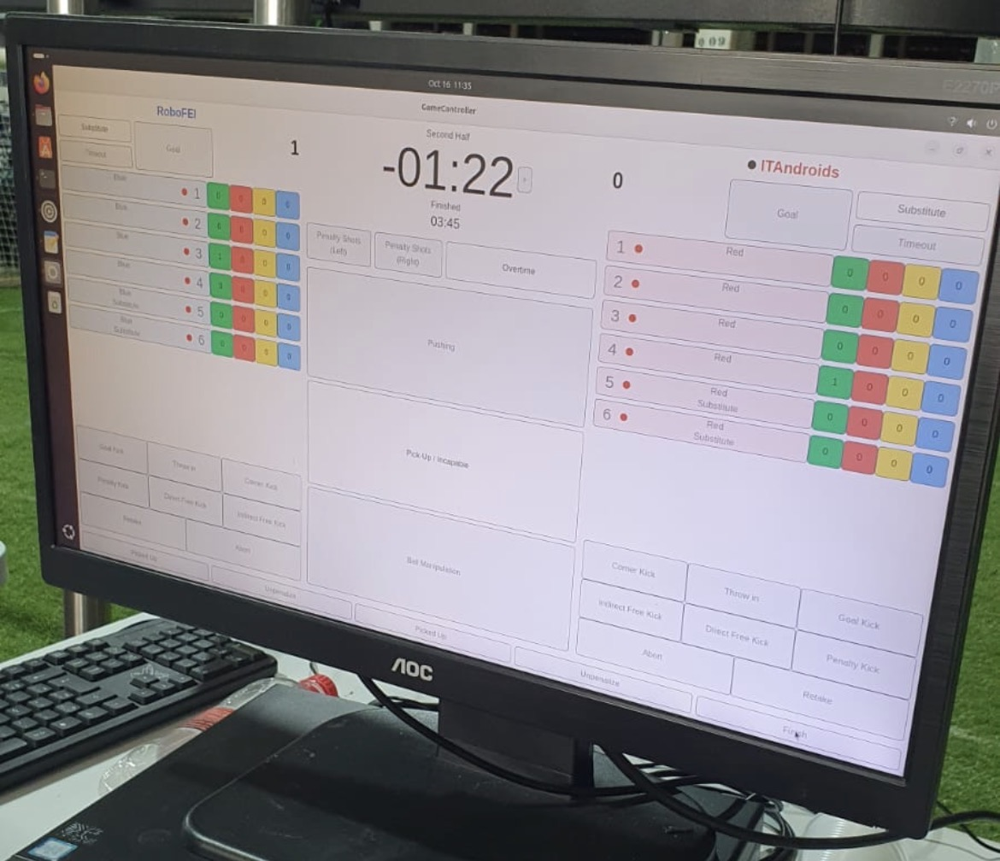

# Entrega 2 — Público-alvo e análise de concorrência

**Data:** 19/08/2026
**Status:** 🟦 revisada após feedback

**Responsabilidade mínima:** cada integrante analisa pelo menos 1 concorrente/interface representativa; a equipe produz síntese comparativa.

## Objetivo da atividade

Compreender soluções do mesmo domínio **e também interfaces familiares ao público-alvo**. O objetivo não é copiar telas, mas identificar convenções, padrões, affordances percebidas, problemas recorrentes, expectativas e oportunidades de design.

> **Concorrente não precisa ser idêntico ao produto.** Pode atuar na mesma área, resolver objetivo semelhante ou disputar a mesma necessidade. Quando não houver concorrente direto, use produtos análogos e softwares que o público já utiliza.

### Para TCCs que não previam interface

Não procure apenas um “concorrente do algoritmo”. Investigue **interfaces profissionais que materializam atividades semelhantes** às que o usuário escolhido precisaria realizar.

Exemplos:

* TCC de banco de dados → consoles de administração, ferramentas para DBA, monitoramento e análise de consultas;
* TCC de LLM/ML → painéis de experimentos, gestão de modelos/datasets, comparação de métricas, revisão de resultados;
* TCC de análise de dados → dashboards, ferramentas de BI, filtros, relatórios e exploração;
* TCC de infraestrutura/API → portais administrativos, observabilidade, logs, gestão de credenciais e uso;
* TCC de cibersegurança → consoles de alertas, triagem, histórico e auditoria.

A pergunta é: **“que convenções esse perfil já conhece para executar tarefas equivalentes?”**

## Entrada obrigatória da Entrega 1

Na Entrega 1, foram mencionadas ferramentas relacionadas à simulação, ao desenvolvimento e à análise de resultados, incluindo MuJoCo, PyBullet, ambientes da RoboCup 3D e recursos de visualização gráfica. Nesta entrega, essas referências são revisitadas juntamente com outras soluções do ecossistema da robótica e do aprendizado de máquina, buscando identificar padrões de interface relevantes para a visualização, interpretação e comparação de resultados de treinamentos.

Estaremos citando pela primeira vez:

| Item citado na Entrega 1 | Tipo               | Por que foi citado                                                                                                               | Status inicial | Decisão nesta entrega |
| ------------------------ | ------------------ | -------------------------------------------------------------------------------------------------------------------------------- | -------------- | --------------------- |
| NuSight                  | Análogo            | Interface relacionada ao acompanhamento de robôs e à visualização de informações técnicas e de desempenho.                       | —              | Analisar              |
| MARIO                    | Análogo            | Solução relacionada ao processamento e análise de dados de partidas de robôs, com organização modular e geração de estatísticas. | —              | Analisar              |
| GameController           | Indireto / Análogo | Software diretamente relacionado ao futebol de robôs humanoides, utilizado para configurar, controlar e acompanhar partidas.     | —              | Analisar              |

> **Observação:** Como os três softwares não foram citados na Entrega 1, eles não possuem um status inicial ou hipótese (`H01`, `H02` etc.) associado à etapa anterior. Por isso, nesta entrega eles são tratados como novas soluções selecionadas para análise comparativa.

| {{...}} | concorrente / análogo / ferramenta cotidiana / processo manual | {{...}} | F / H / ? | analisar / descartar com justificativa |

Se uma hipótese da Entrega 1 for confirmada ou refutada durante esta análise, atualize `H01`, `H02`... em [`../RASTREABILIDADE.md`](../RASTREABILIDADE.md).

## 1. Público-alvo desta análise

O público-alvo desta análise é formado principalmente por estudantes e integrantes de equipes de robótica humanoide que desenvolvem, treinam e avaliam robôs para a prática de futebol, como os participantes de projetos relacionados à RoboCup.

Esses usuários realizam atividades técnicas que envolvem simulação, acompanhamento de experimentos, interpretação de métricas e comparação de resultados obtidos em diferentes treinamentos. A análise considera as interfaces e ferramentas que podem apoiar essas atividades, buscando identificar padrões de interação familiares ao público e oportunidades para facilitar a compreensão dos dados.

Pesquisadores e desenvolvedores da área de robótica humanoide também são considerados como usuários relacionados ao contexto, embora a análise priorize as necessidades de quem acompanha os resultados dos treinamentos e precisa tomar decisões sobre possíveis ajustes nos experimentos.

## 2. Concorrentes diretos/indiretos

### Análise C01 — NuSight

**Autor(a):** Manuella Filipe Peres - 22.224.029-3
**Tipo:** análogo
**Link oficial:** [NuSight](https://nubook.nubots.net/system/tools/nusight#page-content)
**Data de acesso:** 10/10/2026

#### Contexto e proposta

O NUsight é uma ferramenta de visualização e monitoramento utilizada pela equipe NUbots, da University of Newcastle, no contexto do desenvolvimento de robôs humanoides para competições da RoboCup. A ferramenta apresenta informações sobre o estado e o comportamento dos robôs por meio de representações visuais, gráficos e recursos de acompanhamento técnico.

O NUsight foi selecionado como interface análoga porque apresenta recursos de visualização de dados relevantes para equipes de robótica. Embora seu foco seja o monitoramento dos robôs, e não a comparação de resultados de treinamento, seus elementos de interface podem servir como referência para a apresentação de métricas e informações técnicas no projeto.

#### Funcionalidades relevantes

| Funcionalidade                          | Como é realizada                                                                                      | Evidência/print                                                     | Observação de IHC                                                            |
| --------------------------------------- | ----------------------------------------------------------------------------------------------------- | ------------------------------------------------------------------- | ---------------------------------------------------------------------------- |
| Dashboard com informações em tempo real | Campo dispondo dos jogadores e seu estado.                                                            |  tela de Dashboard da NUSight| [F] Permite observar ao vivo a performance do robô. Para nosso projeto, poderíamo incluir um recurso similar, visto que a análise em tempo real pode ser esclarecedora em um treinamento (experiência do TCC)                              |
| Chart tab: dados de séries temporais em um plano de coordenadas                    | Permite a visualização simultânea de múltiplos fluxos de dados em determinado período do tempo  |  tela de Chart do NUSight  | Centraliza informações que poderiam estar distribuídas em diferentes fontes. Este é o principal objetivo do projeto, portanto, servirá como forte referência para nosso desenvolvimento |

#### Experiência do usuário e opiniões

[F] O dashboard do NUsight apresenta uma representação do campo, informações de estado dos robôs e controles de navegação organizados em regiões distintas. Essa distribuição permite localizar diferentes categorias de informações sem depender exclusivamente de descrições textuais.

[H] A presença de diversos indicadores técnicos em uma mesma interface pode aumentar a complexidade visual, especialmente para usuários com menor familiaridade com os parâmetros apresentados. A utilização de gráficos e registros também exige atenção à identificação das métricas, unidades e períodos analisados.

Para o projeto, a principal contribuição está na organização das informações técnicas e na possibilidade de utilizar visualizações que ajudem o usuário a interpretar os resultados. Entretanto, será necessário evitar o excesso de indicadores e priorizar as métricas relacionadas às tarefas de análise de treinamento.

#### Preço/modelo de negócio

A NUSight é disponibilizada como documentação pública da equipe NUbots. Não foi identificado modelo de cobrança ou comercialização da plataforma.

#### Padrões e tendências percebidos

* Separação entre informações sobre equipe, sistemas e guias
* Navegação por categorias
* Centralização de documentação técnica
* Registro de histórico e conhecimento da equipe
* Gráficos e Logs para análise de desempenho
* Informações dos sensores dos robôs para análise mais técnica.

#### Pontos positivos, limitações e lições

| Ponto                        | Evidência                                                                 | Implicação para nosso projeto                                                                 |
| ---------------------------- | ------------------------------------------------------------------------- | --------------------------------------------------------------------------------------------- |
| Centralização de informações | Hardware, software, ferramentas e pesquisas estão reunidos na plataforma. | Informações relacionadas aos treinamentos podem ser centralizadas.                            |
| Guias e documentação         | Existe uma seção específica de Guides.                                    | O guia pode explicar o que se encontra em cada sessão (útil para ajudar pessoas que estão ingressando na área). |
| Aparência e linguagem técnica         | Informações de sensores, Logs e Gráficos precisam de conhecimento técnico sobre robôs para entendimento (temperatura dos servos, graus, odometria, YoLo).                                    | Pode ser interessante oferecer ajuda ou explicações para parâmetros e métricas mais técnicas. |

### Análise C02 — Mario

**Autor(a):** Letizia Lowatzki Baptistella - 22.125.063-2
**Tipo:** análogo
**Link oficial:** [MARIO](https://sites.google.com/unibas.it/wolves/robocup/robocup-2022/mario)
**Data de acesso:** 10/10/2026

#### Contexto e proposta

O MARIO (Modular and Extensible Architecture for Computing Visual Statistics in RoboCup SPL) é uma arquitetura desenvolvida para gerar estatísticas visuais a partir de vídeos de partidas da RoboCup Standard Platform League. O projeto foi desenvolvido no contexto do Open Research Challenge da RoboCup 2022 e possui uma arquitetura modular, na qual diferentes módulos realizam tarefas específicas de processamento e análise.

A solução foi analisada como análogo porque, apesar de não realizar o treinamento do robô, possui um fluxo semelhante ao contexto do projeto como entrada de dados, processamento, acompanhamento de etapas e análise dos resultados.

#### Funcionalidades relevantes

| Funcionalidade          | Como é realizada                                                                    | Evidência/print                                                  | Observação de IHC                                                          |
| ----------------------- | ----------------------------------------------------------------------------------- | ---------------------------------------------------------------- | -------------------------------------------------------------------------- |
| Análises              | Gráficos de análise sobre a partida.                  |  | Para o projeto, talvez fosse interessante adicionar para além de informações de desempenho do robô, informações da partida de futebol jogada por ele.               |
| Tracking | Upload de um vídeo da partida real mostra na interface o comportamento dos robôs. |                     | Visualizar comportamento do robô em partida. [F] Trazer visualiazação da tentativa de treino mais promissora é útil como métrica para melhora de performance (experiência do TCC) |

#### Experiência do usuário e opiniões

[?] Um aspecto positivo é a modularidade do sistema, pois diferentes etapas possuem funções específicas. Isso pode facilitar a compreensão do fluxo de processamento e a identificação da etapa em que determinado resultado foi produzido.

[F] Apesar de ter uma sessão voltada a isso, a função central do MARIO não é analise de resultados e desempenho dos robôs. 

#### Preço/modelo de negócio

Não foi identificado modelo de cobrança ou comercialização da plataforma.

#### Padrões e tendências percebidos

* Organização modular
* Processamento dividido em etapas
* Feedback visual
* Transformação de dados técnicos em estatísticas
* Uso de visualizações para auxiliar a interpretação dos resultados

#### Pontos positivos, limitações e lições

| Ponto           | Evidência                                                     | Implicação para nosso projeto                                          |
| --------------- | ------------------------------------------------------------- | ---------------------------------------------------------------------- |
| Modularidade    | O MARIO divide o processamento em módulos específicos.        | O fluxo da interface pode separar configuração, treinamento e análise. |
| Feedback visual | O tracking representa jogo na interface. | O treinamento pode apresentar visualmente o comportamento do robô.     |
| Falta de elementos para identificar performance | MARIO está mais centrado em análise geral da partida. | Apesar de ser útil ter o panorama geral da partida como métrica, nosso projeto visa aperceiçoar o desempenho de um robô com análise de dados centrados nele.     |

### Análise C03 — GameController

**Autor(a):** Rafaela Altheman de Campos - 22.125.062-4
**Tipo:** indireto/análogo
**Link oficial:** [GameController](https://github.com/RoboCup-HumanoidSoccerLeague/GameController)
**Data de acesso:** 19/08/2026

#### Contexto e proposta

O GameController é uma ferramenta utilizada no gerenciamento de partidas de futebol de robôs humanoides da RoboCup Humanoid Soccer League. Sua interface permite acompanhar informações sobre as equipes, o placar, o tempo e os estados relacionados ao andamento da partida, além de disponibilizar controles para sua operação.

O GameController foi selecionado como interface análoga por pertencer ao contexto de utilização de robôs humanoides e apresentar informações operacionais organizadas visualmente. Embora sua finalidade seja controlar partidas, e não analisar resultados de treinamentos, seus padrões de apresentação de estados, agrupamento de informações e diferenciação visual podem servir como referências para o projeto.

A análise concentra-se nos elementos de interface observáveis e em sua possível adaptação para a consulta e a interpretação dos resultados dos experimentos, sem pressupor que o projeto desenvolverá funcionalidades de controle de partidas ou de execução de treinamentos.

#### Funcionalidades relevantes

| Funcionalidade       | Como é realizada                                                              | Evidência/print                                                                         | Observação de IHC                                                |
| -------------------- | ----------------------------------------------------------------------------- | --------------------------------------------------------------------------------------- | ---------------------------------------------------------------- |
| Tela principal | A interface de controle da partida apresenta informações como placar, cronômetro, identificação das equipes e cartões relacionados aos jogadores. Os elementos estão distribuídos em regiões que permitem acompanhar o andamento do jogo e realizar ações operacionais. |  | Ao controlar a partida em tempo real, fica explicito o estado de cada robô no momento do jogo. Isso é interessante pois espelha na interface o que o robô real e, futuramente, os dados coletados poderiam ser processados e virar métricas de análise. |
|  |  |  |  |

#### Experiência do usuário e opiniões

[F] A interface do GameController apresenta informações organizadas por equipe, com destaque para o tempo e o placar da partida. O agrupamento de controles e indicadores favorece a identificação de informações relacionadas ao mesmo contexto.

[F] Na imagem analisada, diferentes elementos utilizam cores e variações de aparência para representar informações ou condições da partida, incluindo controles visualmente esmaecidos.

[?] A imagem analisada não demonstra, por si só, quais validações ocorrem durante a configuração inicial da partida. Portanto, não é possível confirmar visualmente regras de prevenção de erros relacionadas à seleção das equipes ou às cores utilizadas.

#### Preço/modelo de negócio

Não foi identificado modelo de cobrança pelo uso do software.

#### Padrões e tendências percebidos

* Configuração antes da execução
* Validação de dados
* Feedback do estado atual
* Interface voltada para controle em tempo real

#### Pontos positivos, limitações e lições

| Ponto                          | Evidência                                                                      | Implicação para nosso projeto                                                                                     |
| ------------------------------ | ------------------------------------------------------------------------------ | ----------------------------------------------------------------------------------------------------------------- |
| Configuração antes da execução | O Launcher reúne os parâmetros necessários antes de iniciar a partida.         | O treinamento pode possuir uma etapa clara de configuração antes da execução.                                     |
| Feedback de estado             | A interface principal apresenta informações relacionadas ao estado da partida. | A interface pode informar claramente se o treinamento está configurado, executando, concluído ou apresentou erro. |

### Análise complementar — TensorBoard

O TensorBoard é uma ferramenta de visualização utilizada no acompanhamento de experimentos de aprendizado de máquina. Sua interface disponibiliza gráficos e outros recursos para examinar métricas registradas durante a execução dos experimentos, incluindo a evolução de valores ao longo de etapas de treinamento.

A ferramenta foi selecionada como interface análoga por apresentar funcionalidades diretamente relacionadas à atividade central do projeto: acompanhar, interpretar e comparar resultados de treinamentos. Diferentemente das ferramentas voltadas ao controle de partidas de futebol de robôs, o TensorBoard oferece referências mais próximas da análise de experimentos de aprendizado de máquina.

Sua análise permite identificar padrões de apresentação de séries temporais, identificação de execuções e comparação de métricas, considerando também os riscos de excesso de informações e dificuldades de interpretação de gráficos técnicos.

#### Funcionalidades relevantes

| Funcionalidade | Como é realizada | Evidência/print | Observação de IHC |
| --- | --- | --- | --- |
| Visualização de métricas | Apresenta gráficos com os valores registrados durante os experimentos, permitindo acompanhar a evolução das métricas ao longo das etapas de treinamento. |  | [F] Os gráficos organizam valores das métricas em séries, permitindo observar alterações ao longo do treinamento. [H] A representação gráfica pode facilitar a identificação de tendências, mas exige atenção aos eixos, escalas e unidades para evitar interpretações equivocadas. |
| Comparação de execuções | Permite visualizar métricas de diferentes execuções de treinamento, utilizando séries identificadas para facilitar a comparação dos resultados. |  | [F] A visualização de diferentes execuções permite observar seus resultados em um mesmo contexto gráfico. [H] A comparação pode ajudar a identificar diferenças de desempenho, mas muitas séries simultâneas podem dificultar a leitura e a identificação de cada experimento. |
| Organização de gráficos | Disponibiliza recursos de organização e seleção das informações apresentadas, facilitando a consulta de métricas
