# Entrega 2 — Público-alvo e análise de concorrência

**Data:** 19/08/2026
**Status:** 🟦 revisada após feedback

**Responsabilidade mínima:** cada integrante analisa pelo menos 1 concorrente/interface representativa; a equipe produz síntese comparativa.

## Objetivo da atividade

Compreender soluções do mesmo domínio **e também interfaces familiares ao público-alvo**. O objetivo não é copiar telas, mas identificar convenções, padrões, affordances percebidas, problemas recorrentes, expectativas e oportunidades de design.

> **Concorrente não precisa ser idêntico ao produto.** Pode atuar na mesma área, resolver objetivo semelhante ou disputar a mesma necessidade. Quando não houver concorrente direto, use produtos análogos e softwares que o público já utiliza.

### Para TCCs que não previam interface

Não procure apenas um “concorrente do algoritmo”. Investigue **interfaces profissionais que materializam atividades semelhantes** às que o usuário escolhido precisaria realizar.

Exemplos:

* TCC de banco de dados → consoles de administração, ferramentas para DBA, monitoramento e análise de consultas;
* TCC de LLM/ML → painéis de experimentos, gestão de modelos/datasets, comparação de métricas, revisão de resultados;
* TCC de análise de dados → dashboards, ferramentas de BI, filtros, relatórios e exploração;
* TCC de infraestrutura/API → portais administrativos, observabilidade, logs, gestão de credenciais e uso;
* TCC de cibersegurança → consoles de alertas, triagem, histórico e auditoria.

A pergunta é: **“que convenções esse perfil já conhece para executar tarefas equivalentes?”**

## Entrada obrigatória da Entrega 1

Na Entrega 1, foram mencionadas ferramentas relacionadas à simulação, ao desenvolvimento e à análise de resultados, incluindo MuJoCo, PyBullet, ambientes da RoboCup 3D e recursos de visualização gráfica. Nesta entrega, essas referências são revisitadas juntamente com outras soluções do ecossistema da robótica e do aprendizado de máquina, buscando identificar padrões de interface relevantes para a visualização, interpretação e comparação de resultados de treinamentos.

Estaremos citando pela primeira vez:

| Item citado na Entrega 1 | Tipo               | Por que foi citado                                                                                                               | Status inicial | Decisão nesta entrega |
| ------------------------ | ------------------ | -------------------------------------------------------------------------------------------------------------------------------- | -------------- | --------------------- |
| NuSight                  | Análogo            | Interface relacionada ao acompanhamento de robôs e à visualização de informações técnicas e de desempenho.                       | —              | Analisar              |
| MARIO                    | Análogo            | Solução relacionada ao processamento e análise de dados de partidas de robôs, com organização modular e geração de estatísticas. | —              | Analisar              |
| GameController           | Indireto / Análogo | Software diretamente relacionado ao futebol de robôs humanoides, utilizado para configurar, controlar e acompanhar partidas.     | —              | Analisar              |

> **Observação:** Como os três softwares não foram citados na Entrega 1, eles não possuem um status inicial ou hipótese (`H01`, `H02` etc.) associado à etapa anterior. Por isso, nesta entrega eles são tratados como novas soluções selecionadas para análise comparativa.

| {{...}} | concorrente / análogo / ferramenta cotidiana / processo manual | {{...}} | F / H / ? | analisar / descartar com justificativa |

Se uma hipótese da Entrega 1 for confirmada ou refutada durante esta análise, atualize `H01`, `H02`... em [`../RASTREABILIDADE.md`](../RASTREABILIDADE.md).

## 1. Público-alvo desta análise

O público-alvo desta análise é formado principalmente por estudantes e integrantes de equipes de robótica humanoide que desenvolvem, treinam e avaliam robôs para a prática de futebol, como os participantes de projetos relacionados à RoboCup.

Esses usuários realizam atividades técnicas que envolvem simulação, acompanhamento de experimentos, interpretação de métricas e comparação de resultados obtidos em diferentes treinamentos. A análise considera as interfaces e ferramentas que podem apoiar essas atividades, buscando identificar padrões de interação familiares ao público e oportunidades para facilitar a compreensão dos dados.

Pesquisadores e desenvolvedores da área de robótica humanoide também são considerados como usuários relacionados ao contexto, embora a análise priorize as necessidades de quem acompanha os resultados dos treinamentos e precisa tomar decisões sobre possíveis ajustes nos experimentos.

## 2. Concorrentes diretos/indiretos

### Análise C01 — NuSight

**Autor(a):** Manuella Filipe Peres - 22.224.029-3
**Tipo:** análogo
**Link oficial:** [NuSight](https://nubook.nubots.net/system/tools/nusight#page-content)
**Data de acesso:** 10/10/2026

#### Contexto e proposta

O NUsight é uma ferramenta de visualização e monitoramento utilizada pela equipe NUbots, da University of Newcastle, no contexto do desenvolvimento de robôs humanoides para competições da RoboCup. A ferramenta apresenta informações sobre o estado e o comportamento dos robôs por meio de representações visuais, gráficos e recursos de acompanhamento técnico.

O NUsight foi selecionado como interface análoga porque apresenta recursos de visualização de dados relevantes para equipes de robótica. Embora seu foco seja o monitoramento dos robôs, e não a comparação de resultados de treinamento, seus elementos de interface podem servir como referência para a apresentação de métricas e informações técnicas no projeto.

#### Funcionalidades relevantes

| Funcionalidade                          | Como é realizada                                                                                      | Evidência/print                                                     | Observação de IHC                                                            |
| --------------------------------------- | ----------------------------------------------------------------------------------------------------- | ------------------------------------------------------------------- | ---------------------------------------------------------------------------- |
| Dashboard com informações em tempo real | Campo dispondo dos jogadores e seu estado.                                                            | 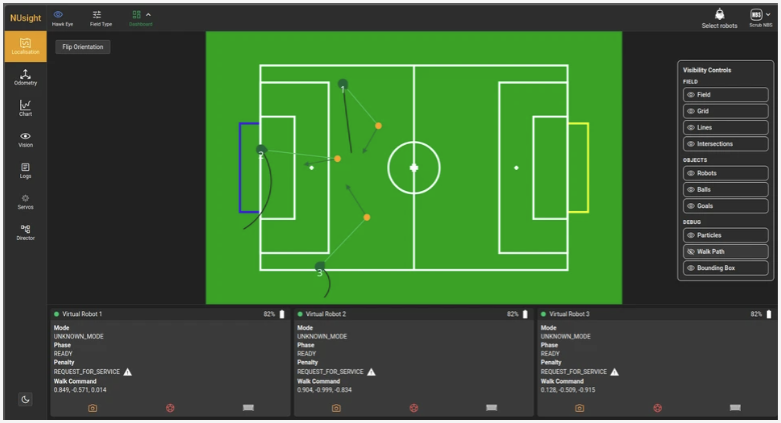 tela de Dashboard da NUSight| [F] Permite observar ao vivo a performance do robô. Para nosso projeto, poderíamo incluir um recurso similar, visto que a análise em tempo real pode ser esclarecedora em um treinamento (experiência do TCC)                              |
| Chart tab: dados de séries temporais em um plano de coordenadas                    | Permite a visualização simultânea de múltiplos fluxos de dados em determinado período do tempo  | 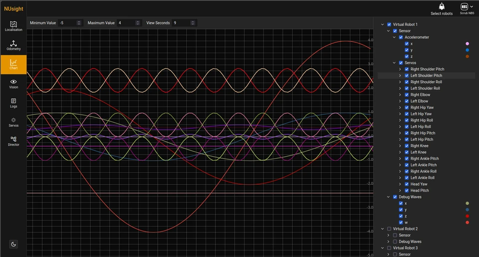 tela de Chart do NUSight  | Centraliza informações que poderiam estar distribuídas em diferentes fontes. Este é o principal objetivo do projeto, portanto, servirá como forte referência para nosso desenvolvimento |

#### Experiência do usuário e opiniões

[F] O dashboard do NUsight apresenta uma representação do campo, informações de estado dos robôs e controles de navegação organizados em regiões distintas. Essa distribuição permite localizar diferentes categorias de informações sem depender exclusivamente de descrições textuais.

[H] A presença de diversos indicadores técnicos em uma mesma interface pode aumentar a complexidade visual, especialmente para usuários com menor familiaridade com os parâmetros apresentados. A utilização de gráficos e registros também exige atenção à identificação das métricas, unidades e períodos analisados.

Para o projeto, a principal contribuição está na organização das informações técnicas e na possibilidade de utilizar visualizações que ajudem o usuário a interpretar os resultados. Entretanto, será necessário evitar o excesso de indicadores e priorizar as métricas relacionadas às tarefas de análise de treinamento.

#### Preço/modelo de negócio

A NUSight é disponibilizada como documentação pública da equipe NUbots. Não foi identificado modelo de cobrança ou comercialização da plataforma.

#### Padrões e tendências percebidos

* Separação entre informações sobre equipe, sistemas e guias
* Navegação por categorias
* Centralização de documentação técnica
* Registro de histórico e conhecimento da equipe
* Gráficos e Logs para análise de desempenho
* Informações dos sensores dos robôs para análise mais técnica.

#### Pontos positivos, limitações e lições

| Ponto                        | Evidência                                                                 | Implicação para nosso projeto                                                                 |
| ---------------------------- | ------------------------------------------------------------------------- | --------------------------------------------------------------------------------------------- |
| Centralização de informações | Hardware, software, ferramentas e pesquisas estão reunidos na plataforma. | Informações relacionadas aos treinamentos podem ser centralizadas.                            |
| Guias e documentação         | Existe uma seção específica de Guides.                                    | O guia pode explicar o que se encontra em cada sessão (útil para ajudar pessoas que estão ingressando na área). |
| Aparência e linguagem técnica         | Informações de sensores, Logs e Gráficos precisam de conhecimento técnico sobre robôs para entendimento (temperatura dos servos, graus, odometria, YoLo).                                    | Pode ser interessante oferecer ajuda ou explicações para parâmetros e métricas mais técnicas. |

### Análise C02 — Mario

**Autor(a):** Letizia Lowatzki Baptistella - 22.125.063-2
**Tipo:** análogo
**Link oficial:** [MARIO](https://sites.google.com/unibas.it/wolves/robocup/robocup-2022/mario)
**Data de acesso:** 10/10/2026

#### Contexto e proposta

O MARIO (Modular and Extensible Architecture for Computing Visual Statistics in RoboCup SPL) é uma arquitetura desenvolvida para gerar estatísticas visuais a partir de vídeos de partidas da RoboCup Standard Platform League. O projeto foi desenvolvido no contexto do Open Research Challenge da RoboCup 2022 e possui uma arquitetura modular, na qual diferentes módulos realizam tarefas específicas de processamento e análise.

A solução foi analisada como análogo porque, apesar de não realizar o treinamento do robô, possui um fluxo semelhante ao contexto do projeto como entrada de dados, processamento, acompanhamento de etapas e análise dos resultados.

#### Funcionalidades relevantes

| Funcionalidade          | Como é realizada                                                                    | Evidência/print                                                  | Observação de IHC                                                          |
| ----------------------- | ----------------------------------------------------------------------------------- | ---------------------------------------------------------------- | -------------------------------------------------------------------------- |
| Análises              | Gráficos de análise sobre a partida.                  | 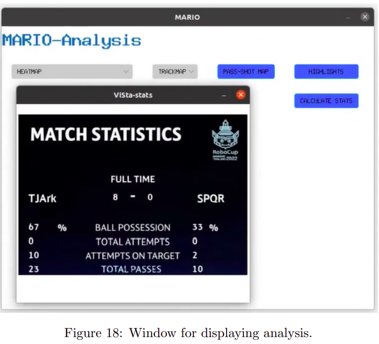 | Para o projeto, talvez fosse interessante adicionar para além de informações de desempenho do robô, informações da partida de futebol jogada por ele.               |
| Tracking | Upload de um vídeo da partida real mostra na interface o comportamento dos robôs. | 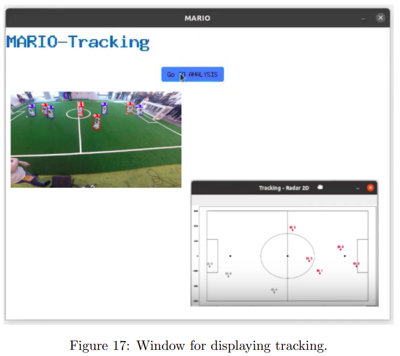                    | Visualizar comportamento do robô em partida. [F] Trazer visualiazação da tentativa de treino mais promissora é útil como métrica para melhora de performance (experiência do TCC) |

#### Experiência do usuário e opiniões

[?] Um aspecto positivo é a modularidade do sistema, pois diferentes etapas possuem funções específicas. Isso pode facilitar a compreensão do fluxo de processamento e a identificação da etapa em que determinado resultado foi produzido.

[F] Apesar de ter uma sessão voltada a isso, a função central do MARIO não é analise de resultados e desempenho dos robôs. 

#### Preço/modelo de negócio

Não foi identificado modelo de cobrança ou comercialização da plataforma.

#### Padrões e tendências percebidos

* Organização modular
* Processamento dividido em etapas
* Feedback visual
* Transformação de dados técnicos em estatísticas
* Uso de visualizações para auxiliar a interpretação dos resultados

#### Pontos positivos, limitações e lições

| Ponto           | Evidência                                                     | Implicação para nosso projeto                                          |
| --------------- | ------------------------------------------------------------- | ---------------------------------------------------------------------- |
| Modularidade    | O MARIO divide o processamento em módulos específicos.        | O fluxo da interface pode separar configuração, treinamento e análise. |
| Feedback visual | O tracking representa jogo na interface. | O treinamento pode apresentar visualmente o comportamento do robô.     |
| Falta de elementos para identificar performance | MARIO está mais centrado em análise geral da partida. | Apesar de ser útil ter o panorama geral da partida como métrica, nosso projeto visa aperceiçoar o desempenho de um robô com análise de dados centrados nele.     |

### Análise C03 — GameController

**Autor(a):** Rafaela Altheman de Campos - 22.125.062-4
**Tipo:** indireto/análogo
**Link oficial:** [GameController](https://github.com/RoboCup-HumanoidSoccerLeague/GameController)
**Data de acesso:** 19/08/2026

#### Contexto e proposta

O GameController é uma ferramenta utilizada no gerenciamento de partidas de futebol de robôs humanoides da RoboCup Humanoid Soccer League. Sua interface permite acompanhar informações sobre as equipes, o placar, o tempo e os estados relacionados ao andamento da partida, além de disponibilizar controles para sua operação.

O GameController foi selecionado como interface análoga por pertencer ao contexto de utilização de robôs humanoides e apresentar informações operacionais organizadas visualmente. Embora sua finalidade seja controlar partidas, e não analisar resultados de treinamentos, seus padrões de apresentação de estados, agrupamento de informações e diferenciação visual podem servir como referências para o projeto.

A análise concentra-se nos elementos de interface observáveis e em sua possível adaptação para a consulta e a interpretação dos resultados dos experimentos, sem pressupor que o projeto desenvolverá funcionalidades de controle de partidas ou de execução de treinamentos.

#### Funcionalidades relevantes

| Funcionalidade       | Como é realizada                                                              | Evidência/print                                                                         | Observação de IHC                                                |
| -------------------- | ----------------------------------------------------------------------------- | --------------------------------------------------------------------------------------- | ---------------------------------------------------------------- |
| Tela principal | A interface de controle da partida apresenta informações como placar, cronômetro, identificação das equipes e cartões relacionados aos jogadores. Os elementos estão distribuídos em regiões que permitem acompanhar o andamento do jogo e realizar ações operacionais. | 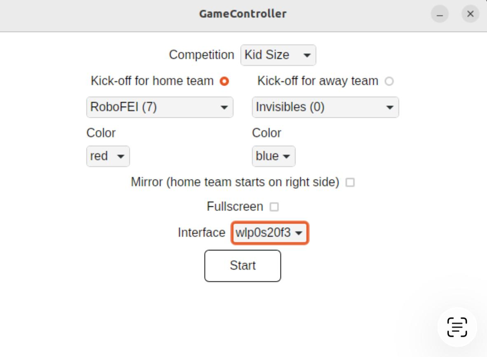 | Ao controlar a partida em tempo real, fica explicito o estado de cada robô no momento do jogo. Isso é interessante pois espelha na interface o que o robô real e, futuramente, os dados coletados poderiam ser processados e virar métricas de análise. |

#### Experiência do usuário e opiniões

[F] A interface do GameController apresenta informações organizadas por equipe, com destaque para o tempo e o placar da partida. O agrupamento de controles e indicadores favorece a identificação de informações relacionadas ao mesmo contexto.

[F] Na imagem analisada, diferentes elementos utilizam cores e variações de aparência para representar informações ou condições da partida, incluindo controles visualmente esmaecidos.

[?] A imagem analisada não demonstra, por si só, quais validações ocorrem durante a configuração inicial da partida. Portanto, não é possível confirmar visualmente regras de prevenção de erros relacionadas à seleção das equipes ou às cores utilizadas.

#### Preço/modelo de negócio

Não foi identificado modelo de cobrança pelo uso do software.

#### Padrões e tendências percebidos

* Configuração antes da execução
* Validação de dados
* Feedback do estado atual
* Interface voltada para controle em tempo real

#### Pontos positivos, limitações e lições

| Ponto                          | Evidência                                                                      | Implicação para nosso projeto                                                                                     |
| ------------------------------ | ------------------------------------------------------------------------------ | ----------------------------------------------------------------------------------------------------------------- |
| Configuração antes da execução | O Launcher reúne os parâmetros necessários antes de iniciar a partida.         | O treinamento pode possuir uma etapa clara de configuração antes da execução.                                     |
| Feedback de estado             | A interface principal apresenta informações relacionadas ao estado da partida. | A interface pode informar claramente se o treinamento está configurado, executando, concluído ou apresentou erro. |

### Análise complementar — TensorBoard

O TensorBoard é uma ferramenta de visualização utilizada no acompanhamento de experimentos de aprendizado de máquina. Sua interface disponibiliza gráficos e outros recursos para examinar métricas registradas durante a execução dos experimentos, incluindo a evolução de valores ao longo de etapas de treinamento.

A ferramenta foi selecionada como interface análoga por apresentar funcionalidades diretamente relacionadas à atividade central do projeto: acompanhar, interpretar e comparar resultados de treinamentos. Diferentemente das ferramentas voltadas ao controle de partidas de futebol de robôs, o TensorBoard oferece referências mais próximas da análise de experimentos de aprendizado de máquina.

Sua análise permite identificar padrões de apresentação de séries temporais, identificação de execuções e comparação de métricas, considerando também os riscos de excesso de informações e dificuldades de interpretação de gráficos técnicos.

#### Funcionalidades relevantes

| Funcionalidade | Como é realizada | Evidência/print | Observação de IHC |
| --- | --- | --- | --- |
| Visualização de métricas | Apresenta gráficos com os valores registrados durante os experimentos, permitindo acompanhar a evolução das métricas ao longo das etapas de treinamento. | 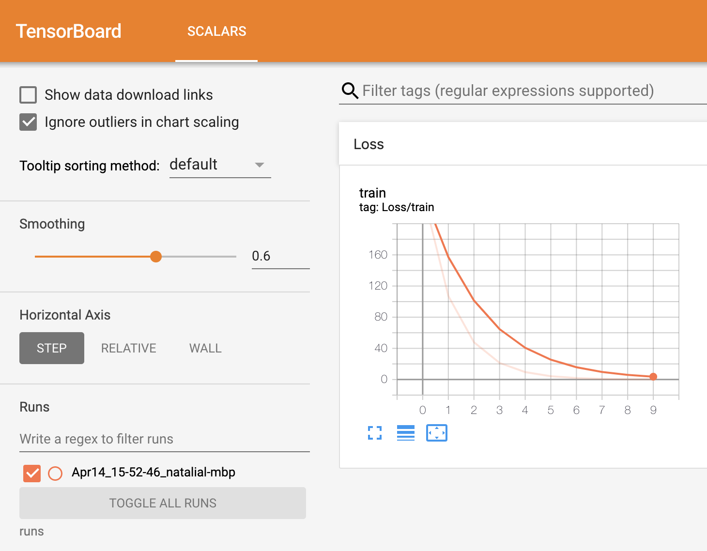 | [F] Os gráficos organizam valores das métricas em séries, permitindo observar alterações ao longo do treinamento. [H] A representação gráfica pode facilitar a identificação de tendências, mas exige atenção aos eixos, escalas e unidades para evitar interpretações equivocadas. |
| Comparação de execuções | Permite visualizar métricas de diferentes execuções de treinamento, utilizando séries identificadas para facilitar a comparação dos resultados. | 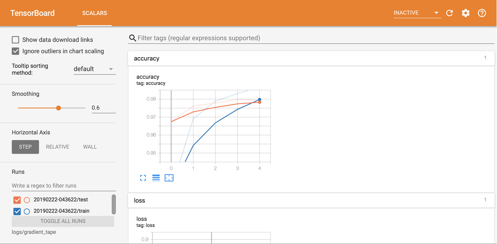 | [F] A visualização de diferentes execuções permite observar seus resultados em um mesmo contexto gráfico. [H] A comparação pode ajudar a identificar diferenças de desempenho, mas muitas séries simultâneas podem dificultar a leitura e a identificação de cada experimento. |
| Organização de gráficos | Disponibiliza recursos de organização e seleção das informações apresentadas, facilitando a consulta de métricas específicas. | 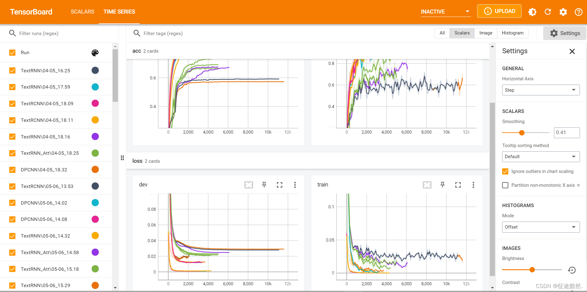 | [F] Os recursos de organização permitem localizar conjuntos de gráficos e métricas. [H] O agrupamento pode facilitar a navegação, mas uma quantidade elevada de painéis e indicadores pode aumentar a complexidade visual. |

#### Experiência do usuário e opiniões

[H] A visualização de métricas em gráficos pode facilitar a identificação de tendências durante os treinamentos, principalmente quando diferentes execuções são apresentadas com identificação consistente.

[H] A quantidade de séries e indicadores exibidos simultaneamente pode dificultar a leitura e a comparação dos resultados. A interpretação dos gráficos também depende do conhecimento das métricas, das escalas e das condições dos experimentos.

Para o projeto, o TensorBoard constitui uma referência relevante para pensar a organização das métricas, a comparação entre experimentos e a apresentação de informações que apoiem decisões sobre ajustes nos treinamentos.

#### Pontos positivos, limitações e lições

| Ponto | Evidência | Implicação para nosso projeto |
| --- | --- | --- |
| Visualização de métricas | O TensorBoard apresenta gráficos que mostram a evolução das métricas ao longo do treinamento. | Apresentar a evolução de métricas relevantes, facilitando a interpretação do desempenho do robô. |
| Comparação de execuções | A ferramenta permite visualizar diferentes execuções de treinamento, identificadas nos gráficos. | Facilitar a comparação entre treinamentos e a identificação de diferenças nos resultados. |
| Excesso de gráficos | A apresentação simultânea de diversas séries e painéis pode dificultar a leitura das informações. | Disponibilizar filtros e opções de seleção de métricas para reduzir a complexidade visual. |
| Necessidade de contexto | A interpretação dos gráficos depende da identificação dos eixos, escalas, unidades e execuções. | Identificar claramente as métricas, os experimentos e os períodos analisados para evitar interpretações equivocadas. |

## 3. Softwares que o público-alvo usa no cotidiano

Analise interfaces que moldam a expectativa do público, mesmo que não sejam concorrentes.

| Software         | Por que o público usa                                                              | Padrões relevantes                                                          | Prints                                                        | O que aprender                                                                                                           |
| ---------------- | ---------------------------------------------------------------------------------- | --------------------------------------------------------------------------- | ------------------------------------------------------------- | ------------------------------------------------------------------------------------------------------------------------ |
| JupyterLab | Executar experimentos, analisar dados, visualizar gráficos e registrar resultados. | Células, gráficos, execução por etapas e organização do experimento.        | 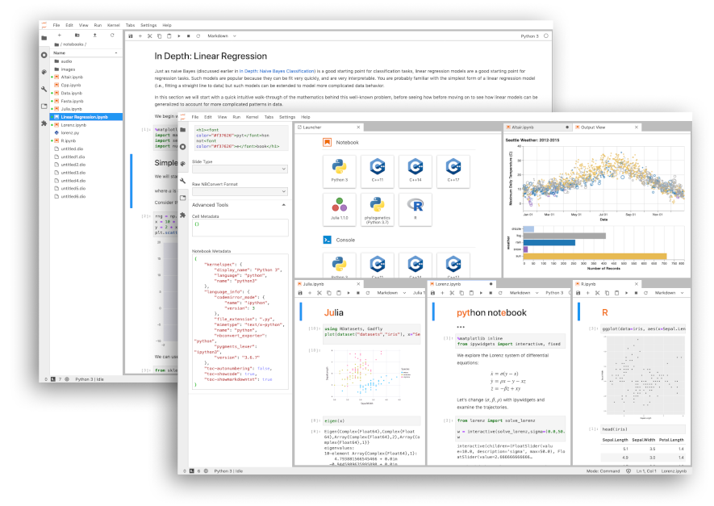 | A organização de código, resultados e gráficos em um mesmo ambiente permite relacionar os dados às operações que os produziram. Para o projeto, essa característica sugere apresentar métricas com identificação clara dos experimentos e de seus parâmetros, evitando que os gráficos fiquem isolados de seu contexto.             |
| GitHub Desktop       | Armazenar código, acompanhar alterações e colaborar no desenvolvimento.            | Navegação por projetos, histórico, versionamento e organização de arquivos. | 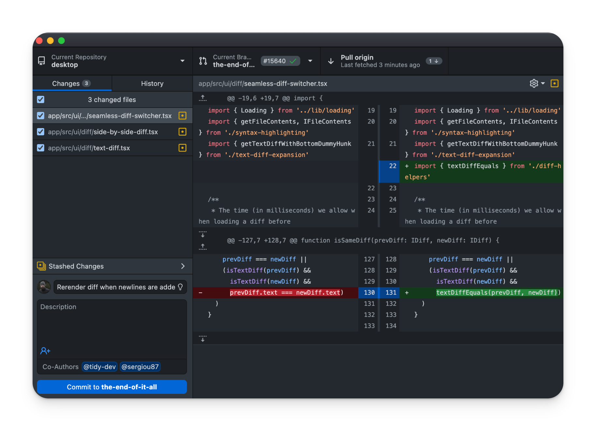               | A organização por histórico e a visualização de diferenças entre versões permitem identificar alterações realizadas ao longo do tempo. Para o projeto, o padrão pode servir como referência para a comparação entre resultados de experimentos, embora diferenças de código e diferenças de desempenho sejam informações de naturezas distintas.             |
| VS Code          | Desenvolver e executar código utilizado nos experimentos.                          | Abas, terminal, explorador de arquivos, extensões e feedback de execução.   | 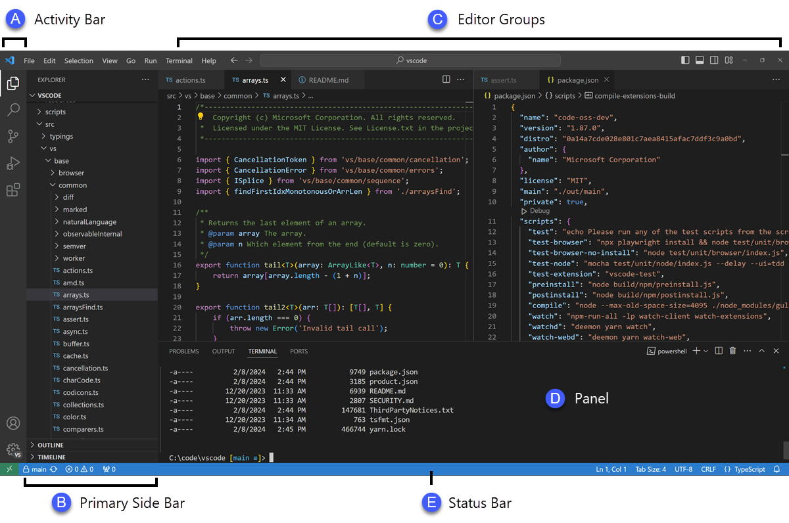              | A organização em áreas de trabalho, com recursos acessíveis em uma mesma interface, favorece a concentração de ferramentas relacionadas. Entretanto, a presença de muitos painéis pode aumentar a complexidade visual. Para o projeto, recomenda-se priorizar os elementos necessários à interpretação dos resultados. |

## 3.1 Padrões de interface relevantes ao escopo de IHC

Registre somente padrões encontrados nas soluções analisadas e que possam ter relação com objetivos reais da equipe.

| Padrão observado                      | Produto(s)                | Para qual tarefa serve                                                               | Vantagem percebida                                                             | Risco/limitação                                                                              | Aplicável ao nosso escopo? |
| ------------------------------------- | ------------------------- | ------------------------------------------------------------------------------------ | ------------------------------------------------------------------------------ | -------------------------------------------------------------------------------------------- | -------------------------- |
| **Execução por etapas**               | Jupyter Notebook          | Executar experimentos e acompanhar cada etapa do processamento.                      | Facilita a organização e o acompanhamento do experimento.                      | Muitos passos ou células podem dificultar a compreensão do fluxo.                            | **Não**                    |
| **Visualização de resultados**        | Jupyter Notebook          | Analisar dados e visualizar gráficos gerados pelos experimentos.                     | Facilita a interpretação dos resultados por meio de representações visuais.    | O excesso de gráficos e informações pode dificultar a análise.                               | **Sim**                    |
| **Histórico e versionamento**         | GitHub                    | Acompanhar alterações no código e consultar versões anteriores.                      | Favorece a rastreabilidade das alterações e dos experimentos.                  | A quantidade de versões e informações pode tornar a navegação mais complexa.                 | **Sim**                    |
| **Organização por projetos/arquivos** | GitHub; VS Code           | Organizar códigos, arquivos e recursos utilizados no desenvolvimento.                | Facilita a localização e o gerenciamento dos arquivos relacionados ao projeto. | Estruturas muito grandes podem dificultar a localização de informações.                      | **Sim**                    |
| **Abas e recursos integrados**        | VS Code                   | Desenvolver e executar código utilizando diferentes recursos em uma mesma interface. | Reduz a necessidade de alternar entre diferentes ferramentas.                  | Uma interface com muitos recursos pode aumentar a complexidade visual.                       | **Sim**                    |
| **Feedback de execução**              | Jupyter Notebook; VS Code | Acompanhar a execução de código e identificar resultados ou problemas.               | Permite perceber rapidamente o resultado de uma ação ou execução.              | Mensagens de erro ou resultados muito extensos podem dificultar a identificação do problema. | **Sim**                    |
| **Comparação/análise de resultados**  | Jupyter Notebook          | Analisar e interpretar os resultados obtidos nos experimentos.                       | Facilita a avaliação dos resultados gerados durante os experimentos.           | A comparação pode se tornar difícil quando há muitos resultados simultâneos.                 | **Sim**                    |

> O objetivo não é concluir “todo concorrente tem dashboard, então teremos um”. O padrão só será adotado se apoiar uma tarefa rastreável.

> A execução de treinamentos por etapas não foi considerada como funcionalidade central da interface proposta, pois o escopo prioriza a consulta, interpretação e comparação dos resultados obtidos.

> Por outro lado, a organização da análise em etapas de seleção de experimento, visualização de métricas e comparação de resultados poderá ser considerada como alternativa de navegação, desde que esteja relacionada às tarefas identificadas para o público-alvo.

## 4. Síntese comparativa da equipe

| Critério | C01 — NUsight | C02 — MARIO | C03 — GameController | C04 — TensorBoard | Oportunidade para o projeto |
| --- | --- | --- | --- | --- | --- |
| Navegação | Organiza informações técnicas em categorias e abas. | Não há evidência suficiente para avaliar a navegação da interface. | Agrupa informações e controles relacionados às equipes e à partida. | Organiza gráficos e métricas em painéis de visualização. | Organizar experimentos e métricas de maneira clara e acessível. |
| Feedback/estado | Apresenta informações sobre o estado dos robôs. | Utiliza representações gráficas para comunicar dados de partidas. | Apresenta o estado da partida, placar e cronômetro. | Apresenta a evolução das métricas registradas nos experimentos. | Permitir identificar o estado dos experimentos e interpretar os resultados obtidos. |
| Prevenção/recuperação de erros | Não há evidência visual suficiente sobre mecanismos de prevenção de erros. | Não há evidência suficiente sobre mecanismos de validação e recuperação de erros. | A documentação descreve validações de configuração, mas os prints não demonstram essas regras. | A identificação dos gráficos e das execuções pode reduzir ambiguidades, mas não comprova mecanismos de validação. | Utilizar identificações claras e mensagens compreensíveis para evitar interpretações equivocadas. |
| Terminologia | Utiliza termos técnicos relacionados ao monitoramento de robôs. | Apresenta termos relacionados a estatísticas e processamento de dados de partidas. | Utiliza termos relacionados a equipes, jogadores e controle de partidas. | Utiliza termos relacionados a métricas, gráficos e execuções de treinamento. | Empregar termos familiares ao público-alvo e explicar indicadores mais técnicos quando necessário. |
| Acessibilidade | A quantidade de indicadores exige atenção à legibilidade. | A interpretação das representações depende de legendas e contexto. | O uso de cores para diferenciar informações exige cuidados de acessibilidade. | A apresentação de múltiplas séries exige atenção ao contraste e à identificação dos gráficos. | Utilizar rótulos, legendas, contraste adequado e evitar a dependência exclusiva de cores. |
| Eficiência | Reúne diferentes informações técnicas em uma mesma ferramenta. | Apresenta resultados visuais que podem apoiar a interpretação de dados. | Organiza informações prioritárias em regiões específicas da interface. | Permite consultar métricas e comparar diferentes execuções. | Facilitar a localização das informações e reduzir a necessidade de alternar entre ferramentas. |
| Aplicação ao projeto de IHC | Referência para organização de informações técnicas e apresentação de estados. | Referência para representação visual de dados relacionados ao comportamento dos robôs. | Referência para hierarquia visual e agrupamento de indicadores. | Referência para acompanhamento de métricas e comparação de experimentos. | Desenvolver uma interface voltada à visualização, interpretação e comparação dos resultados de treinamentos. |

A comparação demonstra que as ferramentas analisadas apresentam diferentes soluções para organizar e visualizar informações técnicas. Entretanto, NUsight, MARIO e GameController estão relacionados principalmente ao acompanhamento de robôs e partidas, enquanto o TensorBoard possui funcionalidades mais diretamente relacionadas à análise de experimentos de aprendizado de máquina.

Dessa forma, os padrões observados serão considerados como referências para o projeto, respeitando a diferença entre monitorar uma partida e interpretar os resultados de treinamentos. A prioridade será facilitar a consulta de métricas, a identificação de experimentos e a comparação dos resultados, sem ampliar automaticamente o escopo para o controle ou a execução de treinamentos.

## 5. Recomendações derivadas

**RC01 — Apresentação clara do estado dos experimentos**

- **Origem:** C01 (NUsight) e C03 (GameController).
- **Evidência:** O dashboard do NUsight apresenta indicadores de estado dos robôs, enquanto o GameController organiza informações sobre o andamento de uma partida.
- **Tarefa relacionada:** Identificar e consultar informações de uma execução de treinamento.
- **Recomendação:** Apresentar de maneira clara a identificação e o estado registrado de cada experimento, diferenciando informações de execução dos indicadores de desempenho.
- **Risco:** A quantidade excessiva de indicadores pode dificultar a identificação das informações relevantes.
- **Prioridade proposta:** Média.

**RC02 — Organização da navegação para análise dos resultados**

- **Origem:** C01 (NUsight) e interfaces de análise de experimentos.
- **Evidência:** O NUsight utiliza categorias para organizar informações técnicas, enquanto ferramentas de análise de experimentos oferecem recursos para consultar diferentes conjuntos de métricas.
- **Tarefa relacionada:** Selecionar um experimento, consultar suas métricas e acessar os resultados disponíveis.
- **Recomendação:** Organizar a navegação de forma que o usuário consiga localizar experimentos e consultar seus resultados sem depender de funcionalidades de controle ou execução de treinamentos.
- **Risco:** Uma estrutura com muitas categorias ou etapas pode aumentar a complexidade da navegação.
- **Prioridade proposta:** Alta.

**RC03 — Visualização de métricas e resultados**

- **Origem:** C01 (NUsight), C02 (MARIO), JupyterLab e ferramenta de análise de experimentos.
- **Evidência:** As referências analisadas apresentam diferentes formas de representar informações técnicas por meio de gráficos e visualizações de resultados.
- **Tarefa relacionada:** Interpretar o desempenho do robô a partir das métricas registradas durante os treinamentos.
- **Recomendação:** Apresentar métricas relevantes por meio de gráficos com identificação das variáveis, unidades, escalas e experimentos associados.
- **Risco:** O excesso de gráficos ou a ausência de contexto pode dificultar a interpretação.
- **Prioridade proposta:** Alta.

**RC04 — Clareza e identificação das informações consultadas**

- **Origem:** C01 (NUsight), C03 (GameController) e JupyterLab.
- **Evidência:** As interfaces utilizam diferentes formas de organização, identificação visual e agrupamento de informações técnicas.
- **Tarefa relacionada:** Identificar corretamente os experimentos, métricas e informações apresentados na interface.
- **Recomendação:** Utilizar rótulos claros, agrupamentos consistentes e identificação das informações para reduzir ambiguidades durante a análise.
- **Risco:** A utilização isolada de cores, abreviações ou termos técnicos pode prejudicar a compreensão dos dados.
- **Prioridade proposta:** Alta.

**RC05 — Organização das informações relacionadas aos experimentos**

- **Origem:** C01 (NUsight), VS Code e JupyterLab.
- **Evidência:** As ferramentas apresentam recursos para organizar diferentes categorias de informações em regiões ou áreas de trabalho relacionadas.
- **Tarefa relacionada:** Consultar métricas e informações associadas a um mesmo treinamento.
- **Recomendação:** Organizar os resultados e seus respectivos contextos de forma integrada, buscando reduzir a alternância desnecessária entre diferentes visualizações.
- **Risco:** A concentração excessiva de informações pode tornar a interface visualmente complexa.
- **Prioridade proposta:** Média.

**RC06 — Histórico e comparação dos resultados**

- **Origem:** GitHub Desktop e ferramenta de análise de experimentos.
- **Evidência:** O GitHub Desktop utiliza histórico e comparação visual de alterações, enquanto ferramentas de acompanhamento de experimentos oferecem referências para visualizar resultados de diferentes execuções.
- **Tarefa relacionada:** Comparar treinamentos e identificar diferenças entre os resultados obtidos.
- **Recomendação:** Permitir consultar o histórico de experimentos e apresentar informações que auxiliem a comparação entre diferentes execuções de treinamento.
- **Risco:** A comparação de muitos experimentos simultaneamente pode dificultar a identificação das diferenças relevantes.
- **Prioridade proposta:** Alta.

### Recomendações revisadas ou descartadas

A formulação original de RC02, que propunha organizar etapas de configuração, execução e análise de treinamentos, foi substituída por uma recomendação voltada à navegação para consulta de resultados.

A formulação original de RC04, que propunha validar parâmetros antes da execução do treinamento, foi substituída por uma recomendação de identificação e clareza das informações consultadas.

Essas alterações preservam o foco definido para a interface do projeto: análise e comparação de resultados, sem ampliar automaticamente o escopo para orquestração ou controle dos treinamentos.

As recomendações deverão ser associadas aos códigos específicos de atividades e hipóteses da Entrega 1 na matriz de rastreabilidade.

## Referências

NuSight: https://nubook.nubots.net/system/tools/nusight#page-content

MARIO: https://sites.google.com/unibas.it/wolves/robocup/robocup-2022/mario

GameController: https://github.com/RoboCup-HumanoidSoccerLeague/GameController

TensorBoard: https://www.tensorflow.org/tensorboard

## Checklist

* [x] O mapa inicial de alternativas da Entrega 1 foi revisitado e aprofundado.
* [x] Hipóteses relevantes sobre mercado/padrões foram atualizadas na rastreabilidade quando surgiram evidências.
* [x] Há pelo menos uma análise completa por integrante.
* [x] Cada análise contém prints legíveis da interface.
* [x] Prints mostram telas/estados relevantes, não apenas logos/homepage.
* [x] Foram analisados concorrentes e/ou interfaces representativas ao público.
* [x] Em TCC sem interface original, foram investigadas ferramentas profissionais análogas às atividades do usuário escolhido.
* [x] Padrões como dashboard, relatório, filtros e CRUD foram analisados como soluções para tarefas, não como requisitos automáticos.
* [x] Opiniões de UX têm fonte.
* [x] A síntese compara critérios comuns e produz recomendações.
* [x] Não há “copiar porque o concorrente faz”; há justificativa de adequação ao público/contexto.
