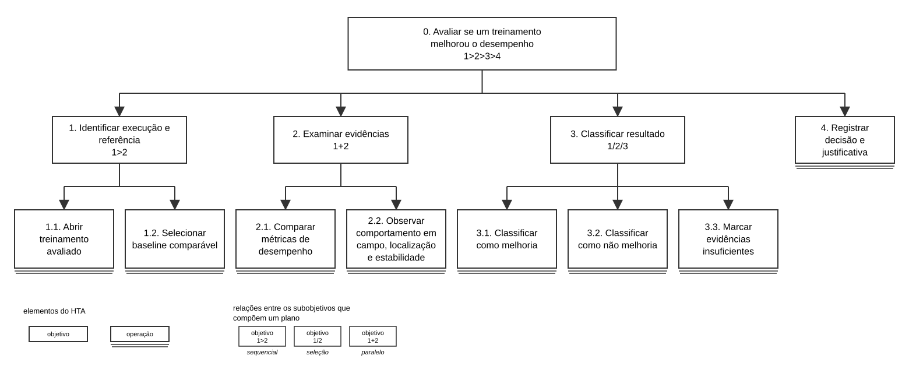
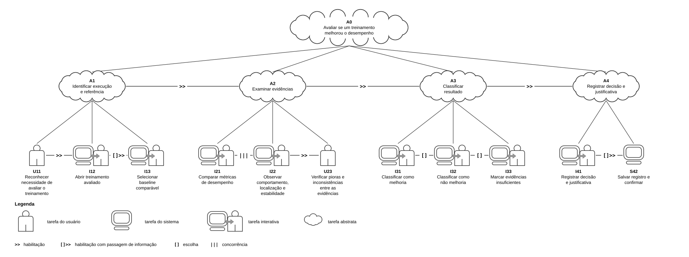
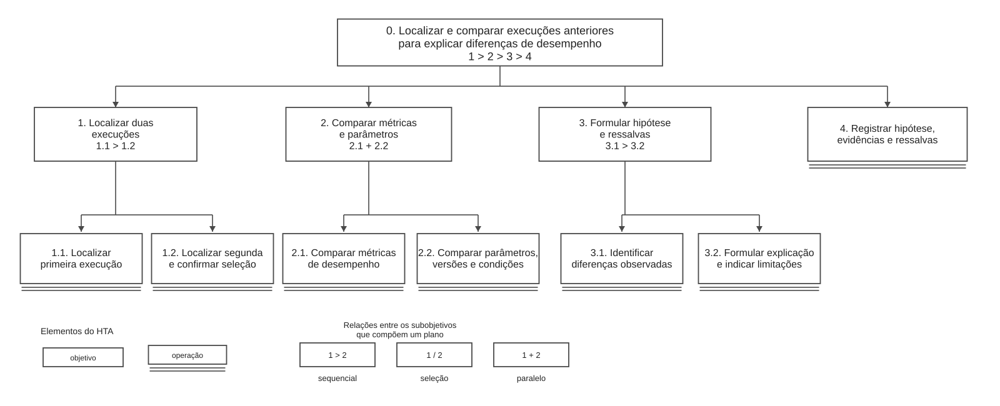
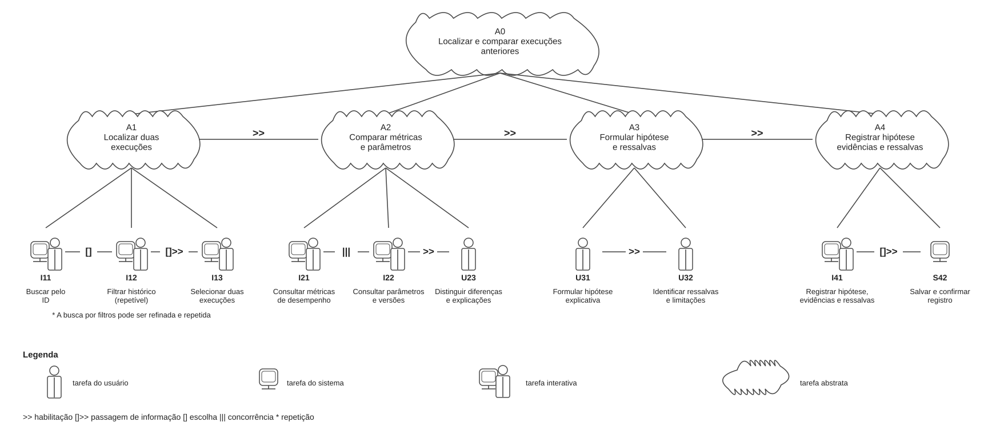
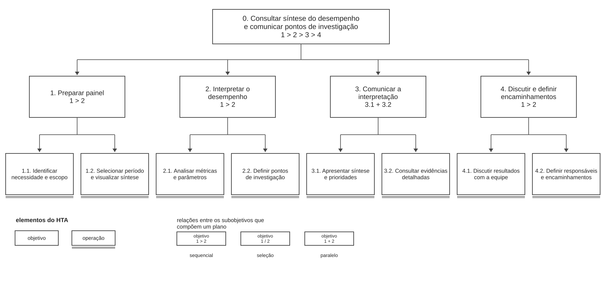
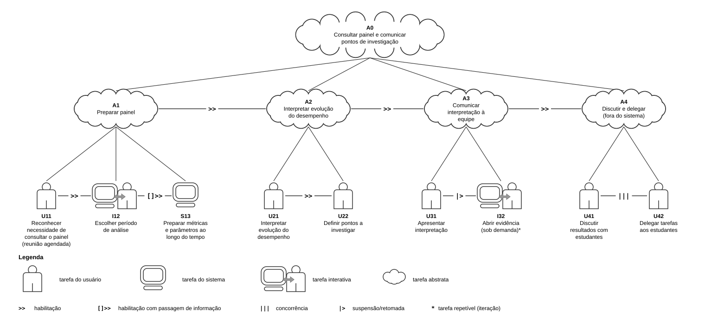

# Entrega 5 — Análise de tarefas: HTA, GOMS e CTT

**Data:** 21/10/2026  
**Status:** 🟨 em andamento  
**Responsabilidade:** cada integrante modela pelo menos 1 HTA, 1 GOMS e 1 CTT. As três técnicas podem abordar a mesma funcionalidade ou funcionalidades distintas, conforme a orientação da disciplina.

## Objetivo da atividade

Modelar tarefas importantes sob perspectivas complementares: decomposição hierárquica (HTA), estrutura de metas/métodos/operações (GOMS) e relações temporais entre tarefas (CTT). O diagrama deve ser acompanhado de interpretação textual.

## Para projetos cujo TCC não previa interface

Modele **tarefas humanas relacionadas ao uso da contribuição técnica**, e não a implementação interna do algoritmo. Exemplos de boas tarefas para análise:

- investigar uma consulta de baixo desempenho;
- configurar uma análise e selecionar parâmetros;
- submeter um dataset e verificar sua validade;
- acompanhar uma execução demorada;
- comparar dois resultados/modelos;
- interpretar uma recomendação e decidir se a aceita;
- localizar uma execução anterior usando busca/filtros;
- gerar e compartilhar um relatório;
- administrar papéis/permissões quando isso for parte do trabalho real;
- revisar um alerta e registrar uma decisão.

Um CRUD pode gerar tarefas relevantes, mas “cadastrar usuário” só merece modelagem se tiver significado no domínio (papéis, validações, riscos, permissões, dependências).

## Seleção das tarefas

| ID | Tarefa | Persona/cenário | Frequência/criticidade | Responsável |
|---|---|---|---|---|
| T01 | Avaliar se o resultado de um treinamento representa uma melhoria real no desempenho do robô | P01 Rafael Martins / C01 | Frequente e alta: decisão equivocada pode provocar ajustes ineficazes e gasto computacional | Rafaela Altheman de Campos — 22.125.062-4 |
| T02 | Localizar e comparar execuções anteriores para explicar diferenças de desempenho | P02 Marina Oliveira / C02 | Recorrente e alta: exige rastreabilidade e comparabilidade entre experimentos | Manuella Filipe Peres — 22.224.029-3 |
| T03 | Consultar uma síntese do desempenho e comunicar à equipe os pontos que precisam de investigação | P03 Carlos Almeida / C03 | Periódica e alta: orienta reuniões e priorização de investigação | Letizia Lowatzki Baptistella — 22.125.063-2 |

> Priorize tarefas necessárias para que o usuário alcance objetivos centrais. Não desperdice a modelagem em ações triviais isoladas, como “clicar em login”, se o objetivo relevante é maior. Da mesma forma, não modele o funcionamento interno do algoritmo como se fosse uma tarefa humana.

---

## T01 — Avaliar se um treinamento melhorou o desempenho

## HTA — T01: Avaliar se um treinamento melhorou o desempenho

**Autor(a):** Rafaela Altheman de Campos — 22.125.062-4

### Descrição da tarefa

O objetivo é decidir se os resultados de um treinamento indicam uma melhoria útil para o desempenho do robô em partidas de futebol. A tarefa começa quando Rafael (P01), no cenário C01, tem acesso aos resultados de uma execução e termina quando registra uma conclusão fundamentada: considerar o resultado uma melhoria, rejeitá-lo como melhoria ou indicar que são necessárias mais evidências. A avaliação considera velocidade média, distância percorrida, taxa de quedas, estabilidade, gol, força de chute e localização, além da observação do comportamento do robô, quando houver esse tipo de registro.

### Diagrama



**Leitura do diagrama:** o objetivo 0 é decomposto em preparar a comparação (1), examinar evidências (2), classificar (3) e registrar (4). A subdivisão do item 3 representa **uma escolha**, não três ações consecutivas. A linha inferior dos nós 1.1, 1.2, 2.1, 2.2, 2.3, 3.1–3.3 e 4 representa o nível operacional útil à interface.

### Decomposição e planos

| ID | Objetivo ou operação | Plano/ordem | Problema de interação e decisão de design |
|---|---|---|---|
| 0 | Avaliar se um treinamento melhorou o desempenho | `1 > 2 > 3 > 4` | Informações da execução e da referência devem acompanhar toda a decisão para evitar conclusões sem contexto. |
| 1 | Identificar execução e referência | `1.1 > 1.2` | Mostrar identificadores, datas, versões, ambiente e parâmetros antes da comparação. |
| 1.1 | Abrir treinamento avaliado | operação | Diferenciar execução concluída, em andamento, com erro e sem dados disponíveis. |
| 1.2 | Selecionar baseline comparável | operação; se não existir, registrar a limitação e seguir para a saída de evidências insuficientes | Informar claramente compatibilidade ou divergência de condições; não escolher referência automaticamente sem identificação. |
| 2 | Examinar evidências | `2.1 + 2.2`; executar também `2.3` se houver registro comportamental | Reunir indicadores complementares sem ocultar pioras em outras métricas. |
| 2.1 | Comparar métricas de deslocamento | operação | Apresentar velocidade média e distância com unidades, escalas e referência. |
| 2.2 | Verificar quedas, estabilidade e localização | operação | Destacar regressões, variações e valores ausentes, evitando tratá-los como zero. |
| 2.3 | Observar comportamento em campo | operação condicional à disponibilidade de vídeo, trajetória ou evidência equivalente | Associar o registro visual à execução correta e indicar sua indisponibilidade quando pertinente. |
| 3 | Classificar resultado | `3.1 / 3.2 / 3.3`, escolhendo uma única alternativa conforme as evidências | Evitar classificação automática baseada somente em velocidade ou em uma média isolada. |
| 3.1 | Classificar como melhoria | operação alternativa | Solicitar justificativa apoiada em indicadores e comportamento observado. |
| 3.2 | Classificar como não melhoria | operação alternativa | Permitir registrar regressão ou compromisso entre ganho de velocidade e aumento de quedas. |
| 3.3 | Marcar evidências insuficientes | operação alternativa | Permitir explicar falta de baseline, incompatibilidade, ausência de medida ou incerteza. |
| 4 | Registrar decisão e justificativa | operação | Associar conclusão ao ID e à referência e confirmar que o registro foi salvo. |

**Planos detalhados:** **Plano 0:** concluir 1, depois 2, depois escolher uma saída em 3 e registrar em 4. **Plano 1:** identificar primeiro o treinamento analisado e depois verificar a referência; se não existir referência válida, conservar o estado de insuficiência de evidência. **Plano 2:** analisar deslocamento e estabilidade sem ordem obrigatória; acrescentar comportamento se disponível. **Plano 3:** selecionar exatamente um desfecho; se uma incompatibilidade for descoberta antes do registro, retornar à seleção de referência ou à análise das evidências. **Plano 4:** salvar com justificativa e conferir confirmação.

**Verificação do HTA:**

- **O objetivo 0 representa uma meta do usuário?** Sim. O resultado é uma decisão sobre o valor do treinamento, não a execução interna de um algoritmo.
- **As subtarefas são necessárias e suficientes?** Sim para a decisão contextualizada, desde que a ausência de informação seja tratada como limitação explícita e a verificação comportamental seja condicional à disponibilidade.
- **Os planos indicam ordem, alternativa, repetição ou condição?** Sim: `>` estabelece a ordem principal, `/` separa os três desfechos, `+` representa evidências complementares e o retorno ocorre quando um dado invalida a comparação.
- **A decomposição parou em nível útil para projeto de interação?** Sim: as operações correspondem a identificar dados, consultar indicadores e registrar uma decisão; detalhes do algoritmo não são decompostos.

**Interpretação:** o maior risco identificado é confundir ganho pontual de um indicador com melhora global. Por exemplo, aumento de velocidade acompanhado de mais quedas exige uma decisão fundamentada. O protótipo deve apresentar simultaneamente as principais métricas, identificar lacunas e permitir a saída “evidências insuficientes” em condições equivalentes às demais opções.

---

## GOMS — T01: Avaliar se um treinamento melhorou o desempenho

**Autor(a):** Rafaela Altheman de Campos — 22.125.062-4

### Goal

`G0: Avaliar se um treinamento melhorou o desempenho do robô e registrar uma conclusão fundamentada.`

**Subobjetivos:** `G1` identificar a execução e a referência; `G2` interpretar métricas e evidências comportamentais; `G3` classificar o resultado; `G4` registrar uma justificativa rastreável. Os dois métodos abaixo cumprem G0, mas utilizam caminhos de navegação distintos.

### Métodos, operadores e regras de seleção

**Method M1 — Comparar em um painel agregado (quando houver visão comparativa adequada):**

1. **Operator O1 :** apontar e selecionar a execução atual.
2. **Operator O2 :** acionar a comparação e selecionar um baseline identificado.
3. **Operator O3 :** ler os valores lado a lado, observando unidades, versões e condições.
4. **Operator O4 :** confrontar velocidade e distância com quedas, estabilidade e localização.
5. **Operator O5 :** abrir e examinar a evidência comportamental disponível ou seu aviso de ausência.
6. **Operator O6 :** escolher entre melhoria, não melhoria e evidências insuficientes.
7. **Operator O7 :** selecionar a conclusão, escrever a justificativa e confirmar seu registro.
8. **Operator O8 :** verificar a confirmação de salvamento e o vínculo com o treinamento.

**Method M2 — Comparar pela inspeção das execuções individuais:**

1. **Operator O1 :** abrir os detalhes do treinamento atual.
2. **Operator O2 :** identificar métricas e condições da execução.
3. **Operator O3 :** localizar e abrir separadamente uma execução de referência.
4. **Operator O4 :** conferir se as condições de comparação são equivalentes.
5. **Operator O5 :** alternar entre os detalhes, consultando números e evidências disponíveis.
6. **Operator O6 :** identificar ganhos, regressões, lacunas e sua relevância.
7. **Operator O7 :** selecionar a conclusão, registrar justificativa e confirmar.
8. **Operator O8 :** verificar que a decisão foi salva e vinculada à execução correta.

**Selection Rule SR1:** usar **M1** quando a interface oferecer uma visão lado a lado com baseline compatível e dados suficientes; usar **M2** quando for preciso inspecionar informações que não aparecem no painel agregado ou quando não houver recurso de comparação direta. **SR2:** se não existir referência válida ou se dados essenciais estiverem ausentes, escolher “evidências insuficientes” no método em uso, em vez de declarar uma melhoria sem suporte. **SR3:** se, durante M1, surgir uma divergência que exija detalhamento, acessar o caminho de inspeção previsto em M2 e preservar as seleções.

**Diagrama GOMS:**


**Interpretação do GOMS:** M1 tende a reduzir a necessidade de lembrar valores entre telas, enquanto M2 dá flexibilidade para verificar registros específicos. Em ambos, os operadores cognitivos de julgar qualidade e compatibilidade não podem ser substituídos por cliques. Como não há tempos medidos na interface, não se atribui aqui estimativa GOMS-KLM. Para o protótipo, deve-se testar se o usuário sabe quando trocar de método sem perder a execução ou a referência selecionada.

---

## CTT — T01: Avaliar se um treinamento melhorou o desempenho

**Autor(a):** Rafaela Altheman de Campos — 22.125.062-4

### Descrição

O CTT representa **quando** as atividades de Rafael podem ocorrer, quais dependem de resultados anteriores e onde existem alternativas reais. O trabalho começa com a seleção de uma execução e de sua referência, passa pelo exame de evidências e termina após a classificação e a confirmação do registro. A escolha da classificação só deve acontecer após a avaliação disponível; a visualização de uma métrica isolada não é condição suficiente para afirmar melhoria.

**Limites e exceções:** as relações modelam o percurso principal. Se um vídeo não existir, o usuário deve reconhecer essa lacuna durante o exame de evidências; se uma referência se mostrar incompatível, deve poder retornar à seleção; se o salvamento falhar, a tarefa não está concluída. Essas condições são requisitos de recuperação a testar, e não funcionalidades já demonstradas no sistema.

### Diagrama



**Hierarquia e tipos de tarefa:** `A0` (avaliar melhoria), `A1` (preparar comparação), `A2` (analisar evidências), `A3` (deliberar) e `A4` (documentar) são **tarefas abstratas**, usadas para decompor o objetivo. `I11` (selecionar treino e referência) e `I41` (registrar justificativa) são **interativas**, pois envolvem diálogo com a interface. `S12` (carregar os resultados associados) e `S42` (salvar a decisão) são **do sistema**, pois correspondem a processamento sem interação durante a operação. `U21`, `U22` e `U23` (interpretar deslocamento, estabilidade e comportamento) e `U31`, `U32`, `U33` (julgar um dos três desfechos) são **do usuário**, pois representam leitura crítica e decisão cognitivas. A visualização dos dados é disponibilizada pelo sistema, mas a avaliação crítica é humana.

**Expressão temporal do modelo:**

```text
A0 = A1 >> A2 >> A3 >> A4
A1 = I11 []>> S12
A2 = U21 ||| U22 ||| U23  (U23: quando houver evidência comportamental)
A3 = U31 [] U32 [] U33
A4 = I41 []>> S42
```

### Legenda e relações temporais usadas

| Operador/relação | Significado no diagrama | Exemplo no modelo |
|---|---|---|
| `>>` | Habilitação: uma tarefa só começa após a anterior terminar. | `A1 >> A2 >> A3 >> A4`: preparar, analisar, decidir e documentar. |
| `[]>>` | Habilitação com passagem de informação: a próxima tarefa recebe dados da anterior. | `I11 []>> S12`: IDs selecionados definem quais resultados são carregados; `I41 []>> S42`: decisão e justificativa são enviadas para registro. |
| `\|\|\|` | Concorrência: tarefas sem precedência obrigatória entre si, podendo ser realizadas em diferentes ordens. | `U21 \|\|\| U22 \|\|\| U23`: examinar categorias diferentes de evidência, quando disponíveis, sem impor uma ordem artificial. |
| `[]` | Escolha alternativa: a seleção de um caminho exclui os demais naquela decisão. | `U31 [] U32 [] U33`: melhoria, não melhoria ou evidências insuficientes. |

**Interpretação e implicações de design:** a primeira habilitação exige que os resultados carregados correspondam aos IDs escolhidos. A concorrência das inspeções indica que o usuário pode começar pela velocidade, pelas quedas ou pelo comportamento, mas a conclusão precisa levar em conta as evidências pertinentes. A escolha em `A3` impede duas classificações finais contraditórias para a mesma avaliação. O registro em `A4` depende da conclusão e deve apresentar confirmação. **Requisito identificado:** manter o contexto do treino visível, sinalizar divergências e oferecer a opção explícita de incerteza.

**Situação para o teste de usabilidade:** apresentar duas execuções nas quais a velocidade melhora, mas a taxa de quedas piora; observar se o participante confere ambas antes de classificar, explica a decisão e reconhece uma referência incompatível, caso ela seja apresentada.

---

## T02 — Localizar e comparar execuções anteriores

## HTA — T02: Localizar e comparar execuções anteriores para explicar diferenças de desempenho

**Autor(a):** Manuella Filipe Peres — 22.224.029-3

### Descrição da tarefa

O objetivo dessa tarefa é comparar treinamenotos. Marina (P02), no cenário C02, precisa recuperar execuções passadas, confirmar que os registros são os corretos e investigar diferenças em métricas e parâmetros. A tarefa começa quando surge uma dúvida sobre desempenhos divergentes e termina quando uma comparação fica documentada com IDs, evidências e uma hipótese de explicação, sem alegar causalidade que não tenha sido comprovada.

### Diagrama



**Leitura do diagrama:** o subobjetivo 2 contém uma alternativa entre buscar por ID e usar filtros. Ambos os caminhos convergem na seleção de duas execuções, que antecede a interpretação de diferenças.

### Decomposição e planos

| ID | Objetivo ou operação | Plano/ordem | Problema de interação e decisão de design |
|---|---|---|---|
| 0 | Localizar e comparar execuções anteriores | `1 > 2 > 3 > 4` | A consulta só é útil se os registros escolhidos e as diferenças analisadas permanecerem rastreáveis. |
| 1 | Definir critérios de comparação | `1.1 > 1.2` | Evitar procura sem contexto, deixando claras a finalidade e as variáveis relevantes. |
| 1.1 | Identificar objetivo da investigação | operação | Permitir indicar a métrica ou divergência que motivou a comparação. |
| 1.2 | Determinar atributos comparáveis | operação | Explicitar versão, ambiente, período, configuração e parâmetros relevantes. |
| 2 | Encontrar execuções | `(2.1 / 2.2) > 2.3`; repetir a consulta se necessário | Oferecer busca por ID e filtros como alternativas; preservar condições de pesquisa. |
| 2.1 | Buscar por identificador | operação alternativa | Permitir busca exata e avisar quando não existir resultado. |
| 2.2 | Filtrar histórico por atributos | operação alternativa | Oferecer filtros compreensíveis, removíveis e combináveis. |
| 2.3 | Selecionar duas execuções | operação | Exibir IDs e metadados antes da confirmação da dupla selecionada. |
| 3 | Comparar execuções | `(3.1 + 3.2) > 3.3` | Não atribuir diferenças apenas a métricas, ignorando alterações de contexto. |
| 3.1 | Examinar métricas e visualizações | operação | Exibir valores e unidades lado a lado, com informação sobre dados ausentes. |
| 3.2 | Verificar parâmetros e versões | operação | Evidenciar diferenças de configuração que limitem conclusões. |
| 3.3 | Formular hipótese para as diferenças | operação | Diferenciar observação, hipótese e causa comprovada. |
| 4 | Registrar comparação e evidências | operação | Preservar IDs comparados, critérios, diferenças, hipótese e ressalvas. |

**Planos detalhados:** **Plano 0:** definir o problema, localizar o par, comparar e registrar. **Plano 2:** escolher 2.1 se possuir os IDs ou 2.2 se dispuser apenas de pistas, como data/versão; se a consulta não encontrar registros, rever critérios e repetir a etapa 2 antes de selecionar. **Plano 3:** inspecionar métricas e parâmetros sem exigir ordem fixa; somente depois produzir a hipótese. **Plano 4:** verificar vínculo correto dos registros antes de concluir.

**Verificação do HTA:**

- **O objetivo 0 representa uma meta do usuário?** Sim: explicar uma diferença apoiando-se em execuções encontradas e verificadas.
- **As subtarefas são necessárias e suficientes?** Sim para gerar uma comparação documentada; a confirmação de comparabilidade é tratada como parte essencial da análise.
- **Os planos indicam ordem, alternativa, repetição ou condição?** Sim: o método de busca é alternativo, o retorno cobre resultados insuficientes e as inspeções de métricas e parâmetros não têm precedência fixa.
- **A decomposição parou em nível útil para projeto de interação?** Sim: termina em ações de buscar, filtrar, selecionar, examinar e registrar.

**Interpretação:** os problemas mais importantes são recuperar o registro errado, perder os filtros durante a comparação e supor que duas execuções de configurações diferentes são diretamente equivalentes. O protótipo deve manter os IDs e parâmetros visíveis durante toda a comparação e distinguir registros ausentes de valores zero.

---

## GOMS — T02: Localizar e comparar execuções anteriores

**Autor(a):** Manuella Filipe Peres — 22.224.029-3

### Goal

`G0: Localizar duas execuções anteriores, comparar seus resultados e registrar uma hipótese rastreável para as diferenças encontradas.`

**Subobjetivos:** `G1` determinar critérios; `G2` localizar a primeira e a segunda execução; `G3` verificar seus contextos; `G4` comparar métricas; `G5` registrar interpretação e ressalvas.

### Métodos, operadores e regras de seleção

**Method M1 — Localizar execuções por identificadores conhecidos:**

1. **Operator O1 (cognição):** recuperar os IDs dos dois experimentos de interesse.
2. **Operator O2 (interação):** apontar, clicar no campo de busca e digitar o primeiro ID.
3. **Operator O3 (interação/percepção):** executar a busca e confirmar o registro apresentado.
4. **Operator O4 (interação):** adicionar a primeira execução à comparação.
5. **Operator O5 (interação):** digitar o segundo ID, executar a busca e selecionar o resultado correto.
6. **Operator O6 (interação):** abrir a comparação entre os dois registros.
7. **Operator O7 (percepção/cognição):** examinar valores, parâmetros e versões, identificando divergências.
8. **Operator O8 (interação):** registrar hipótese, evidências, IDs e ressalvas e confirmar o salvamento.

**Method M2 — Localizar execuções por filtros de histórico:**

1. **Operator O1 (interação):** acessar o histórico de execuções.
2. **Operator O2 (cognição):** definir pistas disponíveis, como período, versão e configuração.
3. **Operator O3 (interação):** selecionar filtros e acionar a consulta.
4. **Operator O4 (percepção):** ler a lista e conferir os metadados dos resultados.
5. **Operator O5 (interação):** selecionar a primeira execução e a segunda execução.
6. **Operator O6 (interação):** abrir a comparação mantendo os critérios de filtro acessíveis.
7. **Operator O7 (percepção/cognição):** conferir métricas, parâmetros e condições para interpretar diferenças.
8. **Operator O8 (interação):** registrar hipótese, evidências e ressalvas e confirmar o salvamento.

**Selection Rule SR1:** escolher **M1** quando os dois IDs forem conhecidos e válidos; escolher **M2** quando um ou ambos forem desconhecidos, mas houver atributos suficientes para filtrar o histórico. **SR2:** se a busca direta falhar, revisar o ID ou mudar para filtros; se os filtros trouxerem muitos resultados, refiná-los antes de selecionar. **SR3:** se os dois registros forem incompatíveis em condições essenciais, registrar a ressalva e buscar outro par quando o objetivo exigir comparação direta.

**Diagrama GOMS:**


**Interpretação do GOMS:** o critério que separa M1 de M2 é informação de que Marina dispõe no início da tarefa, e não uma preferência arbitrária por tela. Ambos alcançam a mesma meta e terminam com um registro contextualizado. A análise revela a necessidade de preservar seleções e filtros entre pesquisa e comparação, além de diferenciar o que foi medido da explicação que Marina propõe. Não se supõe que uma diferença de versão, sozinha, prove a causa da diferença de desempenho.

---

## CTT — T02: Localizar e comparar execuções anteriores

**Autor(a):** Manuella Filipe Peres — 22.224.029-3

### Descrição

O modelo temporal de T02 acompanha a investigação de Marina desde a definição dos critérios até o registro de uma hipótese. O objetivo depende de localizar **dois registros identificáveis**, compará-los sob critérios consistentes e explicitar incertezas. Os caminhos de busca por ID e de pesquisa por filtros são alternativas: não há exigência de usar os dois em toda investigação.

**Condições de exceção:** resultados inexistentes, IDs ambíguos e incompatibilidade de versões exigem retorno à procura ou revisão da pergunta de comparação. Esse retorno é uma condição de recuperação da tarefa, não uma etapa obrigatória de todas as execuções do cenário.

### Diagrama



**Hierarquia e tipos de tarefa:** `A0` (investigar diferenças), `A1` (definir investigação), `A2` (localizar registros), `A3` (comparar) e `A4` (documentar hipótese) são **abstratas**. `U11` (definir mentalmente os critérios), `U31` (interpretar métricas), `U32` (conferir diferenças de parâmetros) e `U33` (formular hipótese) são **do usuário**. `I12` (informar o escopo), `I21` (pesquisar por ID), `I22` (filtrar), `I24` (selecionar dupla) e `I41` (registrar análise) são **interativas**. `S23` (recuperar resultados da pesquisa) e `S42` (armazenar comparação) são **do sistema**.

**Expressão temporal do modelo:**

```text
A0 = A1 >> A2 >> A3 >> A4
A1 = U11 >> I12
A2 = (I21 [] I22) []>> S23 []>> I24
A3 = (U31 ||| U32) >> U33
A4 = I41 []>> S42
```

### Legenda e relações temporais usadas

| Operador/relação | Significado no diagrama | Exemplo no modelo |
|---|---|---|
| `>>` | Habilitação após conclusão da tarefa anterior. | `A1 >> A2 >> A3 >> A4` e `(U31 \|\|\| U32) >> U33`: a hipótese deve suceder a verificação das evidências. |
| `[]` | Escolha entre alternativas mutuamente excludentes naquele ponto. | `I21 [] I22`: localizar pelo identificador ou pelos filtros. |
| `[]>>` | Habilitação com transferência da informação produzida. | `(I21 [] I22) []>> S23`: critérios alimentam a pesquisa; `S23 []>> I24`: os resultados exibidos permitem selecionar a dupla. |
| `\|\|\|` | Concorrência, sem ordem obrigatória entre duas inspeções. | `U31 \|\|\| U32`: interpretar métricas e conferir parâmetros em qualquer ordem. |

**Interpretação e implicações de design:** o nó `S23` precisa devolver resultados claramente identificados, pois a etapa `I24` utiliza essas informações para selecionar a dupla. Em seguida, as interpretações de valores e configurações são complementares; produzir uma hipótese apenas depois de examinar ambas ajuda a evitar comparações equivocadas. O caminho alternativo de busca implica **dois métodos de localização**, com recuperação quando nenhum deles retorna resultados suficientes. No protótipo, os filtros e os dois IDs devem continuar visíveis na comparação e na documentação final.

**Situação para o teste de usabilidade:** pedir que o participante encontre dois experimentos primeiro com IDs fornecidos e depois somente com data ou versão, identifique uma diferença de parâmetro e registre uma hipótese que reconheça essa limitação.

---

## T03 — Consultar síntese e comunicar pontos de investigação

## HTA — T03: Consultar síntese e comunicar pontos de investigação

**Autor(a):** Letizia Lowatzki Baptistella — 22.125.063-2

### Descrição da tarefa

Carlos (P03), no cenário C03, precisa preparar e apresentar à equipe uma síntese do desempenho obtido em treinamentos recentes, destacando indícios positivos, regressões e pontos prioritários de investigação. A tarefa começa com a necessidade de uma reunião ou atualização e termina quando a equipe recebe informações compreensíveis e tem seus encaminhamentos, dúvidas e responsáveis registrados.


### Diagrama



**Leitura do diagrama:** definir escopo, consultar a síntese, selecionar prioridades e comunicar os achados são passos sucessivos; dentro da análise, o exame de tendências e o exame de alertas são complementares e não possuem ordem obrigatória.

### Decomposição e planos

| ID | Objetivo ou operação | Plano/ordem | Problema de interação e decisão de design |
|---|---|---|---|
| 0 | Consultar síntese e comunicar pontos de investigação | `1 > 2 > 3 > 4` | O resultado é uma discussão orientada por evidências, não apenas a abertura de um gráfico. |
| 1 | Definir período e escopo | operação | Tornar identificáveis intervalo temporal, conjunto de treinos e critérios de inclusão. |
| 2 | Consultar síntese de resultados | `2.1 + 2.2` | Mostrar indicadores gerais sem esconder exceções e faltas de dados. |
| 2.1 | Analisar tendências e indicadores principais | operação | Mostrar evolução, unidades e sentido de cada indicador. |
| 2.2 | Identificar regressões e dados ausentes | operação | Destacar instabilidade, quedas e lacunas relevantes para a interpretação. |
| 3 | Selecionar pontos de investigação | `3.1 > 3.2`; repetir para cada ponto relevante | Justificar prioridades com informações verificáveis. |
| 3.1 | Priorizar divergências relevantes | operação | Permitir diferenciar gravidade, recorrência e impacto dos achados. |
| 3.2 | Associar execuções e evidências | operação | Vincular cada tópico ao registro que o sustenta. |
| 4 | Comunicar à equipe | `4.1 > 4.2` | Separar fatos observados, interpretações e decisões coletivas. |
| 4.1 | Gerar ou apresentar síntese | operação | Exibir período, autoria/identificação e fontes dos indicadores. |
| 4.2 | Registrar dúvidas, ações e responsáveis | operação | Preservar encaminhamentos e permitir correção após discussão. |

**Planos detalhados:** **Plano 0:** delimitar o período, examinar os resultados, selecionar pontos e comunicá-los. **Plano 2:** revisar tendências gerais e também exceções; nenhuma categoria deve ser dispensada pela outra. **Plano 3:** escolher a divergência prioritária, associar evidências e repetir para cada outro tópico relevante. **Plano 4:** apresentar os pontos e, ao fim da discussão, registrar ações e responsáveis. Se surgir pergunta que revele evidência insuficiente, retornar aos detalhes de 2 ou 3 antes de finalizar.

**Verificação do HTA:**

- **O objetivo 0 representa uma meta do usuário?** Sim: apoiar a equipe na identificação de problemas que mereçam investigação.
- **As subtarefas são necessárias e suficientes?** Sim para uma apresentação rastreável acompanhada de encaminhamentos, desde que o conjunto de execuções esteja identificado.
- **Os planos indicam ordem, alternativa, repetição ou condição?** Sim: o ciclo de priorização se repete para achados relevantes e perguntas durante a apresentação podem motivar retorno a evidências.
- **A decomposição parou em nível útil para projeto de interação?** Sim: o nível final identifica ações humanas relacionadas ao escopo, à interpretação, à apresentação e ao registro.

**Interpretação:** um painel resumido pode parecer adequado e ainda induzir decisões erradas se esconder regressões, a fonte dos dados ou limites da amostra. O protótipo deve equilibrar leitura rápida e detalhamento verificável, permitindo que Carlos justifique cada prioridade a partir de uma execução identificada.

---

## GOMS — T03: Consultar síntese e comunicar pontos de investigação

**Autor(a):** Letizia Lowatzki Baptistella — 22.125.063-2

### Goal

`G0: Consultar o desempenho de um conjunto de treinamentos e comunicar à equipe os pontos de investigação com evidências e encaminhamentos.`

**Subobjetivos:** `G1` definir escopo; `G2` obter uma visão consistente; `G3` identificar prioridades e suas evidências; `G4` comunicar resultados; `G5` registrar ações e dúvidas.

### Métodos, operadores e regras de seleção

**Method M1 — Preparar e apresentar pelo painel interativo:**

1. **Operator O1 (interação):** selecionar período e conjunto de execuções.
2. **Operator O2 (percepção):** ler cartões e gráficos da síntese produzida.
3. **Operator O3 (cognição):** identificar tendências, regressões e lacunas.
4. **Operator O4 (interação):** abrir evidências das ocorrências prioritárias.
5. **Operator O5 (cognição):** escolher e ordenar os pontos para apresentação.
6. **Operator O6 (usuário/interação):** apresentar os pontos e consultar detalhes diante das perguntas da equipe.
7. **Operator O7 (interação):** registrar ações, responsáveis, dúvidas e confirmação de salvamento.

**Method M2 — Preparar e apresentar por relatório consolidado:**

1. **Operator O1 (interação):** localizar e abrir o relatório do período.
2. **Operator O2 (percepção):** conferir título, intervalo, execuções e abrangência.
3. **Operator O3 (percepção/cognição):** analisar tabelas, comparações e ressalvas do relatório.
4. **Operator O4 (cognição):** escolher pontos prioritários e suas evidências.
5. **Operator O5 (interação):** compartilhar ou apresentar o relatório à equipe.
6. **Operator O6 (usuário):** responder dúvidas, deixando explícitas limitações ainda não resolvidas.
7. **Operator O7 (interação):** registrar encaminhamentos e responsáveis após a discussão.

**Selection Rule SR1:** utilizar **M1** quando a reunião exigir investigação dinâmica, alteração de filtros ou abertura frequente de evidências; utilizar **M2** quando já existir relatório apropriado ao período e objetivo da reunião e a comunicação puder seguir uma síntese estável. **SR2:** quando o relatório não cobrir uma dúvida importante, retornar à consulta detalhada e explicitar que o documento é insuficiente para aquele ponto. **SR3:** quando não houver dados suficientes para inferir uma tendência, registrar a limitação antes de recomendar novos ajustes.

**Diagrama GOMS:**


**Interpretação do GOMS:** M1 e M2 permitem alcançar a mesma meta, mas atendem a contextos de apresentação diferentes. O painel interativo favorece exploração; um relatório consolidado pode favorecer comunicação estável e compartilhamento. A regra de seleção precisa observar a cobertura dos dados, não simplesmente escolher o caminho mais curto. O protótipo deve permitir abrir um detalhe e retornar à síntese sem perder período, seleção nem contexto da discussão.

---

## CTT — T03: Consultar síntese e comunicar pontos de investigação

**Autor(a):** Letizia Lowatzki Baptistella — 22.125.063-2

### Descrição

O CTT descreve o encadeamento entre preparar o panorama, interpretar indicadores e alertas, apresentar prioridades e registrar encaminhamentos. A relação temporal mais importante para esse cenário é que Carlos pode **suspender a apresentação** para atender a uma dúvida, abrir a evidência e depois **retomar** a exposição do ponto em que parou. Isso não equivale a encerrar a apresentação e começar outra do zero.

**Limites e exceções:** o processamento do sistema prepara a síntese a partir do escopo informado, mas a identificação de prioridades e a comunicação continuam sendo humanas. A consulta de evidência detalhada ocorre quando houver uma pergunta ou necessidade de esclarecimento. Se o sistema não apresentar dados suficientes, Carlos comunica a limitação e não cria encaminhamento baseado em certeza indevida.

### Diagrama



**Hierarquia e tipos de tarefa:** `A0` (comunicar panorama), `A1` (preparar), `A2` (interpretar), `A3` (comunicar) e `A4` (registrar) são **abstratas**. `I11` (escolher período), `I32` (abrir evidência) e `I41` (registrar ações) são **interativas**. `S12` (preparar síntese) e `S42` (persistir encaminhamentos) são **do sistema**. `U21` (interpretar indicadores), `U22` (interpretar alertas), `U23` (definir prioridades) e `U31` (apresentar descobertas) são **do usuário**.

**Expressão temporal do modelo:**

```text
A0 = A1 >> A2 >> A3 >> A4
A1 = I11 []>> S12
A2 = (U21 ||| U22) >> U23
A3 = U31 |> I32  (I32 ocorre quando há necessidade de consultar evidências)
A4 = I41 []>> S42
```

### Legenda e relações temporais usadas

| Operador/relação | Significado no diagrama | Exemplo no modelo |
|---|---|---|
| `>>` | Habilitação: exige conclusão da etapa anterior. | `A1 >> A2 >> A3 >> A4`: preparar a síntese antes de interpretá-la e comunicar prioridades. |
| `[]>>` | Habilitação com passagem de informação. | `I11 []>> S12`: o período selecionado determina os resultados; `I41 []>> S42`: ações informadas são salvas. |
| `\|\|\|` | Concorrência: atividades que podem ocorrer em qualquer ordem ou concomitantemente. | `U21 \|\|\| U22`: examinar tendências e alertas, antes da priorização. |
| `\|>` | Suspensão e retomada: uma atividade pode ser interrompida pela outra e prosseguir de onde parou. | `U31 \|> I32`: interromper momentaneamente a apresentação, abrir evidência solicitada e voltar ao ponto anterior. |

**Interpretação e implicações de design:** a preparação dos dados depende diretamente do escopo indicado; por isso, o período selecionado deve estar visível na síntese. Indicadores gerais e alertas precisam ser lidos de maneira complementar para que a priorização tenha fundamento. Durante a reunião, a interface precisa preservar filtros, indicador escolhido e posição da apresentação quando uma evidência é aberta. A confirmação dos encaminhamentos ao final garante que a comunicação gere próximos passos recuperáveis, e não apenas uma conversa sem registro.

**Situação para o teste de usabilidade:** simular uma reunião em que Carlos deve explicar uma regressão, receber uma pergunta sobre sua origem, abrir a execução correspondente e retornar ao panorama sem redefinir período e seleção. Avaliar também se registra pelo menos um próximo passo vinculado ao achado.

---

## Síntese da equipe

Quais problemas de interação, oportunidade e requisitos apareceram a partir das modelagens? Quais tarefas irão para o protótipo e para o teste de usabilidade?

## Checklist

- [ ] Cada integrante produziu ao menos 1 HTA, 1 GOMS e 1 CTT.
- [ ] Cada artefato identifica autor e tarefa.
- [ ] Diagramas são legíveis e possuem fonte editável quando possível (SVG e DOT).
- [ ] HTA contém planos, não apenas árvore de tópicos.
- [ ] GOMS distingue Goals, Operators, Methods e Selection Rules.
- [ ] CTT usa operadores temporais e tipos de tarefa coerentes com a notação adotada em aula.
- [ ] Há texto explicando cada diagrama.
- [ ] Tarefas estão ligadas a cenários/personas na rastreabilidade.
- [ ] Em TCC técnico, as tarefas descrevem o que a pessoa faz com a contribuição/resultados, não passos internos do código.
- [ ] CRUDs, relatórios, filtros e atividades administrativas foram escolhidos por relevância ao objetivo do usuário.
