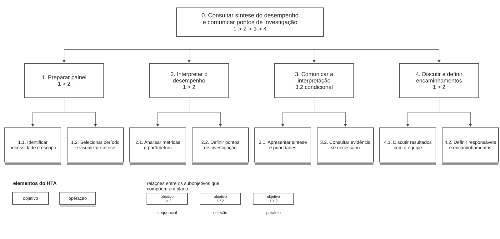

# Entrega 5 — Análise de tarefas: HTA, GOMS e CTT

**Data:** 21/10/2026  
**Status:** 🟩 concluída 
**Responsabilidade:** cada integrante modela pelo menos 1 HTA, 1 GOMS e 1 CTT. As três técnicas podem abordar a mesma funcionalidade ou funcionalidades distintas, conforme a orientação da disciplina.

## Objetivo da atividade

Modelar tarefas importantes sob perspectivas complementares: decomposição hierárquica (HTA), estrutura de metas/métodos/operações (GOMS) e relações temporais entre tarefas (CTT). O diagrama deve ser acompanhado de interpretação textual.

## Para projetos cujo TCC não previa interface

Modele **tarefas humanas relacionadas ao uso da contribuição técnica**, e não a implementação interna do algoritmo. Exemplos de boas tarefas para análise:

- investigar uma consulta de baixo desempenho;
- configurar uma análise e selecionar parâmetros;
- submeter um dataset e verificar sua validade;
- acompanhar uma execução demorada;
- comparar dois resultados/modelos;
- interpretar uma recomendação e decidir se a aceita;
- localizar uma execução anterior usando busca/filtros;
- gerar e compartilhar um relatório;
- administrar papéis/permissões quando isso for parte do trabalho real;
- revisar um alerta e registrar uma decisão.

Um CRUD pode gerar tarefas relevantes, mas “cadastrar usuário” só merece modelagem se tiver significado no domínio (papéis, validações, riscos, permissões, dependências).

## Seleção das tarefas

| ID | Tarefa | Persona/cenário | Frequência/criticidade | Responsável |
|---|---|---|---|---|
| T01 | Avaliar se o resultado de um treinamento representa uma melhoria real no desempenho do robô | P01 Rafael Martins / C01 | Frequente e alta: decisão equivocada pode provocar ajustes ineficazes e gasto computacional | Letizia Lowatzki Baptistella 22.125.063-2 |
| T02 | Localizar e comparar execuções anteriores para explicar diferenças de desempenho | P02 Marina Oliveira / C02 | Recorrente e alta: exige rastreabilidade e comparabilidade entre experimentos | Manuella Filipe Peres — 22.224.029-3 |
| T03 | Consultar uma síntese do desempenho e comunicar à equipe os pontos que precisam de investigação | P03 Carlos Almeida / C03 | Periódica e alta: orienta reuniões e priorização de investigação | Rafaela Altheman de Campos — 22.125.062-4 |

> Priorize tarefas necessárias para que o usuário alcance objetivos centrais. Não desperdice a modelagem em ações triviais isoladas, como “clicar em login”, se o objetivo relevante é maior. Da mesma forma, não modele o funcionamento interno do algoritmo como se fosse uma tarefa humana.

---

## HTA — T01: Avaliar se um treinamento melhorou o desempenho


**Autor(a):** Letizia Lowatzki Baptistella 22.125.063-2

### Descrição da tarefa

O objetivo é decidir se os resultados de um treinamento indicam uma melhoria útil para o desempenho do robô em partidas de futebol. A tarefa começa quando Rafael (P01), no cenário C01, tem acesso aos resultados de uma execução e termina quando registra uma conclusão fundamentada: considerar o resultado uma melhoria, rejeitá-lo como melhoria ou indicar que são necessárias mais evidências. A avaliação considera velocidade média, distância percorrida, taxa de quedas, estabilidade, gol, força de chute e localização, além da observação do comportamento do robô, quando houver esse tipo de registro.

### Diagrama


**Leitura do diagrama:** o objetivo 0 é decomposto em preparar a comparação (1), examinar evidências (2), classificar (3) e registrar (4). A subdivisão do item 3 representa uma escolha, não três ações consecutivas. A linha inferior dos nós 1.1, 1.2, 2.1, 2.2, 3.1–3.3 e 4 representa o nível operacional.

### Decomposição e planos

| ID | Objetivo ou operação | Plano/ordem | Problema de interação e decisão de design | Input | Feedback |
|---|---|---|---|---|---|
| 0 | Avaliar se um treinamento melhorou o desempenho | `1 > 2 > 3 > 4` | Informações da execução e da referência devem acompanhar toda a decisão para evitar conclusões sem contexto. | Resultados da execução avaliada (ID, status, data, ambiente, parâmetros e métricas) e registro visual do comportamento. | Confirmação de que a decisão (melhoria, não melhoria ou evidências insuficientes) e a justificativa foram salvas, associadas ao ID da execução e ao baseline. |
| 1 | Identificar execução e referência | `1.1 > 1.2` | Mostrar identificadores, datas, versões, ambiente e parâmetros antes da comparação. |
| 1.1 | Abrir treinamento avaliado | operação | Diferenciar execução concluída, em andamento, com erro e sem dados disponíveis. |
| 1.2 | Selecionar baseline comparável | operação; se não existir, registrar a limitação e seguir para a saída de evidências insuficientes | Informar claramente compatibilidade ou divergência de condições; não escolher referência automaticamente sem identificação. |
| 2 | Examinar evidências | `2.1 + 2.2` | Reunir indicadores complementares sem ocultar pioras em outras métricas. |
| 2.1 | Comparar métricas de desempenho | operação | Apresentar velocidade média, distância percorrida, taxa de quedas, gols marcados e força de chute com unidades. |
| 2.2 | Observar comportamento em campo, localização e estabilidade | operação | Associar o registro visual à execução correta e indicar sua indisponibilidade quando pertinente. |
| 3 | Classificar resultado | `3.1 / 3.2 / 3.3`, escolhendo uma única alternativa conforme as evidências | Evitar classificação automática baseada somente em velocidade ou em uma média isolada. |
| 3.1 | Classificar como melhoria | operação alternativa | Solicitar justificativa apoiada em indicadores e comportamento observado. |
| 3.2 | Classificar como não melhoria | operação alternativa | Permitir registrar regressão ou compromisso entre ganho de velocidade e aumento de quedas. |
| 3.3 | Marcar evidências insuficientes | operação alternativa | Permitir explicar falta de baseline, incompatibilidade, ausência de medida ou incerteza. |
| 4 | Registrar decisão e justificativa | operação | Associar conclusão ao ID e à referência e confirmar que o registro foi salvo. |

**Planos detalhados:** **Plano 0:** concluir 1, depois 2, depois escolher uma saída em 3 e registrar em 4. **Plano 1:** identificar primeiro o treinamento analisado e depois verificar a referência; se não existir referência válida, conservar o estado de insuficiência de evidência. **Plano 2:** analisar métricas quantitativas e visuais do treinamento **Plano 3:** selecionar exatamente um desfecho; se uma incompatibilidade for descoberta antes do registro, retornar à seleção de referência ou à análise das evidências. **Plano 4:** salvar com justificativa e conferir confirmação.

**Verificação do HTA:**

- **O objetivo 0 representa uma meta do usuário?** Sim. O resultado é uma decisão sobre o valor do treinamento, não a execução interna de um algoritmo.
- **As subtarefas são necessárias e suficientes?** Sim para a decisão contextualizada, desde que a ausência de informação seja tratada como limitação explícita e a verificação comportamental seja condicional à disponibilidade.
- **Os planos indicam ordem, alternativa, repetição ou condição?** Sim: `>` estabelece a ordem principal, `/` separa os três desfechos, `+` representa evidências complementares e o retorno ocorre quando um dado invalida a comparação.
- **A decomposição parou em nível útil para projeto de interação?** Sim: as operações correspondem a identificar dados, consultar indicadores e registrar uma decisão; detalhes do algoritmo não são decompostos.

**Interpretação:** o maior risco identificado é confundir ganho pontual de um indicador com melhora global. Por exemplo, aumento de velocidade acompanhado de mais quedas exige uma decisão fundamentada. O protótipo deve apresentar simultaneamente as principais métricas, identificar lacunas e permitir a saída “evidências insuficientes” em condições equivalentes às demais opções.

---

## GOMS — T01: Avaliar se um treinamento melhorou o desempenho

**Autor(a):** Letizia Lowatzki Baptistella — 22.125.063-2

### Goal

`G0: Decidir se o resultado de um treinamento representa uma melhoria útil no desempenho do robô e registrar uma conclusão fundamentada (melhoria, não melhoria ou evidências insuficientes).`

**Subgoals sequenciais de G0:** `G1 > G2 > G3 > G4`.

- **G1:** identificar execução e referência.
- **G2:** examinar evidências de desempenho.
- **G3:** classificar o resultado.
- **G4:** registrar a decisão e a justificativa.

A notação `>` indica que os objetivos são cumpridos em sequência. Quando há alternativas (`/`), são descritos métodos diferentes para atingir um mesmo goal; quando há abordagens complementares (`+`), os métodos contribuem em conjunto para o goal. Cada método possui uma regra de seleção explícita.

### Métodos, operadores e regras de seleção

### G1: Identificar execução e referência

**Subgoals sequenciais:** `G1.1 > G1.2`.

#### G1.1: Identificar o treinamento avaliado

- O1 (interação): acessar a lista de treinamentos.
- O2 (interação): selecionar a execução que será avaliada.
- O3 (percepção): conferir ID, data, status, versão, ambiente e parâmetros.
- O4 (cognição): verificar se a execução possui resultados adequados à avaliação.

#### G1.2: Identificar um baseline comparável

- O1 (interação): acessar as referências disponíveis.
- O2 (interação): selecionar o baseline candidato.
- O3 (percepção): conferir ID, versão, ambiente e parâmetros da referência.
- O4 (cognição): avaliar a compatibilidade com o treinamento selecionado.
- O5 (percepção): confirmar que os IDs das duas execuções permanecem visíveis.

### G2: Examinar evidências

#### Method M1 — Comparar métricas quantitativas

**SR1:** utilizar M1 sempre que houver métricas disponíveis; quando alguma estiver ausente, sinalizar a lacuna em vez de presumir o resultado.

- O1 (percepção): ler, lado a lado, velocidade média, distância percorrida, taxa de quedas, gols marcados e força de chute, com unidades.
- O2 (cognição): identificar avanços e regressões em relação ao baseline.
- O3 (cognição): verificar compromissos entre indicadores, como maior velocidade acompanhada de mais quedas.
- O4 (percepção): confirmar que os valores se referem às execuções selecionadas.

#### Method M2 — Examinar comportamento, localização e estabilidade

**SR1:** utilizar M2 quando houver registro visual ou comportamental relacionado à execução. Se não houver, assinalar a indisponibilidade e considerar essa limitação em G3.

- O1 (interação): abrir o registro visual ou comportamental do treinamento, quando disponível.
- O2 (percepção): observar deslocamento, localização, estabilidade e possíveis quedas.
- O3 (cognição): verificar se o comportamento observado é coerente com os indicadores quantitativos.
- O4 (percepção): conferir a identificação da execução associada ao registro.

### G3: Classificar o resultado

#### Method M1 — Classificar como melhoria

**SR1:** selecionar M1 quando as evidências disponíveis sustentarem uma melhora útil e a comparação for suficientemente confiável.

- O1 (cognição): avaliar se as métricas relevantes melhoraram sem regressão crítica em quedas ou estabilidade.
- O2 (cognição): verificar a coerência das demais evidências disponíveis.
- O3 (interação): selecionar **Melhoria**.
- O4 (percepção): confirmar a classificação selecionada.

#### Method M2 — Classificar como não melhoria

**SR1:** selecionar M2 quando as evidências indicarem regressão ou ausência de ganho útil, mesmo que algum indicador isolado tenha melhorado.

- O1 (cognição): identificar regressões ou perdas relevantes que comprometam o resultado.
- O2 (cognição): ponderar ganhos isolados frente a pioras em indicadores críticos.
- O3 (interação): selecionar **Não melhoria**.
- O4 (percepção): confirmar a classificação selecionada.

#### Method M3 — Classificar como evidências insuficientes

**SR1:** selecionar M3 quando as informações não permitirem justificar com segurança os desfechos M1 ou M2.

- O1 (cognição): reconhecer falta de baseline comparável, ausência de medida necessária ou inconsistência nos dados.
- O2 (interação): selecionar **Evidências insuficientes**.
- O3 (cognição): identificar quais informações faltam ou precisam ser verificadas.
- O4 (percepção): confirmar a classificação selecionada.


### G4: Registrar decisão e justificativa

- O1 (interação): preencher a justificativa com os indicadores e comportamentos relevantes, incluindo limitações.
- O2 (percepção): conferir classificação, ID da execução e baseline associado.
- O3 (interação): salvar a avaliação.
- O4 (percepção): verificar a confirmação de salvamento e a associação aos IDs corretos.


### Interpretação do GOMS

A estrutura sequencial `G1 > G2 > G3 > G4` representa a progressão da avaliação. Dentro de G1, identificar a execução (`G1.1`) precede selecionar o baseline (`G1.2`). Em G2, a comparação quantitativa e a observação comportamental são métodos complementares (`+`), com regras de aplicação relacionadas à disponibilidade das evidências. Em G3, os métodos são alternativos (`/`), pois a avaliação deve terminar com apenas uma classificação. As regras de seleção deixam explícito quando escolher melhoria, não melhoria ou evidências insuficientes. O modelo reforça a necessidade de preservar o contexto das execuções, mostrar ganhos e regressões e confirmar o registro final.


---

## CTT — T01: Avaliar se um treinamento melhorou o desempenho

**Autor(a):** Letizia Lowatzki Baptistella 22.125.063-2

### Descrição

O CTT descreve o encadeamento entre reconhecer a necessidade de avaliar um treinamento, identificar execução e referência, examinar evidências, classificar o resultado e registrar a decisão. Na T01, Rafael (P01, cenário C01) decide se o resultado de uma execução representa uma melhoria útil.
As relações temporais mais importantes são três. As evidências (métricas e comportamento observado) podem ser examinadas em qualquer ordem. A classificação é uma escolha exclusiva entre melhoria, não melhoria e evidências insuficientes. A seleção do baseline pode se repetir quando a referência escolhida se mostra incompatível.


### Diagrama


A tarefa abstrata A0 (avaliar se um treinamento melhorou o desempenho) se decompõe em quatro subtarefas abstratas, ligadas por habilitação (>>): identificar execução e referência (A1), examinar evidências (A2), classificar resultado (A3) e registrar decisão e justificativa (A4). Em A1, Rafael reconhece a necessidade de avaliar o treinamento (U11, fora do sistema) e abre o treinamento avaliado (I12), passando a informação (`[]>>`) para a seleção do baseline comparável (I13). Em A2, a comparação das métricas (I21) e a observação do comportamento (I22) ocorrem em qualquer ordem (|||) e habilitam a verificação de pioras e inconsistências entre as evidências (U23, tarefa do usuário). Em A3, Rafael escolhe uma única classificação ([]): melhoria (I31), não melhoria (I32) ou evidências insuficientes (I33). Em A4, a decisão e a justificativa informadas (I41) são passadas ao sistema (`[]>>`), que salva o registro e confirma o salvamento (S42).

**Expressão temporal do modelo:**

```text
A0 = A1 >> A2 >> A3 >> A4
A1 = U11 >> I12 []>> I13*
A2 = (I21 ||| I22) >> U23
A3 = I31 [] I32 [] I33
A4 = I41 []>> S42
```

### Legenda e relações temporais usadas

| Operador/relação | Significado no diagrama | Exemplo no modelo |
|---|---|---|
| `>>` | **Habilitação:** indica que uma atividade depende da conclusão de uma etapa anterior para ser iniciada. | `A1 >> A2 >> A3 >> A4`: a execução e a referência são identificadas antes de examinar as evidências, classificar e registrar. `U11 >> I12`: Rafael reconhece a necessidade de avaliar antes de abrir o treinamento. |
| `[]>>` | **Habilitação com passagem de informação:** além de habilitar a atividade seguinte, a etapa anterior fornece informações necessárias para sua execução. | `I12 []>> I13`: a execução aberta determina os baselines candidatos. `I41 []>> S42`: a decisão e a justificativa informadas são o que o sistema salva. |
| `[]` | **Escolha:** duas ou mais tarefas estão habilitadas, mas, iniciada uma, as outras são desabilitadas. | `I31 [] I32 [] I33`: Rafael escolhe uma única classificação. |
| `\|\|\|` | **Concorrência:** as atividades podem ocorrer em qualquer ordem ou ao mesmo tempo. | `I21 \|\|\| I22`: métricas e comportamento observado são examinados na ordem que Rafael preferir. |

**Interpretação e implicações de design:** a saída "evidências insuficientes" precisa ser uma opção da escolha, e não uma falha a esconder. A comparação das métricas e a observação do comportamento devem estar acessíveis ao mesmo tempo, para que Rafael cruze as duas evidências antes de classificar. O contexto da execução e do baseline deve acompanhar toda a análise, e a troca de baseline não pode obrigar Rafael a refazer a seleção da execução.

---

## HTA — T02: Localizar e comparar execuções anteriores

**Autor(a):** Manuella Filipe Peres — 22.224.029-3

### Descrição da tarefa

O objetivo é localizar duas execuções anteriores de treinamento, comparar seus resultados e formular uma hipótese fundamentada para explicar as diferenças de desempenho observadas. A tarefa começa quando Marina (P02), no cenário C02, precisa investigar diferenças entre experimentos e termina quando registra uma hipótese acompanhada das evidências e ressalvas necessárias.

A análise considera identificadores, datas, versões, parâmetros e métricas dos treinamentos, incluindo velocidade média, distância percorrida, taxa de quedas, estabilidade, gols marcados e força de chute. Marina pode localizar execuções por identificadores conhecidos ou utilizar filtros do histórico. A comparação deve permitir distinguir diferenças observadas de possíveis explicações, sem considerar que uma alteração de parâmetro ou versão comprove, isoladamente, a causa de uma mudança de desempenho.

### Diagrama


**Leitura do diagrama:** o objetivo 0 é decomposto em localizar duas execuções (1), comparar métricas e parâmetros (2), formular uma hipótese com ressalvas (3) e registrar a análise (4). A localização pode ser realizada por busca de ID ou filtros do histórico. As métricas e os parâmetros representam evidências complementares. A última etapa registra a hipótese e sua justificativa, vinculadas às execuções selecionadas.

### Decomposição e planos

| ID | Objetivo ou operação | Plano/ordem | Problema de interação e decisão de design | Input | Feedback |
|---|---|---|---|---|---|
| 0 | Localizar e comparar execuções anteriores | `1 > 2 > 3 > 4` | Preservar o contexto das duas execuções durante toda a análise. | Histórico dos treinamentos, IDs, datas, versões, parâmetros e métricas. | Confirmação das execuções selecionadas e do registro da hipótese com evidências e ressalvas. |
| 1 | Localizar duas execuções | `1.1 > 1.2` | Permitir busca por ID ou filtros, preservando as seleções. | Identificadores conhecidos ou atributos disponíveis para filtragem. | Resultados encontrados e identificação das execuções selecionadas. |
| 1.1 | Localizar primeira execução | operação | Exibir ID, data, versão e demais informações necessárias para identificar o registro. | ID ou filtros de pesquisa. | Execução encontrada e adicionada à comparação. |
| 1.2 | Localizar segunda execução e confirmar seleção | operação | Mostrar claramente quais duas execuções foram selecionadas. | Segunda execução desejada. | Confirmação dos dois IDs selecionados. |
| 2 | Comparar métricas e parâmetros | `2.1 + 2.2` | Apresentar informações lado a lado, com unidades e identificação. | Resultados das duas execuções. | Métricas e parâmetros exibidos para comparação. |
| 2.1 | Comparar métricas de desempenho | operação | Evidenciar diferenças de velocidade, distância, quedas, estabilidade, gols e força de chute. | Métricas de desempenho das execuções. | Valores e diferenças apresentados com unidades. |
| 2.2 | Comparar parâmetros, versões e condições | operação | Identificar diferenças de configuração e limitações de comparabilidade. | Parâmetros, versões e condições dos treinamentos. | Divergências de configuração identificáveis. |
| 3 | Formular hipótese e ressalvas | `3.1 > 3.2` | Separar os resultados efetivamente medidos das explicações propostas. | Diferenças de desempenho e configuração. | Evidências disponíveis para fundamentar a hipótese. |
| 3.1 | Identificar diferenças observadas | operação | Destacar divergências relevantes sem atribuir automaticamente uma causa. | Resultados comparados. | Diferenças observadas disponíveis para consulta. |
| 3.2 | Formular explicação e indicar limitações | operação | Permitir registrar hipóteses e ressalvas decorrentes das evidências. | Divergências identificadas e condições dos experimentos. | Hipótese e limitações definidas pelo usuário. |
| 4 | Registrar hipótese, evidências e ressalvas | operação | Associar o registro aos IDs das execuções e confirmar o salvamento. | Hipótese, evidências, ressalvas e identificadores. | Confirmação de salvamento e associação às duas execuções. |

**Planos detalhados:**

**Plano 0:** concluir 1, depois 2, formular a hipótese em 3 e registrar a análise em 4.

**Plano 1:** localizar a primeira execução e depois a segunda. Utilizar busca por identificador quando o ID for conhecido ou filtros do histórico quando não for. Caso os resultados sejam insuficientes ou incorretos, revisar a busca antes de prosseguir.

**Plano 2:** comparar métricas e parâmetros das duas execuções. Essas evidências são complementares e devem ser consideradas em conjunto.

**Plano 3:** identificar as diferenças observadas e, a partir delas, formular uma hipótese explicativa. Indicar as limitações e evitar afirmar causalidade quando as evidências não forem conclusivas.

**Plano 4:** registrar a hipótese, as evidências utilizadas e as ressalvas, conferindo se o salvamento foi realizado e vinculado às duas execuções corretas.

**Verificação do HTA:**

- **O objetivo 0 representa uma meta do usuário?** Sim. A tarefa busca compreender diferenças entre experimentos e registrar uma explicação fundamentada, não executar procedimentos internos do algoritmo.
- **As subtarefas são necessárias e suficientes?** Sim. Localização, comparação, formulação e registro representam as etapas necessárias para cumprir a tarefa.
- **Os planos indicam ordem, alternativa, repetição ou condição?** Sim. `>` indica sequência, `+` representa evidências complementares, e a localização admite métodos alternativos de busca e repetição dos filtros.
- **A decomposição parou em nível útil para projeto de interação?** Sim. As operações correspondem a atividades humanas relacionadas à consulta, comparação e registro de informações.

**Interpretação:** o principal problema de interação identificado é a possibilidade de perder o contexto das execuções durante a pesquisa e a comparação. A interface deve preservar IDs, filtros e seleções, além de apresentar as métricas e os parâmetros lado a lado.

Outro risco é confundir diferenças observadas com relações causais comprovadas. Por exemplo, uma mudança de versão acompanhada de melhoria de velocidade não demonstra, isoladamente, que a versão causou o ganho. O protótipo deve permitir registrar hipóteses, evidências e ressalvas, garantindo rastreabilidade entre a análise e os treinamentos selecionados.

## GOMS — T02: Localizar e comparar execuções anteriores

**Autor(a):** Manuella Filipe Peres — 22.224.029-3

### Goal

`G0: Localizar duas execuções anteriores, comparar seus resultados e registrar uma hipótese rastreável para as diferenças encontradas.`

**Subgoals sequenciais de G0:** `G1 > G2 > G3 > G4`.

- **G1:** localizar e selecionar duas execuções.
- **G2:** comparar métricas e parâmetros.
- **G3:** formular uma hipótese e suas ressalvas.
- **G4:** registrar hipótese, evidências e ressalvas.

O símbolo `>` indica sequência entre goals. A localização por ID ou por filtros é tratada como escolha entre métodos (`/`); a análise de métricas e parâmetros usa métodos complementares (`+`). Cada método apresenta sua própria regra de seleção.

### Métodos, operadores e regras de seleção

### G1: Localizar e selecionar duas execuções

**Subgoals sequenciais:** `G1.1 > G1.2`.

#### G1.1: Localizar a primeira execução

- O1 (cognição): recuperar o identificador da primeira execução.
- O2 (interação): inserir o ID no campo de busca.
- O3 (interação): acionar a pesquisa.
- O4 (percepção): conferir ID, data e versão do resultado.
- O5 (interação): selecionar a execução encontrada.

#### G1.2: Localizar a segunda execução e confirmar a seleção

- O1 (cognição): recuperar o ID da segunda execução.
- O2 (interação): pesquisar o identificador.
- O3 (percepção): conferir os metadados do resultado.
- O4 (interação): adicionar a execução à comparação.
- O5 (percepção): verificar se as duas execuções selecionadas possuem os IDs esperados.

### G2: Comparar métricas e parâmetros

#### Method M1 — Comparar métricas de desempenho

**SR1:** utilizar M1 quando houver métricas disponíveis nas execuções selecionadas; marcar lacunas e diferenças de medição quando a comparação não for diretamente possível.

- O1 (interação): abrir a visualização de comparação das duas execuções.
- O2 (percepção): ler velocidade, distância, quedas, estabilidade, gols e força de chute lado a lado, com unidades.
- O3 (cognição): identificar aumentos, reduções e demais diferenças relevantes.
- O4 (percepção): confirmar os IDs associados às métricas exibidas.

#### Method M2 — Comparar versões, parâmetros e condições

**SR1:** utilizar M2 em conjunto com M1 para contextualizar as diferenças de desempenho; registrar como limitação qualquer metadado ausente ou incompatibilidade relevante.

- O1 (percepção): consultar versões, parâmetros e condições dos dois treinamentos.
- O2 (cognição): identificar alterações de configuração e diferenças entre os contextos.
- O3 (cognição): verificar se essas diferenças limitam a comparabilidade dos resultados.
- O4 (percepção): confirmar a correspondência dos dados aos dois IDs selecionados.

### G3: Formular hipótese e ressalvas

#### G3.1: Identificar diferenças observadas

- O1 (cognição): reunir as principais divergências de desempenho e configuração.
- O2 (cognição): separar fatos medidos de interpretações ainda não verificadas.
- O3 (percepção/cognição): conferir se cada diferença está associada à execução correta.

#### G3.2: Formular uma explicação possível e suas limitações

- O1 (cognição): relacionar as divergências identificadas a uma possível explicação.
- O2 (cognição): avaliar hipóteses alternativas e fatores não controlados.
- O3 (cognição): explicitar ressalvas, incluindo que uma mudança de versão não comprova causalidade.
- O4 (cognição): conferir se a hipótese é coerente com as evidências observadas.

### G4: Registrar hipótese, evidências e ressalvas

- O1 (interação): registrar hipótese, evidências, ressalvas e IDs das duas execuções.
- O2 (percepção): conferir a vinculação da análise às execuções selecionadas.
- O3 (interação): salvar o registro.
- O4 (percepção): confirmar que o salvamento foi realizado corretamente.

### Interpretação do GOMS

A sequência `G1 > G2 > G3 > G4` mostra que é necessário localizar execuções antes de compará-las, formular uma hipótese e registrá-la. Em G1, a primeira e a segunda execuções são subgoals sequenciais (`G1.1 > G1.2`), enquanto a escolha entre busca por ID e filtros ocorre por métodos alternativos (`/`), com regras próprias. Em G2, comparar métricas e comparar parâmetros são métodos complementares (`+`), necessários para contextualizar as diferenças observadas. Em G3, a identificação dos fatos medidos precede a formulação da hipótese. O modelo evidencia a necessidade de preservar as seleções, manter rastreabilidade e distinguir evidências de explicações possíveis.


## CTT — T02: Localizar e comparar execuções anteriores

**Autor(a):** Manuella Filipe Peres — 22.224.029-3

### Descrição

O CTT descreve o encadeamento temporal das atividades necessárias para localizar duas execuções anteriores, comparar os resultados e registrar uma hipótese sobre as diferenças encontradas. Na T02, Marina (P02, cenário C02) investiga experimentos para compreender variações no desempenho do robô.

As relações temporais mais importantes são a escolha entre busca por identificador e busca por filtros, a possibilidade de repetir consultas quando os resultados não forem suficientes e a análise complementar de métricas e parâmetros.

Após localizar e selecionar as duas execuções, Marina examina os resultados, identifica diferenças observadas e formula uma hipótese com suas respectivas limitações. O registro só é realizado depois que essas etapas foram concluídas.

**Limites e exceções:** o sistema disponibiliza o histórico, apresenta as informações para comparação e salva os registros. A interpretação das diferenças e a formulação da hipótese permanecem sob responsabilidade de Marina. Quando uma execução não é encontrada, a busca pode ser repetida ou refinada.

### Diagrama


A tarefa abstrata A0 (localizar e comparar execuções anteriores) se decompõe em quatro subtarefas abstratas, ligadas por habilitação (`>>`): localizar execuções (A1), comparar resultados (A2), formular hipótese (A3) e registrar hipótese (A4).

Em A1, Marina escolhe entre buscar por ID (I11) e filtrar o histórico (I12). Após encontrar os registros desejados, seleciona as duas execuções (I13), passando suas informações para a comparação. A busca por filtros pode ser repetida quando necessário.

Em A2, Marina consulta as métricas de desempenho (I21) e os parâmetros e versões (I22), que podem ser examinados em qualquer ordem (`|||`). Após reunir as informações, distingue diferenças observadas de explicações possíveis (U23).

Em A3, Marina formula uma hipótese (U31) e identifica as ressalvas e limitações aplicáveis (U32). Em A4, informa a hipótese, as evidências e as ressalvas (I41), que são passadas ao sistema (`[]>>`) para salvar o registro e confirmar o salvamento (S42).

**Expressão temporal do modelo:**

```text
A0 = A1 >> A2 >> A3 >> A4
A1 = (I11 [] I12*) []>> I13
A2 = (I21 ||| I22) >> U23
A3 = U31 >> U32
A4 = I41 []>> S42
```

### Legenda e relações temporais usadas

| Operador/relação | Significado no diagrama | Exemplo no modelo |
|---|---|---|
| `>>` | **Habilitação:** uma atividade depende da conclusão da anterior. | `A1 >> A2 >> A3 >> A4`: localizar, comparar, formular e registrar. |
| `[]>>` | **Habilitação com passagem de informação:** uma atividade fornece informações para a próxima. | `I41 []>> S42`: os dados informados são enviados para salvamento. |
| `[]` | **Escolha:** uma alternativa é selecionada entre os métodos possíveis. | `I11 [] I12`: Marina escolhe busca por ID ou filtros. |
| `\|\|\|` | **Concorrência:** atividades podem ocorrer em qualquer ordem ou simultaneamente. | `I21 \|\|\| I22`: comparação de métricas e parâmetros. |
| `*` | **Iteração:** uma atividade pode ser repetida conforme necessário. | `I12*`: Marina pode ajustar e repetir a busca por filtros. |

### Interpretação e implicações de design

A modelagem evidencia a importância de oferecer diferentes formas de localização de execuções. Quando Marina conhece os identificadores, pode utilizar a busca direta. Caso contrário, deve conseguir localizar os registros utilizando filtros de período, versão ou configuração.

Após selecionar duas execuções, a interface precisa manter os IDs e os demais metadados visíveis durante a comparação. As métricas e os parâmetros devem estar disponíveis de forma complementar para que Marina consiga identificar divergências e formular hipóteses fundamentadas.

O CTT também demonstra que a formulação de uma hipótese depende da análise anterior das evidências. O sistema não deve transformar automaticamente correlações observadas em explicações causais. A confirmação do salvamento deve indicar que a hipótese e suas ressalvas foram associadas corretamente às duas execuções.

---

## HTA — T03: Consultar síntese e comunicar pontos de investigação

**Autor(a):** Rafaela Altheman de Campos — 22.125.062-4

### Descrição da tarefa

O objetivo é consultar uma síntese do desempenho do robô, interpretar a evolução dos indicadores e comunicar à equipe os principais pontos que precisam de investigação. A tarefa começa quando Carlos (P03), no cenário C03, precisa preparar ou conduzir uma reunião sobre os resultados dos treinamentos e termina quando a equipe discute os resultados e define os encaminhamentos necessários.

A análise considera a evolução de métricas como velocidade média, distância percorrida, taxa de quedas, estabilidade, gols marcados e força de chute, além das alterações de parâmetros ao longo dos treinamentos. O painel apresenta essas informações de forma consolidada, permitindo que Carlos identifique mudanças relevantes, consulte evidências detalhadas quando necessário e comunique suas observações à equipe. A interpretação, priorização e definição dos encaminhamentos permanecem sob responsabilidade humana.

### Diagrama



**Leitura do diagrama:** o objetivo 0 é decomposto em preparar o painel (1), interpretar o desempenho (2), comunicar a interpretação (3) e discutir os resultados e definir encaminhamentos (4). A subdivisão do item 3 representa uma apresentação que pode ser temporariamente interrompida para consultar evidências detalhadas, sem necessidade de reiniciar a análise. A linha inferior dos nós 1.1, 1.2, 2.1, 2.2, 3.1, 3.2, 4.1 e 4.2 representa o nível operacional.

### Decomposição e planos

| ID | Objetivo ou operação | Plano/ordem | Problema de interação e decisão de design | Input | Feedback |
|---|---|---|---|---|---|
| 0 | Consultar síntese e comunicar pontos de investigação | `1 > 2 > 3 > 4` | Manter o período e o contexto da análise visíveis ao longo da consulta e da apresentação. | Histórico de treinamentos, métricas, parâmetros e período selecionado. | Síntese exibida com período e indicadores identificados. |
| 1 | Preparar o painel | `1.1 > 1.2` | Permitir selecionar o escopo da análise e identificar claramente quais dados estão sendo apresentados. | Objetivo da reunião e histórico disponível. | Painel preparado para o período selecionado. |
| 1.1 | Identificar necessidade e escopo da análise | operação | Evitar a consulta de informações sem relação com o objetivo da reunião. | Necessidade de acompanhamento dos treinamentos. | Escopo de análise definido pelo usuário. |
| 1.2 | Selecionar período e visualizar síntese | operação | Oferecer seleção de período e manter os filtros visíveis, indicando ausência de dados quando pertinente. | Período escolhido e resultados dos treinamentos. | Indicadores e parâmetros apresentados no painel. |
| 2 | Interpretar o desempenho | `2.1 > 2.2` | Facilitar a identificação de tendências, mudanças relevantes e possíveis regressões. | Métricas e parâmetros consolidados. | Gráficos e valores disponíveis para interpretação. |
| 2.1 | Analisar evolução das métricas e parâmetros | operação | Apresentar os indicadores com unidades e referência temporal, sem ocultar pioras. | Velocidade, distância, quedas, estabilidade, gols, força de chute e parâmetros. | Evolução dos indicadores exibida ao longo do período. |
| 2.2 | Definir pontos que exigem investigação | operação | Permitir relacionar variações de desempenho às condições dos treinamentos sem assumir causalidade automaticamente. | Tendências, divergências e resultados observados. | Indicadores e evidências permanecem disponíveis para consulta. |
| 3 | Comunicar a interpretação à equipe | `3.1`, com `3.2` opcional e repetível quando houver necessidade de esclarecimento | Preservar o contexto do painel durante interrupções da apresentação. | Síntese interpretada e pontos identificados. | Retorno ao painel sem perda do período e dos indicadores selecionados. |
| 3.1 | Apresentar síntese e prioridades | operação | Exibir informações de forma compreensível para apoiar a comunicação dos resultados. | Conclusões e pontos considerados relevantes. | Síntese permanece disponível durante a exposição. |
| 3.2 | Abrir evidência detalhada quando necessário | operação condicional e repetível | Permitir consultar registros detalhados e retornar à apresentação sem perder o estado anterior. | Dúvida da equipe ou necessidade de esclarecer um resultado. | Evidência exibida com identificação da execução e retorno ao contexto anterior. |
| 4 | Discutir e definir encaminhamentos | `4.1 > 4.2` | Disponibilizar as evidências para apoiar a discussão, sem substituir decisões humanas. | Pontos apresentados e questionamentos da equipe. | Informações permanecem acessíveis para consulta durante a discussão. |
| 4.1 | Discutir resultados com a equipe | operação | Facilitar a consulta aos dados que fundamentam as observações apresentadas. | Resultados, dúvidas e interpretações dos participantes. | Painel e evidências disponíveis para esclarecimentos. |
| 4.2 | Definir responsáveis e próximos encaminhamentos | operação | Evitar que a interface apresente decisões automáticas sobre prioridades ou responsabilidades. | Conclusões da discussão e necessidades identificadas. | Encaminhamentos definidos pela equipe, fora do sistema. |

**Planos detalhados:**

**Plano 0:** concluir 1, depois 2, comunicar os resultados em 3 e finalizar com a discussão e definição de encaminhamentos em 4.

**Plano 1:** identificar a necessidade de análise e o objetivo da reunião; em seguida, selecionar o período e consultar a síntese preparada pelo sistema. Caso não existam dados para o período escolhido, revisar o intervalo antes de continuar.

**Plano 2:** examinar a evolução das métricas e dos parâmetros e, com base nas informações observadas, definir os principais pontos que precisam de investigação. Se houver dados incompletos ou inconsistentes, considerar essas limitações na interpretação.

**Plano 3:** apresentar os resultados e prioridades à equipe. Caso surja uma dúvida ou necessidade de esclarecimento, abrir a evidência detalhada correspondente e retornar à apresentação. A consulta pode se repetir quantas vezes forem necessárias, sem reiniciar a exposição.

**Plano 4:** discutir os resultados apresentados e definir, com os participantes, os responsáveis e encaminhamentos para as próximas investigações. Essas decisões são realizadas pelos usuários e não automaticamente pelo sistema.

### Verificação do HTA

- **O objetivo 0 representa uma meta do usuário?** Sim. O objetivo é compreender e comunicar os resultados dos treinamentos para orientar a investigação, e não executar procedimentos internos do algoritmo.
- **As subtarefas são necessárias e suficientes?** Sim. A preparação do painel, interpretação dos indicadores, comunicação dos resultados e discussão dos encaminhamentos representam as principais atividades necessárias para atingir o objetivo.
- **Os planos indicam ordem, alternativa, repetição ou condição?** Sim. O símbolo `>` representa a ordem principal, enquanto a consulta às evidências é condicional e repetível durante a apresentação. O retorno à seleção do período ocorre quando os dados disponíveis não atendem à necessidade da análise.
- **A decomposição parou em nível útil para projeto de interação?** Sim. As operações envolvem seleção de períodos, consulta de indicadores, apresentação e abertura de evidências, sem detalhar o processamento interno dos treinamentos.

**Interpretação:** o principal risco identificado é perder o contexto da análise durante a comunicação dos resultados. Por exemplo, ao apresentar uma queda de desempenho, Carlos pode precisar consultar uma execução específica para esclarecer uma dúvida da equipe. Se o sistema não preservar o período, os indicadores e o ponto da apresentação, a continuidade da discussão será prejudicada. O protótipo deve manter o contexto da análise visível, permitir acesso às evidências detalhadas e oferecer retorno ao painel sem perda das seleções realizadas. A identificação de prioridades e a definição de encaminhamentos continuam sendo responsabilidades de Carlos e da equipe.


## GOMS — T03: Consultar síntese e comunicar pontos de investigação

**Autor(a):** Rafaela Altheman de Campos — 22.125.062-4

### Goal

`G0: Consultar uma síntese da evolução do desempenho do robô, identificar pontos relevantes de investigação, comunicar os resultados à equipe e apoiar a definição de encaminhamentos.`

**Subgoals sequenciais de G0:** `G1 > G2 > G3 > G4`.

- **G1:** preparar o painel e selecionar o período.
- **G2:** interpretar os resultados e identificar pontos de investigação.
- **G3:** comunicar os resultados à equipe.
- **G4:** discutir resultados e definir encaminhamentos.

A notação `>` representa sequência entre goals. Quando há caminhos distintos para cumprir um mesmo goal, eles são descritos como métodos alternativos (`/`), cada um com sua regra de seleção. A consulta de evidências detalhadas é condicional, não uma etapa obrigatória para todas as apresentações.

### Métodos, operadores e regras de seleção

### G1: Preparar o painel e selecionar o período

#### G1.1: Definir o objetivo e o escopo da análise

- O1 (cognição): identificar a finalidade da reunião e os resultados que precisam ser examinados.
- O2 (cognição): definir o intervalo de treinamentos relevante.
- O3 (interação): acessar o painel de acompanhamento do desempenho.

#### G1.2: Selecionar período e consultar a síntese

- O1 (interação): selecionar o período desejado no painel.
- O2 (percepção): conferir o intervalo aplicado.
- O3 (percepção): verificar os indicadores e parâmetros apresentados.
- O4 (cognição): avaliar se a abrangência dos dados atende ao objetivo da reunião.

### G2: Interpretar os resultados e identificar pontos de investigação

#### G2.1: Examinar a evolução do desempenho

- O1 (percepção): observar os gráficos e valores da evolução do desempenho.
- O2 (percepção): conferir velocidade média, distância, quedas, estabilidade, gols e força de chute.
- O3 (cognição): identificar tendências, variações inesperadas e possíveis regressões.
- O4 (cognição): relacionar variações observadas a alterações de parâmetros, sem presumir causalidade.

#### G2.2: Definir pontos que precisam de investigação

- O1 (cognição): identificar os indicadores e comportamentos que exigem esclarecimento.
- O2 (cognição): ponderar a relevância e a criticidade das variações observadas.
- O3 (cognição): diferenciar achados medidos de explicações ainda não confirmadas.
- O4 (cognição): organizar os pontos a comunicar à equipe.

### G3: Comunicar os resultados à equipe

#### Method M1 — Apresentar diretamente a síntese

**SR1:** utilizar M1 quando os indicadores consolidados forem suficientes para explicar os resultados e não houver solicitação de detalhamento.

- O1 (percepção): conferir o período e os indicadores exibidos no painel.
- O2 (cognição): organizar a exposição dos principais resultados.
- O3 (comunicação): explicar a evolução do desempenho e os pontos de investigação.
- O4 (percepção/cognição): verificar se a síntese é suficiente para sustentar a discussão.

#### Method M2 — Apresentar a síntese e consultar evidências detalhadas

**SR1:** utilizar M2 quando surgir uma dúvida, divergência ou solicitação de evidência específica; repetir a consulta, se necessário, mantendo o contexto da apresentação. Se não houver necessidade de detalhamento, permanecer em M1

- O1 (comunicação): apresentar a síntese até surgir uma dúvida ou necessidade de esclarecimento.
- O2 (interação): selecionar o indicador ou a execução relacionada à questão.
- O3 (interação): abrir a evidência detalhada.
- O4 (percepção): conferir ID, período e resultados da execução consultada.
- O5 (cognição): relacionar a evidência à dúvida levantada.
- O6 (comunicação): esclarecer a questão para a equipe.
- O7 (interação): retornar ao painel principal.
- O8 (percepção): confirmar que período e seleções anteriores foram preservados.
- O9 (comunicação): retomar a apresentação do ponto em que foi interrompida.


### G4: Discutir resultados e definir encaminhamentos

#### G4.1: Discutir os resultados com a equipe

- O1 (comunicação): ouvir dúvidas e interpretações dos participantes.
- O2 (cognição): considerar os pontos levantados e sua relação com os indicadores.
- O3 (interação, quando necessário): consultar novamente informações do painel para esclarecer questões.
- O4 (comunicação): discutir os principais problemas e oportunidades de investigação.

#### G4.2: Definir prioridades e próximos encaminhamentos

- O1 (cognição): avaliar a relevância e a criticidade dos pontos discutidos.
- O2 (comunicação): decidir com a equipe quais questões serão investigadas primeiro.
- O3 (comunicação): definir responsáveis e próximos encaminhamentos fora do sistema.
- O4 (cognição): confirmar que as decisões são coerentes com os resultados apresentados.

### Interpretação do GOMS

A sequência `G1 > G2 > G3 > G4` mostra que Carlos prepara a análise, interpreta os indicadores, comunica os resultados e participa da definição dos encaminhamentos. Em G1, G2 e G4, as etapas dependentes aparecem como subgoals numerados (`G1.1 > G1.2`, `G2.1 > G2.2` e `G4.1 > G4.2`). Em G3, os métodos são alternativos (`M1 / M2`): Carlos apresenta apenas a síntese quando ela é suficiente ou consulta evidências detalhadas quando surge uma dúvida. Cada método possui uma regra de seleção, evitando tratar uma decisão condicional como operação obrigatória. O principal requisito de interação é preservar o período, os indicadores e o ponto da apresentação após uma consulta detalhada. O sistema apoia a discussão, mas não substitui a interpretação ou a decisão da equipe.


## CTT — T03: Consultar síntese e comunicar pontos de investigação


**Autor(a):** Rafaela Altheman de Campos — 22.125.062-4

### Descrição

O CTT descreve o encadeamento entre preparar o panorama, interpretar indicadores e alertas, comunicar prioridades e registrar encaminhamentos. Na T03, Carlos (P03, cenário C03) usa a síntese do desempenho para conduzir uma reunião com a equipe.
A relação temporal mais importante é que Carlos pode suspender a apresentação para atender a uma dúvida, abrir a evidência e depois retomar a exposição do ponto em que parou (isso não equivale a encerrar a apresentação e começar outra).

Limites e exceções: <br> 
O sistema prepara a síntese a partir do escopo informado, mas identificar prioridades e comunicá-las continua sendo trabalho humano. <br>
A evidência detalhada só é aberta quando há uma pergunta ou necessidade de esclarecimento, e pode ser aberta mais de uma vez.

### Diagrama


A tarefa abstrata A0 (consultar painel e comunicar pontos de investigação) se decompõe em quatro subtarefas abstratas, ligadas por habilitação (>>): preparar o painel (A1), interpretar a evolução do desempenho (A2), comunicar a interpretação à equipe (A3) e discutir e delegar (A4). Em A1, Carlos sente a necessidade de consultar o painel para se preparar para a reunião com os estudante (U11). Após isso, ele executa a tarefa de escolher o período de análise (I11), com passagem de informação ([]>>), para tarefa do sistema que prepara as métricas e os parâmetros ao longo do tempo (S12). Em A2, Carlos interpreta a evolução do desempenho (U21) e, em seguida, define os pontos a investigar (U22), ambas tarefas do usuário. Em A3, a apresentação da interpretação (U31) pode ser suspensa pela abertura de uma evidência (I32), que é interativa e repetível (*), e retomada do ponto em que parou (|>). Em A4, as tarefas do usuário de discutir os resultados (U41) e delegar tarefas (U42) ocorrem em qualquer ordem (|||) e fora do sistema, que se limita a preparar o painel e a exibir as evidências.

**Expressão temporal do modelo:**

```text
A0 = A1 >> A2 >> A3 >> A4
A1 = U11 >> I12 []>> S13
A2 = U21 >> U22
A3 = U31 |> I32*
A4 = U41 ||| U42
```

### Legenda e relações temporais usadas

| Operador/relação | Significado no diagrama | Exemplo no modelo |
|---|---|---|
| `>>` | **Habilitação:** indica que uma atividade depende da conclusão de uma etapa anterior para ser iniciada. | `A1 >> A2 >> A3 >> A4`: o painel é preparado antes de ser interpretado, comunicado e discutido. `U21 >> U22`: os pontos a investigar são definidos após a interpretação da evolução. `U11 >> I12`:  |
| `[]>>` | **Habilitação com passagem de informação:** indica que, além de habilitar a atividade seguinte, a etapa anterior fornece informações necessárias para sua execução. | `I11 []>> S12`: o período escolhido determina as métricas e os parâmetros exibidos no painel. |
| `\|\|\|` | **Concorrência:** indica que duas ou mais atividades podem ocorrer simultaneamente ou em qualquer ordem, sem uma sequência obrigatória entre elas. | `U41 \|\|\| U42`: Carlos e os estudantes discutem os resultados e delegam tarefas de acordo com as necessidades da reunião. |
| `\|>` | **Suspensão e retomada:** indica que uma atividade pode ser temporariamente interrompida para a execução de outra, sendo retomada posteriormente do ponto em que parou. | `U31 \|> I32`: durante a apresentação, Carlos interrompe momentaneamente a exposição para abrir uma evidência solicitada e, em seguida, retoma a apresentação do ponto anterior. |
| `*` | **Iteração:** indica que uma atividade pode ser repetida uma ou mais vezes durante o processo. | `I32*`: Carlos pode abrir diferentes evidências ou consultar a mesma evidência várias vezes durante a reunião. |

---

## Síntese da equipe

Problemas de interação: as três tarefas exigem decidir com contexto. Em T01, o risco é concluir por um único indicador (mais velocidade, mais quedas) ou sem baseline comparável. Em T02, é perder seleções e filtros entre a busca e a comparação, e confundir o que foi medido com a hipótese. Em T03, é perder período, indicador e ponto da apresentação ao abrir uma evidência durante a reunião.

Oportunidades: uma tela de comparação serve a T01 e T02, e o painel temporal de T03 reaproveita as mesmas métricas. Mostrar métricas e parâmetros na mesma linha do tempo ajuda a relacionar mudanças de configuração a mudanças de desempenho.

Requisitos principais:
- Mostrar o contexto da execução e do baseline (ID, versão, parâmetros) durante toda a análise.
- Apresentar as métricas lado a lado, com unidades, sem ocultar pioras.
- Oferecer busca por ID e filtros como caminhos equivalentes, preservando as seleções.
- Registrar decisão ou hipótese com justificativa, IDs e ressalvas, e confirmar o salvamento.
- Exibir o período de análise e permitir abrir uma evidência e voltar ao painel sem perder o estado.

Fora do escopo: delegar tarefas e priorizar automaticamente (responsabilidade de Carlos e os estudantes).

Protótipo e teste de usabilidade: as três tarefas entram, em duas frentes, uma tela de histórico e comparação (T01 e T02) e um painel temporal (T03). Os testes simulam uma avaliação (T01), a busca e comparação de duas execuções (T02) e uma reunião com interrupção para abrir evidência (T03).

## Checklist

- [X] Cada integrante produziu ao menos 1 HTA, 1 GOMS e 1 CTT.
- [X] Cada artefato identifica autor e tarefa.
- [X] Diagramas são legíveis e possuem fonte editável quando possível (SVG e DOT).
- [X] HTA contém planos, não apenas árvore de tópicos.
- [X] GOMS distingue Goals, Operators, Methods e Selection Rules.
- [X] CTT usa operadores temporais e tipos de tarefa coerentes com a notação adotada em aula.
- [X] Há texto explicando cada diagrama.
- [X] Tarefas estão ligadas a cenários/personas na rastreabilidade.
- [X] Em TCC técnico, as tarefas descrevem o que a pessoa faz com a contribuição/resultados, não passos internos do código.
- [X] CRUDs, relatórios, filtros e atividades administrativas foram escolhidos por relevância ao objetivo do usuário.
