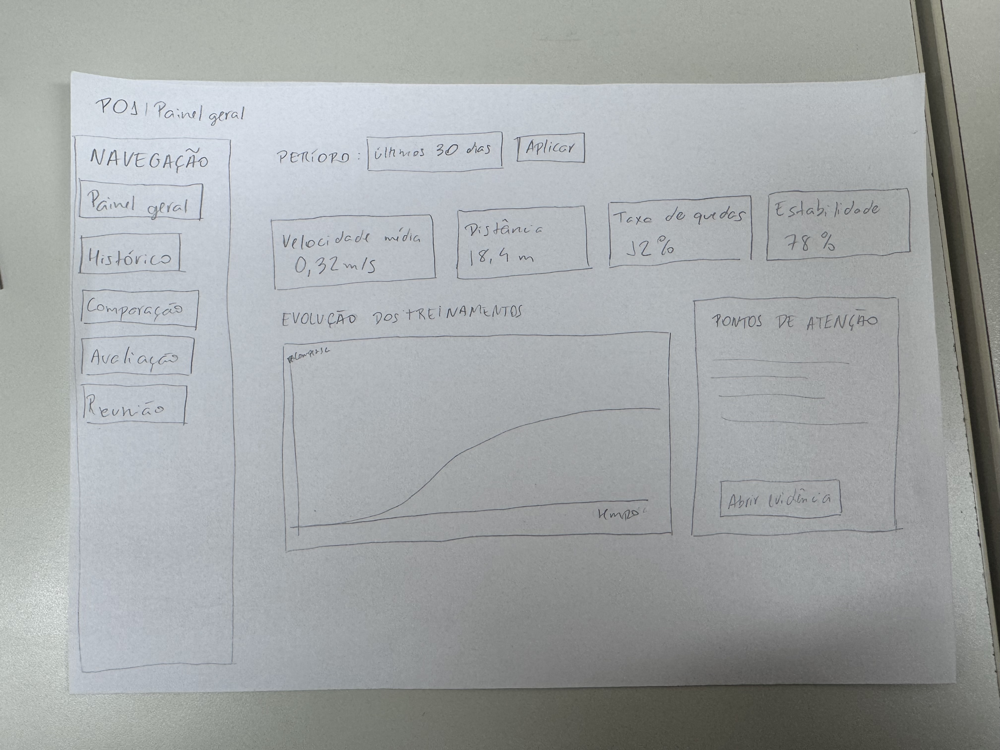
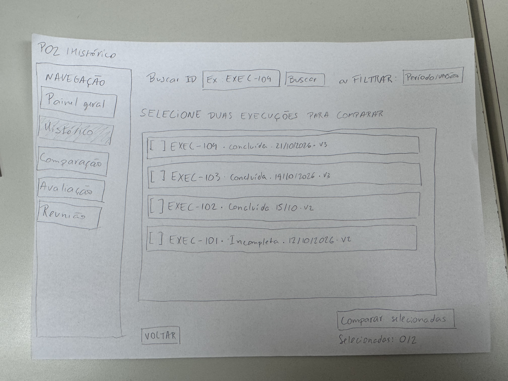
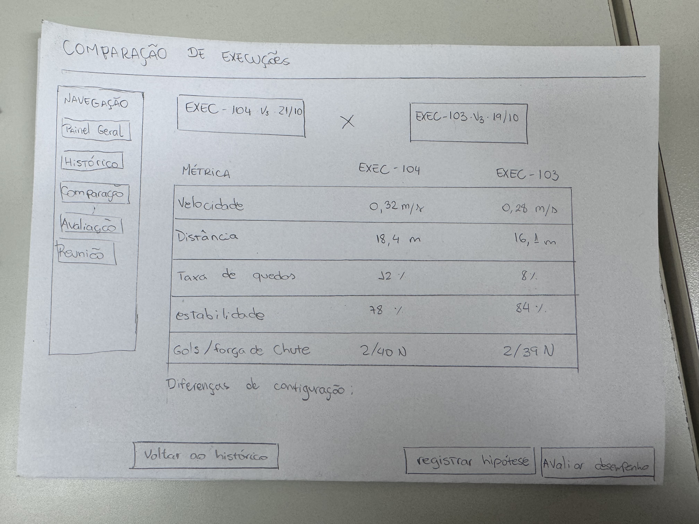
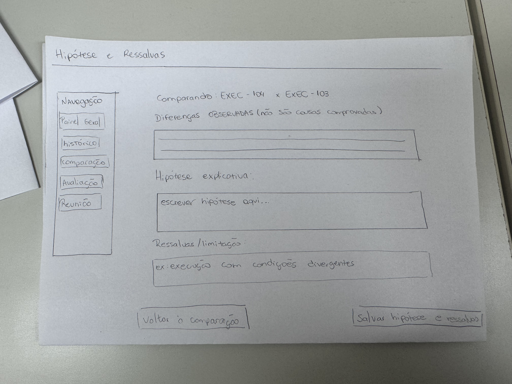
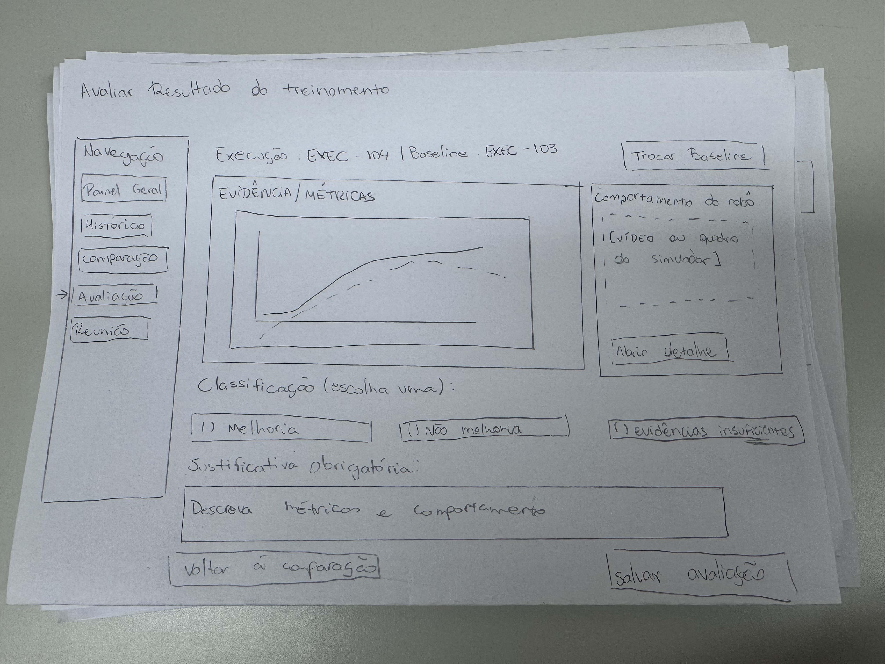
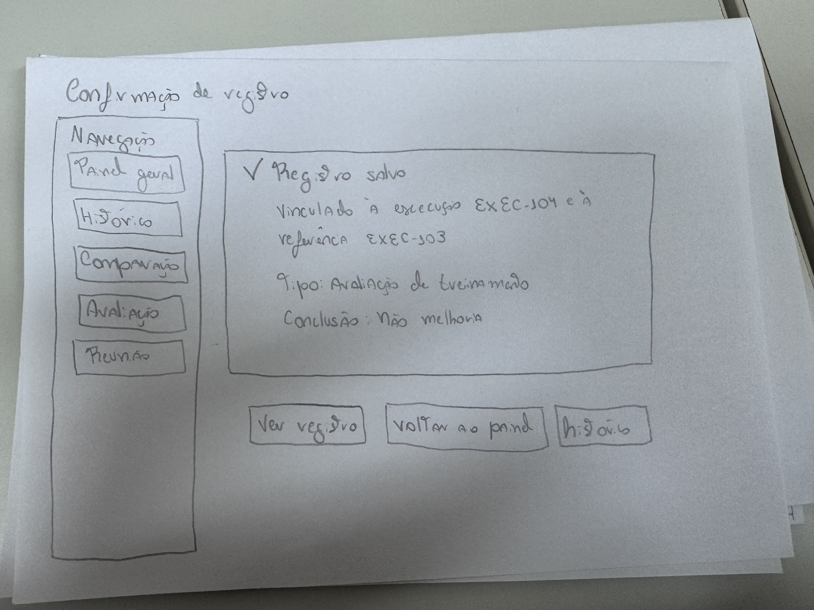
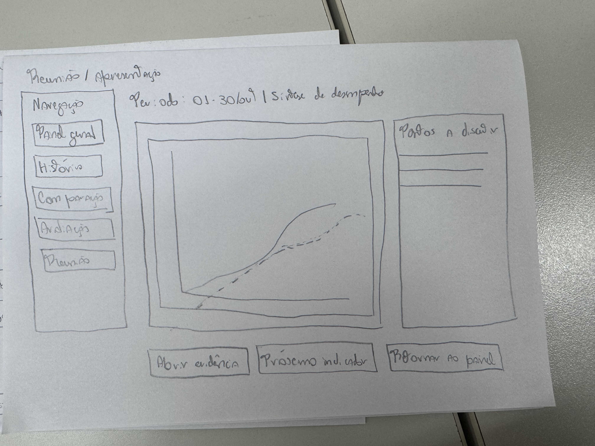
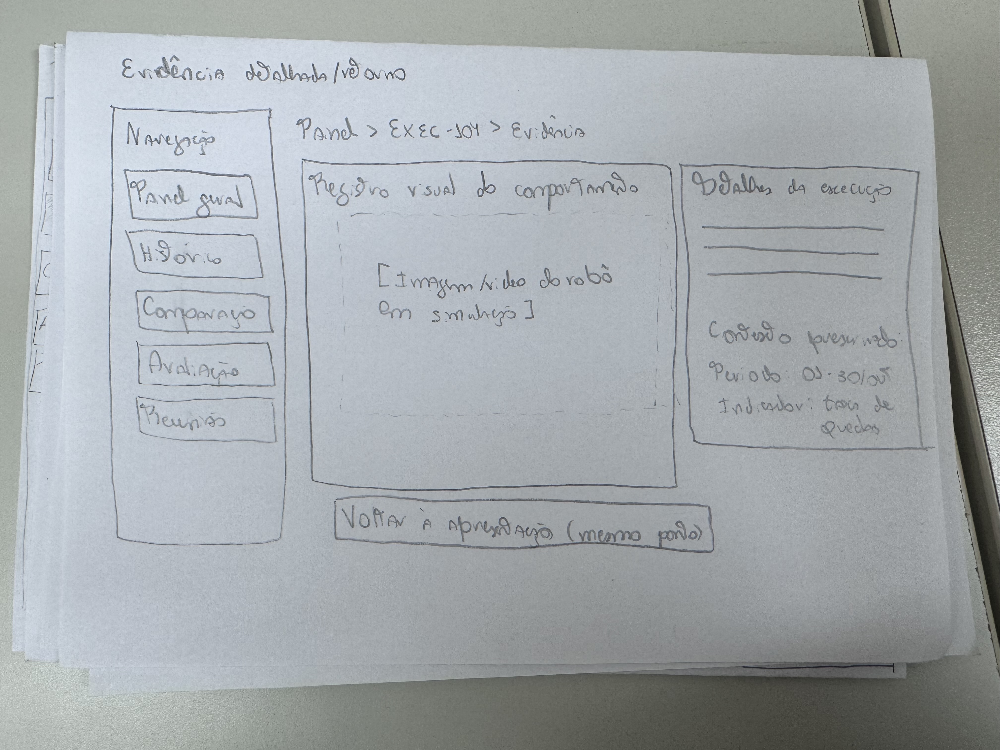
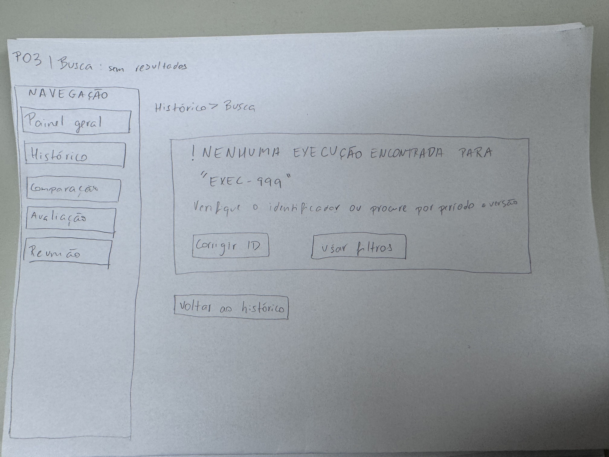
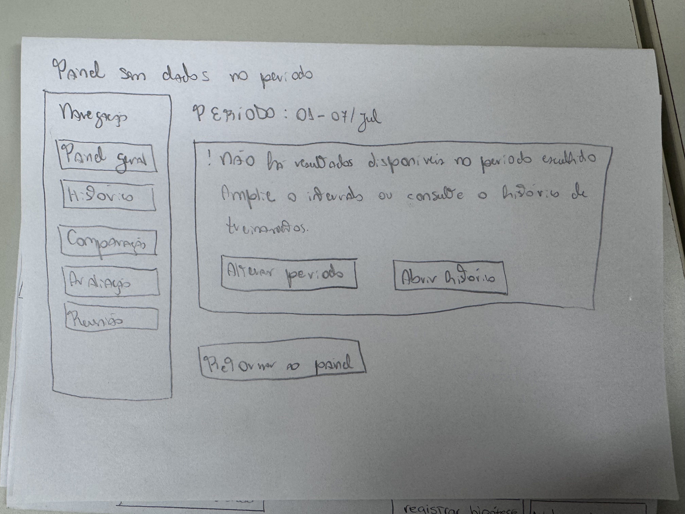

# Entrega 6 — Prototipação em papel

**Data:** {{28/10/2026}}  
**Status:** 🟦 revisada após feedback
**Responsabilidade:** 1 solução integrada por equipe

## Objetivo da atividade

Externalizar rapidamente ideias de interação em baixa fidelidade para explorar alternativas antes de investir em detalhes visuais. O valor da atividade está no **ciclo construir → simular → observar → revisar**, não na beleza do desenho.

## 1. Escopo do protótipo

### Personas:

P01 — Rafael Martins: responsável por avaliar os resultados dos treinamentos e identificar se houve melhoria real no desempenho do robô.

P02 — Marina Oliveira: responsável por localizar execuções anteriores, comparar experimentos e investigar possíveis causas para diferenças de desempenho.

P03 — Carlos Almeida: responsável por acompanhar a evolução do desempenho do robô, interpretar indicadores e comunicar à equipe os pontos que precisam de investigação.

### Cenários/tarefas cobertos:

C01/T01: avaliar se o resultado de um treinamento representa uma melhoria real no desempenho do robô, comparando indicadores com uma execução de referência (baseline) e registrando uma conclusão fundamentada.

C02/T02: localizar duas execuções anteriores por identificadores ou filtros, comparar suas métricas e parâmetros e registrar uma hipótese para explicar as diferenças encontradas, acompanhada de evidências e ressalvas.

C03/T03: consultar uma síntese da evolução do desempenho ao longo dos treinamentos, identificar pontos relevantes de investigação e apresentar os resultados à equipe, permitindo consultar evidências detalhadas durante a reunião.

### Objetivos principais:

O protótipo tem como objetivo explorar uma solução integrada de visualização e análise dos resultados dos treinamentos do robô humanoide, facilitando a interpretação dos indicadores e apoiando decisões da equipe sobre possíveis melhorias e necessidades de investigação.

Para isso, a interface deverá permitir:

Visualizar os resultados de treinamentos, incluindo velocidade média, distância percorrida, taxa de quedas, estabilidade, gols marcados e força de chute.

Consultar o histórico de execuções utilizando busca por identificador e filtros de período, versão e parâmetros.

Selecionar e comparar duas execuções, apresentando métricas e configurações lado a lado para facilitar a identificação de diferenças.

Avaliar se uma execução apresentou melhoria em relação a um baseline, considerando ganhos e possíveis regressões em diferentes indicadores.

Registrar conclusões e hipóteses com justificativas, evidências e ressalvas, mantendo a associação com as execuções analisadas.

Acompanhar a evolução dos indicadores e parâmetros ao longo do tempo por meio de um painel de síntese.

Apoiar a comunicação dos resultados durante reuniões, mantendo a interpretação e a definição dos encaminhamentos sob responsabilidade da equipe.

## 1.1 Possíveis famílias de interface

Escolha apenas o que for coerente com tarefas e cenários. Para TCCs técnicos, o protótipo pode explorar:

- **dashboard** para monitoramento e tomada de decisão;
- **configuração/parametrização** para preparar algoritmo/modelo/processo;
- **entrada/seleção de dados** com validação;
- **acompanhamento de execução** com progresso, fila, cancelamento e recuperação;
- **relatório/resultados** com explicação, gráficos e exportação;
- **histórico** com busca, filtros, ordenação e detalhes;
- **comparação** entre execuções, versões, algoritmos ou períodos;
- **administração** de usuários, papéis, permissões ou entidades do domínio;
- **auditoria/logs** traduzidos para o perfil;
- **alertas/ocorrências** com ação de resposta.

> Não desenhe todas essas telas por obrigação. O objetivo da baixa fidelidade é experimentar a **estrutura da interação** necessária para as tarefas priorizadas.

## 2. Fluxos escolhidos

Os fluxos foram definidos com base nas três tarefas priorizadas na Entrega 5, contemplando a avaliação de treinamentos, a comparação de execuções anteriores e o acompanhamento da evolução do desempenho do robô. A proposta é integrar essas funcionalidades em uma única interface, permitindo que diferentes integrantes da equipe consultem os resultados de acordo com seus objetivos.

| Fluxo | Tarefa/objetivo | Por que foi priorizado |
|---|---|---|
| PF01 | T01 — Avaliar melhoria de um treinamento: selecionar uma execução, definir um baseline comparável, analisar métricas e evidências e registrar uma conclusão sobre o desempenho. | É uma atividade frequente e crítica para a evolução do robô. A classificação em melhoria, não melhoria e sem evidências indica se os treinos estão seguindo o caminho certo |
| PF02 | T02 — Localizar e comparar execuções anteriores: buscar duas execuções por ID ou filtros, comparar métricas e parâmetros e registrar uma hipótese sobre as diferenças encontradas. | Garante rastreabilidade dos experimentos e permite investigar variações de desempenho. |
| PF03 | T03 — Consultar síntese e comunicar pontos de investigação: selecionar um período, visualizar a evolução dos indicadores, identificar pontos relevantes e apresentar os resultados à equipe, consultando evidências detalhadas quando necessário. | Apoia reuniões de acompanhamento e decisões sobre futuras investigações. O fluxo permite organizar os resultados e manter o contexto da análise durante a comunicação com a equipe. |

### Descrição dos fluxos

**PF01 — Avaliação de melhoria do treinamento**

O usuário acessa o histórico de treinamentos e seleciona uma execução para avaliação. Em seguida, escolhe um baseline e consulta as métricas e evidências disponíveis. Após analisar os resultados, classifica o treinamento como melhoria, não melhoria ou evidências insuficientes, registrando uma justificativa associada às execuções.

**PF02 — Localização e comparação de execuções**

O usuário localiza duas execuções anteriores utilizando identificadores conhecidos ou filtros do histórico. Depois de confirmar as seleções, acessa uma visualização comparativa das métricas, versões e parâmetros. Com base nas divergências observadas, formula uma hipótese explicativa, registra as evidências utilizadas e indica possíveis limitações da análise.

**PF03 — Acompanhamento e comunicação do desempenho**

O usuário seleciona um período de análise e consulta um painel com a evolução dos principais indicadores dos treinamentos. A partir dos resultados, identifica tendências, regressões e pontos que precisam de investigação. Durante a apresentação à equipe, pode consultar evidências detalhadas sem perder o contexto do painel. Por fim, a equipe discute os resultados e define os encaminhamentos necessários.

### Integração entre os fluxos

Os três fluxos compartilham informações sobre execuções, métricas e parâmetros dos treinamentos. O histórico e a comparação de resultados atendem principalmente aos fluxos PF01 e PF02, enquanto o painel de evolução temporal atende ao PF03.

## 3. Telas e estados

A navegação foi estruturada por meio de um menu lateral compartilhado entre as telas, contendo as opções Painel Geral, Histórico, Comparação, Avaliação, Reunião. Essa organização busca manter a consistência da interface e facilitar o deslocamento entre funcionalidades relacionadas.

Durante a simulação em papel, os controles desenhados representam ações do usuário, enquanto a troca das folhas corresponde às transições entre telas. A numeração P01 a P10 identifica os estados do protótipo e permite relacioná-los aos fluxos e às tarefas analisadas anteriormente.

### P01 — Painel geral de desempenho

**Fluxo relacionado:** PF03 — Consultar síntese e comunicar pontos de investigação.

A tela P01 representa a visão inicial do sistema, oferecendo uma síntese dos resultados dos treinamentos do robô humanoide. Seu objetivo é permitir que os integrantes da equipe acompanhem a evolução do desempenho sem precisar consultar individualmente cada execução realizada.

Na parte superior, o usuário encontra o controle de seleção do período de análise. Após definir o intervalo desejado e aplicar a consulta, o painel apresenta indicadores consolidados, incluindo velocidade média, distância percorrida, taxa de quedas e estabilidade.

A região central contém um gráfico de evolução dos treinamentos, permitindo identificar tendências e alterações no comportamento dos indicadores ao longo do tempo. Uma área lateral apresenta pontos de atenção que podem exigir investigação adicional.

Essa organização procura facilitar uma interpretação inicial dos resultados e apoiar a identificação de questões relevantes para as reuniões de acompanhamento.

**Controles e navegação:**

- Selecionar o período de análise.
- Acionar o botão "Aplicar" para atualizar os resultados.
- Consultar os indicadores e o gráfico de evolução.
- Selecionar "Abrir evidência" para acessar P08.
- Acessar o histórico de execuções (P02).
- Acessar a área de reunião (P07).
- Quando o período não apresentar dados, visualizar P10.

### P02 — Histórico de execuções

**Fluxos relacionados:** PF01 — Avaliação de treinamento e PF02 — Localização e comparação de execuções.

A tela P02 apresenta o histórico dos treinamentos realizados, permitindo localizar execuções anteriores e selecionar registros para análise comparativa.

Na parte superior, existe um campo de busca por identificador, acompanhado de um botão para executar a pesquisa. Também há a possibilidade de utilizar filtros de período e versão, oferecendo diferentes maneiras de localizar um treinamento conforme as informações disponíveis.

A área central apresenta uma lista de execuções com seus identificadores, datas, versões e estados de conclusão. Cada registro possui um controle de seleção, permitindo escolher duas execuções para comparação.

Na parte inferior, a interface apresenta a quantidade de execuções selecionadas, ajudando o usuário a compreender quantos registros ainda precisam ser escolhidos antes de iniciar a comparação.

**Controles e navegação:**

- Digitar o identificador de uma execução no campo de busca.
- Acionar o botão "Buscar".
- Aplicar filtros de período e versão.
- Selecionar duas execuções na lista.
- Conferir a quantidade de registros selecionados.
- Acionar "Comparar selecionadas" para acessar P03.
- Visualizar P09 quando a pesquisa não encontrar resultados.
- Retornar ao painel geral (P01).

### P03 — Comparação de execuções

**Fluxos relacionados:** PF01 — Avaliação de melhoria e PF02 — Investigação de diferenças de desempenho.

A tela P03 permite comparar os resultados de duas execuções selecionadas anteriormente no histórico. Seu objetivo é apresentar os dados de maneira organizada para facilitar a identificação de diferenças entre os treinamentos.

Na parte superior, são exibidos os identificadores das execuções, suas versões e datas. A região central apresenta uma tabela com as métricas dispostas lado a lado, permitindo comparar velocidade média, distância percorrida, taxa de quedas, estabilidade, gols marcados e força de chute.

A estrutura facilita a identificação de indicadores que apresentaram melhoria ou regressão entre os experimentos. Além disso, existe uma área destinada às diferenças de configuração, permitindo relacionar alterações nos parâmetros às variações observadas nos resultados.

A comparação não determina automaticamente qual execução é superior nem estabelece relações causais entre mudanças de configuração e desempenho. Essas interpretações permanecem sob responsabilidade do usuário.

**Controles e navegação:**

- Visualizar as duas execuções selecionadas.
- Comparar métricas e parâmetros lado a lado.
- Examinar diferenças de configuração.
- Selecionar "Voltar ao histórico" para retornar à P02.
- Selecionar "Registrar hipótese" para acessar P04.
- Selecionar "Avaliar desempenho" para acessar P05.

### P04 — Registro de hipóteses e ressalvas

**Fluxo relacionado:** PF02 — Localizar e comparar execuções anteriores.

A tela P04 representa a etapa de formulação e registro de uma hipótese explicativa sobre as diferenças encontradas entre duas execuções.

O contexto da comparação permanece identificado na parte superior, apresentando os IDs das execuções analisadas. A interface organiza as informações em três áreas principais: diferenças observadas, hipótese explicativa e ressalvas ou limitações.

A primeira área permite consultar as divergências efetivamente identificadas nos resultados. A segunda disponibiliza um campo para o usuário escrever uma possível explicação para essas diferenças. A terceira permite registrar fatores que podem limitar a interpretação, como condições divergentes entre treinamentos.

A separação entre evidências, hipóteses e ressalvas busca evitar que uma correlação entre parâmetros e resultados seja interpretada como uma relação causal comprovada.

**Controles e navegação:**

- Consultar as diferenças observadas.
- Preencher o campo de hipótese explicativa.
- Informar ressalvas e limitações da análise.
- Selecionar "Voltar à comparação" para retornar à P03.
- Acionar "Salvar hipótese e ressalvas" para registrar a análise.

### P05 — Avaliação do resultado do treinamento

**Fluxo relacionado:** PF01 — Avaliar se um treinamento apresentou melhoria real no desempenho.

A tela P05 representa a etapa de avaliação de um treinamento em relação a uma execução de referência, denominada baseline.

Na parte superior, são identificadas a execução avaliada e a referência utilizada na comparação. O usuário pode solicitar a troca do baseline caso identifique a necessidade de selecionar outra execução.

A região central apresenta uma área dedicada às evidências quantitativas, incluindo gráficos de desempenho, enquanto uma seção complementar disponibiliza informações sobre o comportamento do robô durante a simulação.

Depois de analisar os resultados, o usuário deve selecionar uma classificação entre três possibilidades: melhoria, não melhoria ou evidências insuficientes.

A classificação deve ser acompanhada de uma justificativa, permitindo documentar os indicadores e comportamentos que fundamentaram a decisão.

A existência da opção "evidências insuficientes" é importante para representar situações em que os dados não permitem determinar com segurança se houve uma melhoria real.

**Controles e navegação:**

- Consultar a execução e o baseline selecionados.
- Acionar "Trocar baseline".
- Analisar gráficos e indicadores de desempenho.
- Selecionar "Abrir detalhe" para acessar P08.
- Escolher uma das três classificações disponíveis.
- Preencher o campo de justificativa obrigatória.
- Selecionar "Voltar à comparação" para retornar à P03.
- Acionar "Salvar avaliação" para acessar P06.

### P06 — Confirmação do registro

**Fluxos relacionados:** PF01 — Avaliação do treinamento e PF02 — Registro de análise.

A tela P06 apresenta uma confirmação visual após o salvamento de um registro de análise. Sua finalidade é informar ao usuário que a operação foi concluída e permitir a conferência das informações associadas ao registro.

No exemplo representado no protótipo, a confirmação corresponde a uma avaliação de treinamento vinculada à execução EXEC-104 e à referência EXEC-103, com a conclusão "não melhoria".

A interface apresenta o tipo de registro realizado, os identificadores envolvidos e a classificação registrada, permitindo verificar se a análise foi associada aos treinamentos corretos.

Esse estado procura evitar incertezas sobre a conclusão da operação e oferece caminhos para continuar utilizando o sistema.

**Controles e navegação:**

- Consultar as informações do registro salvo.
- Selecionar "Ver registro" para acessar os detalhes.
- Selecionar "Voltar ao painel" para retornar à P01.
- Selecionar "Histórico" para acessar P02.

### P07 — Reunião e apresentação dos resultados

**Fluxo relacionado:** PF03 — Consultar síntese e comunicar pontos de investigação.

A tela P07 representa o uso do painel durante uma reunião de acompanhamento dos treinamentos.

Na parte superior, são apresentados o período de análise e a identificação da síntese de desempenho. A região central contém um gráfico que permite observar a evolução dos resultados, enquanto uma área lateral reúne os pontos que precisam ser discutidos com a equipe.

Essa organização procura apoiar a apresentação das informações e facilitar o acompanhamento dos indicadores durante a reunião.

O usuário pode apresentar a interpretação dos resultados e consultar evidências detalhadas para complementar as explicações. A consulta deve permitir o retorno à apresentação sem perda do contexto anterior.

As discussões sobre prioridades e a definição dos encaminhamentos continuam sendo realizadas pelos integrantes da equipe.

**Controles e navegação:**

- Consultar os indicadores do período selecionado.
- Visualizar os pontos a discutir.
- Selecionar "Abrir evidência" para acessar P08.
- Acionar "Próximo indicador" para continuar a apresentação.
- Selecionar "Retornar ao painel" para acessar P01.

### P08 — Evidência detalhada da execução

**Fluxos relacionados:** PF01 — Avaliação de treinamento e PF03 — Apresentação dos resultados.

A tela P08 apresenta uma visualização detalhada de uma execução específica, permitindo que o usuário consulte informações complementares às métricas apresentadas nas telas anteriores.

A interface possui uma área destinada ao registro visual do comportamento do robô em simulação, acompanhada de um painel lateral com dados sobre a execução.

O contexto de origem é identificado por meio de informações como o ID da execução, o período e o indicador analisado.

A principal finalidade dessa tela é permitir o aprofundamento da análise sem exigir que o usuário reinicie a tarefa. Isso é especialmente importante durante uma reunião, quando a consulta a uma evidência pode ocorrer enquanto os resultados estão sendo apresentados.

**Controles e navegação:**

- Consultar o registro visual do comportamento do robô.
- Visualizar informações complementares da execução.
- Conferir o identificador e o contexto da evidência.
- Selecionar "Voltar à apresentação" para retornar à tela anterior, preservando o contexto.

### P09 — Estado de busca sem resultados

**Fluxos relacionados:** PF01 e PF02 — Localização de execuções.

A tela P09 representa um estado alternativo em que a busca por um identificador não encontra nenhuma execução correspondente.

No exemplo desenhado, a pesquisa pelo identificador EXEC-999 não retorna resultados. A interface apresenta uma mensagem informativa e orienta o usuário a verificar o identificador ou utilizar filtros alternativos.

A inclusão desse estado busca evitar que uma pesquisa sem resultados seja interpretada como falha do sistema. Além disso, são oferecidas alternativas para que o usuário consiga retomar a tarefa sem abandonar o processo.

**Controles e navegação:**

- Visualizar a mensagem de ausência de resultados.
- Selecionar "Corrigir ID" para modificar a pesquisa.
- Selecionar "Usar filtros" para buscar por outros critérios.
- Selecionar "Voltar ao histórico" para retornar à P02.

### P10 — Estado de painel sem dados no período

**Fluxo relacionado:** PF03 — Acompanhamento da evolução do desempenho.

A tela P10 representa a situação em que o usuário seleciona um período para análise, mas não existem resultados de treinamento disponíveis naquele intervalo.

No exemplo apresentado, o painel informa a ausência de resultados para o período selecionado e orienta o usuário a ampliar o intervalo ou consultar o histórico.

Esse estado é importante porque diferencia a ausência de dados de indicadores com valores iguais a zero ou de possíveis falhas de carregamento.

A interface permite recuperar a interação por meio da alteração do período ou da navegação para outras áreas do sistema.

**Controles e navegação:**

- Visualizar a mensagem de ausência de dados.
- Selecionar "Alterar período" para definir outro intervalo.
- Selecionar "Abrir histórico" para acessar P02.
- Selecionar "Retornar ao painel" para acessar P01.

### Organização da navegação entre telas

As dez telas foram organizadas em uma estrutura integrada, permitindo que diferentes tarefas compartilhem componentes e informações. Embora estejam numeradas para facilitar a documentação, sua utilização não depende de uma sequência única, pois cada fluxo possui caminhos próprios e estados alternativos.

**PF01 — Avaliação de treinamento:**

P02 (Histórico) → P03 (Comparação) → P05 (Avaliação) → P06 (Confirmação).

Durante esse fluxo, P08 pode ser acessada para consultar evidências detalhadas. Caso uma pesquisa não encontre resultados, o usuário pode acessar P09 e corrigir a busca.

**PF02 — Localização e comparação de execuções:**

P02 (Histórico) → P03 (Comparação) → P04 (Hipóteses e ressalvas).

O usuário pode retornar ao histórico para modificar as execuções selecionadas. Caso a pesquisa não encontre resultados, P09 apresenta alternativas para continuar a tarefa.

**PF03 — Acompanhamento e comunicação do desempenho:**

P01 (Painel geral) → P07 (Reunião) → P08 (Evidência detalhada) → P07 (Retorno à reunião).

Quando o período selecionado não possui dados, o sistema apresenta P10, permitindo alterar o intervalo ou consultar o histórico.

A organização proposta busca preservar o contexto das análises e reduzir a necessidade de repetir operações durante a navegação. Na simulação em papel, as transições serão representadas pela troca das folhas correspondentes às ações realizadas pelo participante.

Os estados alternativos foram incluídos para observar como o usuário reage a situações inesperadas e se os controles apresentados permitem a recuperação da tarefa.

## 4. Simulação / walkthrough

**Moderador:** Tá, então é o seguinte: a gente fez umas telas de um sistema para acompanhar o desempenho de um robô que é treinado para jogar futebol. Eu vou te dar algumas tarefas e você vai falando o que está pensando enquanto tenta fazer, beleza?

**Participante:** Tá bom. Eu não entendo muito de robô, mas vamos lá, kkk.

**Moderador:** Não tem problema. A ideia é justamente ver se dá para entender as telas sem a gente ficar explicando.

**Moderador:** Primeiro, imagina que você precisa encontrar dois treinamentos, o 103 e o 104, e comparar os resultados deles.

**Participante:** Tá... deixa eu olhar aqui. Tem painel geral, histórico, comparação... Acho que eu iria direto em comparação.

**Moderador:** Pode tentar.

**Participante:** Ué, mas eu tenho que escolher os treinamentos antes, né? Acho que seria no histórico então.

**Moderador:** Pode seguir.

**Participante:** Ah, aqui tem os dois. O 104 e o 103. Vou marcar eles.

**Participante:** Pera, é para marcar só dois? Ah, tá escrito ali embaixo, selecionados zero de dois. Beleza.

**Participante:** Agora apareceu dois de dois. Vou clicar em comparar selecionadas.

**Moderador:** E aí, conseguiu entender essa tela?

**Participante:** Acho que sim. Tá mostrando os dois lado a lado, né? A velocidade de um é 0,32 e do outro 0,28.

**Participante:** Nossa, mas olha aqui, o que tá mais rápido também cai mais. Então não é necessariamente melhor, né?

**Moderador:** O que mais você olharia?

**Participante:** A estabilidade também. Aqui tá 78 e 84. Então o 104 tá mais rápido, só que tá menos estável.

**Participante:** Só não entendi esse negócio de diferenças de configuração. Era para aparecer o que mudou?

**Moderador:** O que você esperava encontrar ali?

**Participante:** Ah, sei lá, tipo, qual configuração usaram no 103 e qual usaram no 104. Porque aí daria para entender o que mudou.

**Moderador:** Entendi. Agora imagina que você precisa registrar uma explicação para essa diferença.

**Participante:** Acho que é nesse registrar hipótese aqui.

**Participante:** Ah, beleza. Tem as diferenças observadas e aí eu escrevo o que acho que aconteceu.

**Participante:** Eu colocaria que alguma mudança deixou ele mais rápido, mas acabou fazendo ele cair mais. Só que eu não sei exatamente o que mudou, então não dá para afirmar.

**Moderador:** E as ressalvas?

**Participante:** Acho que é isso que eu falei, que não dá para ter certeza se foi por causa da configuração. Eu colocaria aí.

**Moderador:** Agora você precisa decidir se o treinamento 104 realmente melhorou em relação ao 103.

**Participante:** Tá. Vou voltar aqui... acho que é avaliação.

**Participante:** Ah, aqui tem o 104 e o baseline 103. Baseline é o treinamento que eu tô usando para comparar?

**Moderador:** Isso.

**Participante:** Tá, entendi. Mas acho que podia ter escrito referência também, porque baseline eu não saberia de primeira.

**Participante:** Aqui tem o gráfico, mas eu não tô entendendo qual linha é qual. Tem duas linhas e não tem uma legenda.

**Moderador:** O que você faria?

**Participante:** Eu tentaria abrir esse detalhe aqui do comportamento do robô.

**Participante:** Ah, aqui seria o vídeo dele andando. Legal. Porque só os números não mostram se ele tá andando esquisito ou caindo toda hora.

**Participante:** Só que agora eu quero voltar para a avaliação. Esse botão tá escrito voltar à apresentação... Mas eu não tava apresentando nada.

**Moderador:** E isso te atrapalharia?

**Participante:** Um pouco, porque eu ia ficar com medo de voltar para uma tela nada a ver. Eu colocaria só "Voltar" ou "Voltar à avaliação".

**Moderador:** Tá. Agora você precisa escolher uma classificação.

**Participante:** Eu acho que colocaria não melhoria. Porque ele ficou mais rápido, mas a estabilidade piorou e ele caiu mais.

**Participante:** Aí eu escreveria isso na justificativa e salvaria.

**Moderador:** E essa tela de confirmação?

**Participante:** Ah, essa tá boa. Mostra que salvou mesmo. Eu gosto quando aparece isso, porque senão fico naquela dúvida se foi ou não.

**Moderador:** Agora imagina que você vai mostrar para a equipe como o robô evoluiu nos últimos 30 dias.

**Participante:** Tá, acho que agora eu iria no painel geral.

**Participante:** Ah, aqui já tem os últimos 30 dias. Tem velocidade, distância, quedas... Essa tela parece mais fácil.

**Moderador:** E como você faria para apresentar isso para a equipe?

**Participante:** Tem reunião aqui no menu. Vou clicar.

**Participante:** Ah, aqui parece uma apresentação mesmo. Tem o gráfico maior e os pontos para discutir.

**Participante:** Só esse botão de próximo indicador que eu fiquei meio perdido. Próximo indicador qual?

**Moderador:** O que você colocaria no lugar?

**Participante:** Talvez "Próximo: estabilidade", por exemplo. Aí eu já saberia o que vai aparecer.

**Moderador:** E se alguém da reunião perguntasse por que a taxa de quedas aumentou?

**Participante:** Eu clicaria em abrir evidência para mostrar o treinamento específico.

**Participante:** Aí depois voltaria para a reunião.

**Participante:** Isso eu achei importante, porque imagina ter que escolher o período tudo de novo no meio da reunião. Ia ser chato.

**Moderador:** Agora falando de tudo que você viu, o que achou mais fácil?

**Participante:** Acho que o histórico e a comparação. Dá para entender bem o que tem que fazer.

**Moderador:** E o que achou mais difícil?

**Participante:** Fiquei um pouco perdido nos gráficos porque não sabia qual linha representava qual execução. E também não entendi o termo baseline de primeira.

**Moderador:** Você mudaria alguma coisa na navegação?

**Participante:** Ah, eu deixaria os botões de voltar mais claros. Tipo, mostrar para onde vai voltar.

**Moderador:** E teve alguma coisa que você gostou?

**Participante:** Gostei da comparação lado a lado e da confirmação quando salva. E também achei importante conseguir abrir uma evidência e voltar para a reunião sem perder o que estava mostrando.

**Moderador:** Tá ótimo, era isso. Valeu pela ajuda!

**Participante:** Imagina, espero ter ajudado, kkk.

### 4.1 Registro de observações do walkthrough

| Observação | Tela/ação | Evidência disponível no protótipo | Consequência para o design |
|---|---|---|---|
| A comparação depende da seleção prévia de duas execuções. | P02 — Histórico de execuções. | A tela apresenta a seleção de treinamentos e um contador indicando a quantidade selecionada. | Manter o contador e orientar o usuário quando ainda não houver duas execuções selecionadas. |
| A apresentação das métricas lado a lado facilita a identificação de ganhos e regressões. | P03 — Comparação de execuções. | A comparação entre EXEC-103 e EXEC-104 apresenta velocidade média, estabilidade e taxa de quedas. | Preservar a apresentação conjunta das métricas, permitindo interpretar o desempenho sem considerar apenas um indicador. |
| A área de diferenças de configuração precisa apresentar informações suficientes para a análise. | P03 — Diferenças de configuração. | A tela identifica uma área destinada às diferenças, mas não apresenta todos os valores dos parâmetros. | Apresentar os parâmetros e seus respectivos valores quando disponíveis, permitindo compreender quais configurações foram modificadas. |
| A separação entre observações, hipóteses e ressalvas contribui para a organização da análise. | P04 — Registro de hipóteses e ressalvas. | A tela apresenta áreas distintas para registrar diferenças observadas, possíveis explicações e limitações. | Manter essa separação, evitando que hipóteses sejam interpretadas como causas comprovadas. |
| O termo técnico "baseline" pode dificultar a compreensão da referência utilizada. | P05 — Avaliação do treinamento. | A tela utiliza o termo "baseline" para identificar a execução de referência. | Utilizar "Baseline (execução de referência)", mantendo o termo técnico acompanhado de uma explicação. |
| Os gráficos precisam permitir a identificação das execuções representadas. | P05 — Gráfico de avaliação. | O gráfico apresenta séries de desempenho sem uma legenda suficientemente clara. | Acrescentar legendas com os identificadores das execuções e utilizar estilos de linha distintos. |
| A confirmação do salvamento permite verificar a conclusão do registro. | P06 — Confirmação do registro. | A tela identifica as execuções relacionadas e apresenta a classificação registrada. | Manter a confirmação explícita, permitindo ao usuário conferir as informações salvas. |
| O controle "Próximo indicador" não informa qual conteúdo será apresentado em seguida. | P07 — Reunião e apresentação. | A tela apresenta a opção de avançar entre indicadores, mas não identifica o próximo. | Alterar a identificação para algo contextual, como "Próximo: Estabilidade". |
| O retorno da evidência detalhada precisa corresponder à atividade de origem. | P08 — Evidência detalhada. | A tela apresenta "Voltar à apresentação", embora também possa ser acessada a partir da avaliação. | Utilizar um retorno contextual, como "Voltar à avaliação" ou "Voltar à apresentação", preservando o contexto anterior. |
| A ausência de resultados em uma busca precisa ser comunicada claramente. | P09 — Busca sem resultados. | A tela apresenta uma mensagem de ausência de resultados e alternativas para modificar a pesquisa. | Manter as orientações para corrigir o identificador ou utilizar filtros. |
| A ausência de dados em um período precisa ser diferenciada de um resultado igual a zero. | P10 — Painel sem dados. | A tela comunica que não existem resultados no período selecionado e permite alterar o intervalo. | Manter a mensagem específica e os caminhos para continuar a consulta. |

## 5. Alterações após a simulação

As alterações propostas estão relacionadas às telas P01 a P10.

A tabela apresenta as decisões de revisão da equipe, que deverão ser incorporadas às próximas versões do protótipo.

| Antes | Problema identificado | Depois (alteração proposta) | Justificativa |
|---|---|---|---|
| P05 — A execução de referência é identificada apenas pelo termo "baseline". | O termo técnico pode dificultar a compreensão de usuários com menor familiaridade com o vocabulário de robótica e aprendizado por reforço. | Utilizar a identificação "Baseline (execução de referência)", acompanhada do identificador da execução selecionada. | Manter a terminologia técnica utilizada pela equipe, oferecendo uma explicação que facilite a compreensão da referência utilizada na avaliação. |
| P05 — O gráfico apresenta diferentes séries de desempenho sem uma legenda suficientemente clara. | A ausência de identificação das séries pode dificultar a associação entre os resultados apresentados e suas respectivas execuções. | Adicionar uma legenda com os identificadores EXEC-103 e EXEC-104, utilizando estilos de linha distintos para representar cada execução. | Facilitar a interpretação das métricas e reduzir o risco de conclusões incorretas sobre melhorias e regressões. |
| P08 — O botão de retorno apresenta a identificação fixa "Voltar à apresentação". | A evidência detalhada pode ser acessada tanto durante a avaliação de um treinamento quanto durante uma reunião, tornando o destino do retorno pouco claro em determinados contextos. | Adaptar a identificação do retorno conforme a origem, utilizando "Voltar à avaliação" ou "Voltar à apresentação", preservando o contexto anterior. | Melhorar a previsibilidade da navegação e permitir que o usuário retome sua atividade sem precisar repetir etapas anteriores. |
| P07 — O controle "Próximo indicador" não informa qual conteúdo será apresentado em seguida. | O usuário pode não conseguir identificar antecipadamente qual métrica será exibida ao avançar na apresentação. | Utilizar uma identificação contextual, como "Próximo: Estabilidade", indicando o conteúdo seguinte. | Facilitar a condução das reuniões e tornar mais clara a sequência de informações apresentadas. |

### Decisões de revisão e delimitação do escopo

Após o feedback recebido, a equipe decidiu manter o escopo da interface concentrado na consulta, comparação, avaliação e comunicação dos resultados de treinamentos.

A configuração e o início de novos treinamentos permanecem fora do escopo de IHC, conforme a decisão registrada anteriormente na matriz de rastreabilidade. Dessa forma, a equipe não dará continuidade à tela exploratória de configuração de treinamento.

O conjunto de dez telas permanece como base para as próximas etapas do projeto, sem a necessidade de incluir funcionalidades de execução ou controle de treinamentos.

## Checklist

- [X] O protótipo cobre tarefas relevantes da Entrega 5.
- [X] Cada tela/estado pode ser justificado por uma tarefa, decisão ou informação necessária.
- [X] O projeto não criou dashboard/CRUD/login apenas para parecer “completo”.
- [X] Telas/estados estão numerados e navegáveis na documentação.
- [X] Há pelo menos uma simulação/walkthrough documentado.
- [X] Críticas não foram apenas listadas: geraram decisão de revisão.
- [X] O protótipo continua em baixa fidelidade; detalhes visuais não mascaram problemas de fluxo.
