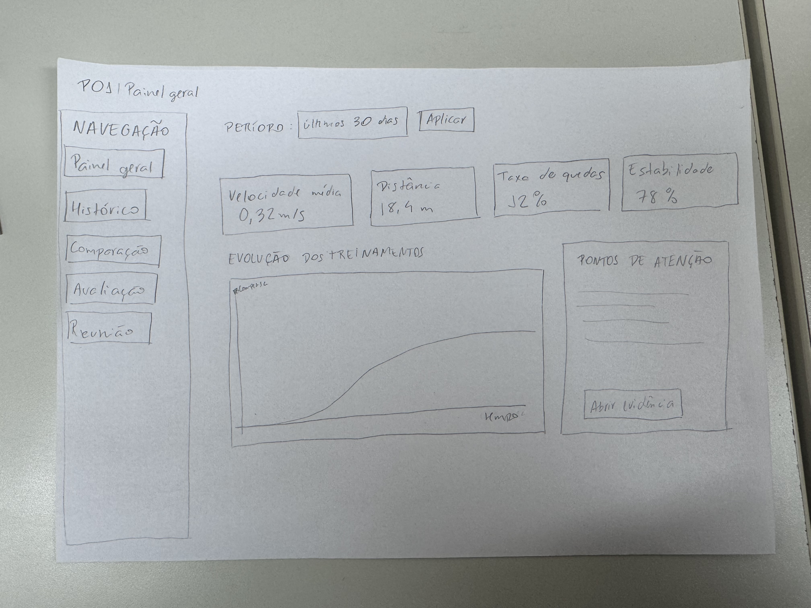
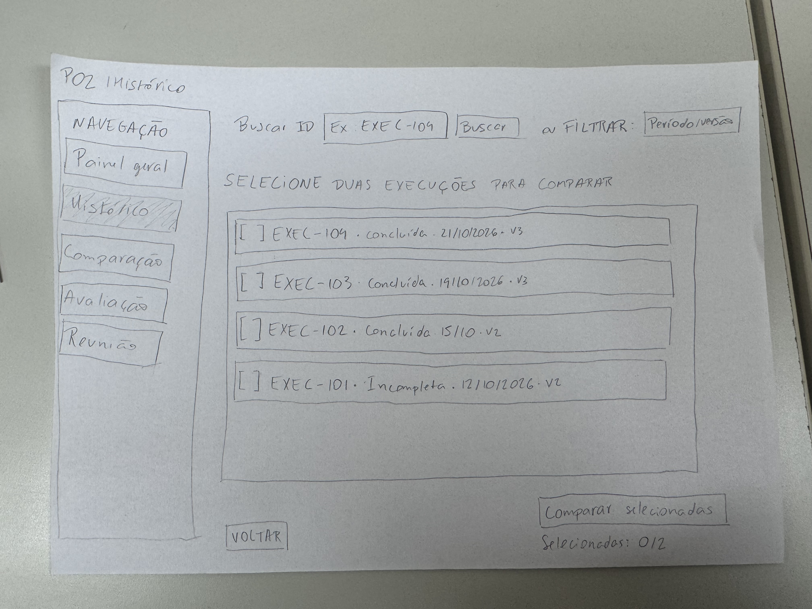
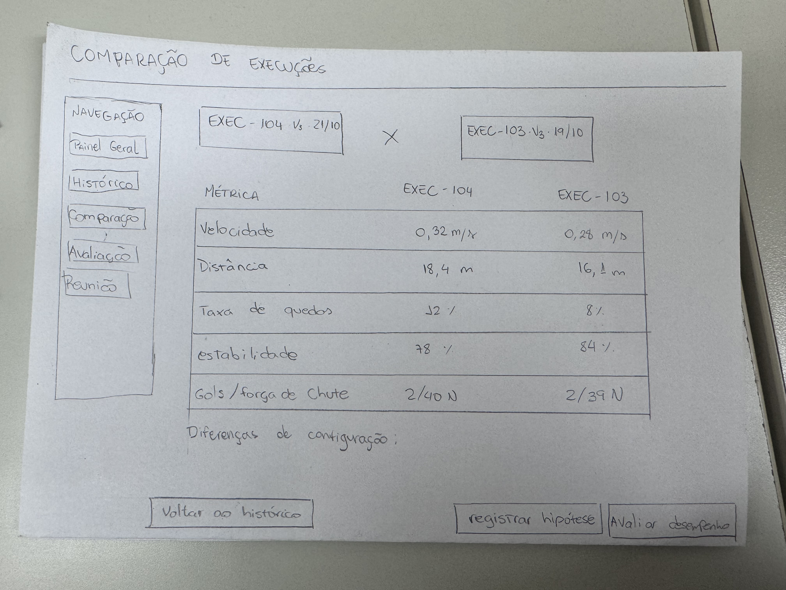
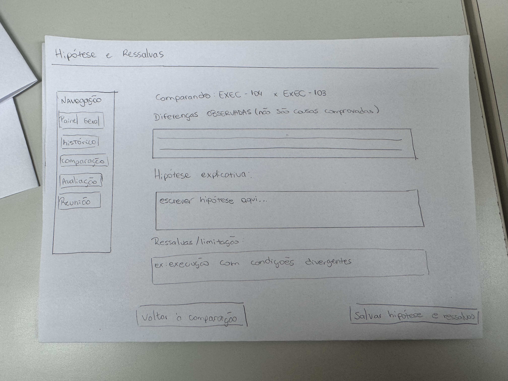
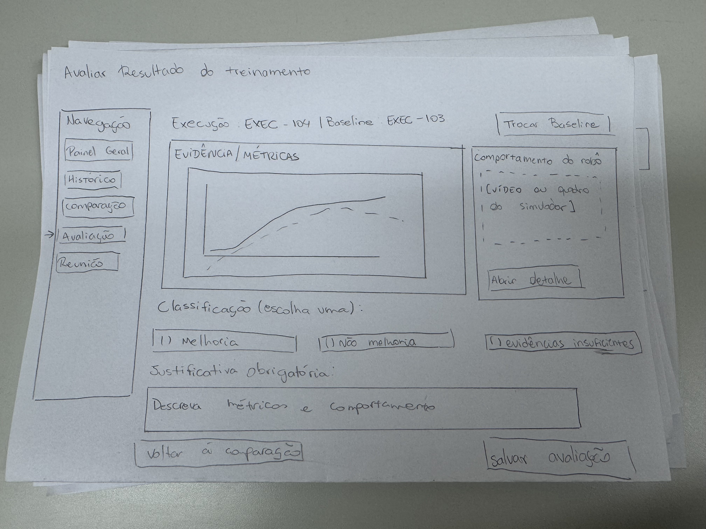
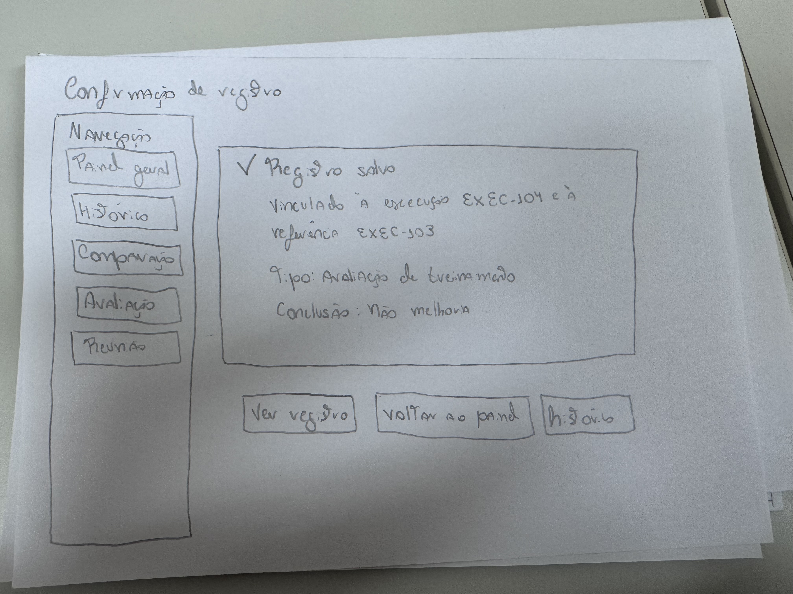
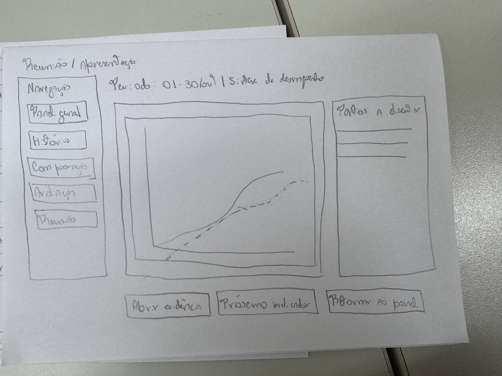
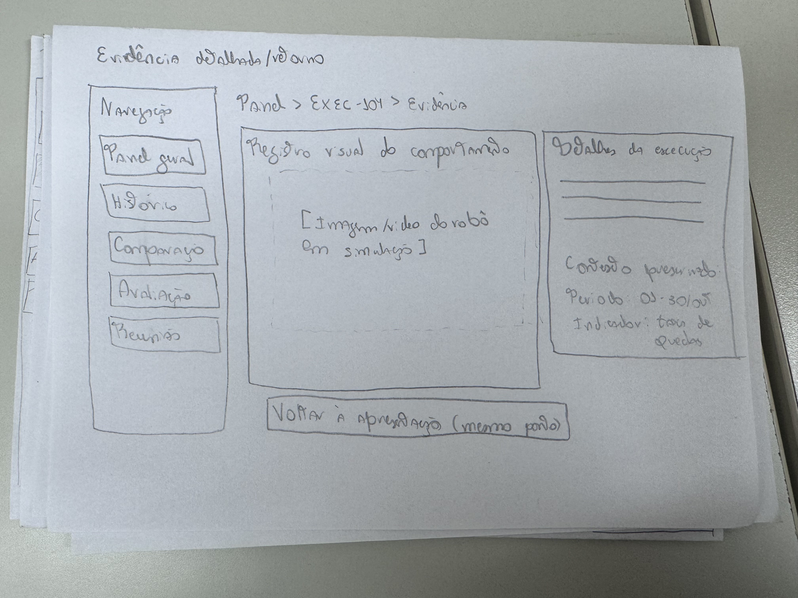
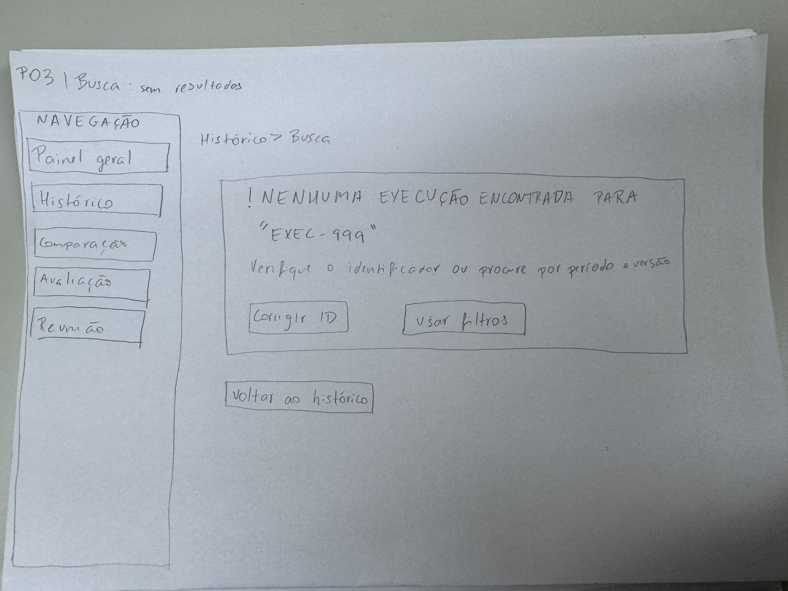
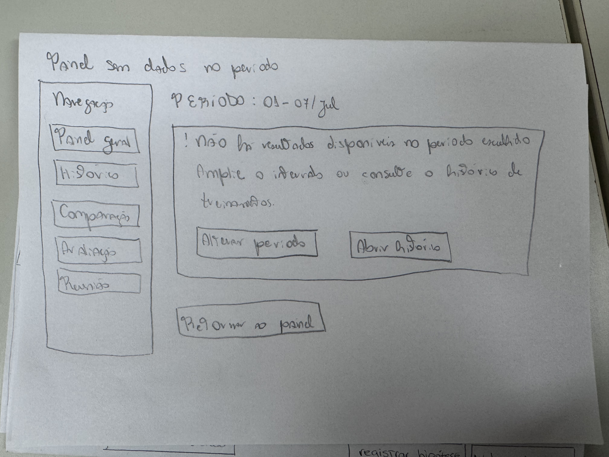

# Entrega 6 — Prototipação em papel

**Data:** {{28/10/2026}}  
**Status:** 🟨 em andamento
**Responsabilidade:** 1 solução integrada por equipe

## Objetivo da atividade

Externalizar rapidamente ideias de interação em baixa fidelidade para explorar alternativas antes de investir em detalhes visuais. O valor da atividade está no **ciclo construir → simular → observar → revisar**, não na beleza do desenho.

## 1. Escopo do protótipo

### Personas:

P01 — Rafael Martins: responsável por avaliar os resultados dos treinamentos e identificar se houve melhoria real no desempenho do robô.

P02 — Marina Oliveira: responsável por localizar execuções anteriores, comparar experimentos e investigar possíveis causas para diferenças de desempenho.

P03 — Carlos Almeida: responsável por acompanhar a evolução do desempenho do robô, interpretar indicadores e comunicar à equipe os pontos que precisam de investigação.

### Cenários/tarefas cobertos:

C01/T01: avaliar se o resultado de um treinamento representa uma melhoria real no desempenho do robô, comparando indicadores com uma execução de referência (baseline) e registrando uma conclusão fundamentada.

C02/T02: localizar duas execuções anteriores por identificadores ou filtros, comparar suas métricas e parâmetros e registrar uma hipótese para explicar as diferenças encontradas, acompanhada de evidências e ressalvas.

C03/T03: consultar uma síntese da evolução do desempenho ao longo dos treinamentos, identificar pontos relevantes de investigação e apresentar os resultados à equipe, permitindo consultar evidências detalhadas durante a reunião.

### Objetivos principais:

O protótipo tem como objetivo explorar uma solução integrada de visualização e análise dos resultados dos treinamentos do robô humanoide, facilitando a interpretação dos indicadores e apoiando decisões da equipe sobre possíveis melhorias e necessidades de investigação.

Para isso, a interface deverá permitir:

Visualizar os resultados de treinamentos, incluindo velocidade média, distância percorrida, taxa de quedas, estabilidade, gols marcados e força de chute.

Consultar o histórico de execuções utilizando busca por identificador e filtros de período, versão e parâmetros.

Selecionar e comparar duas execuções, apresentando métricas e configurações lado a lado para facilitar a identificação de diferenças.

Avaliar se uma execução apresentou melhoria em relação a um baseline, considerando ganhos e possíveis regressões em diferentes indicadores.

Registrar conclusões e hipóteses com justificativas, evidências e ressalvas, mantendo a associação com as execuções analisadas.

Acompanhar a evolução dos indicadores e parâmetros ao longo do tempo por meio de um painel de síntese.

Consultar evidências detalhadas e retornar ao contexto anterior sem perder o período, os filtros ou as execuções selecionadas.

Apoiar a comunicação dos resultados durante reuniões, mantendo a interpretação e a definição dos encaminhamentos sob responsabilidade da equipe.

O escopo da prototipação será concentrado nas interações necessárias para realizar essas três tarefas. A proposta não inclui a implementação interna dos algoritmos de treinamento, nem a automatização da interpretação dos resultados ou da definição de prioridades.

Por se tratar de um protótipo em papel, as telas serão representadas em baixa fidelidade, priorizando a organização das informações, os controles de navegação, os fluxos entre telas e os estados de interação. O objetivo é identificar dificuldades de uso e revisar a estrutura da solução antes da implementação de uma interface funcional.

## 1.1 Possíveis famílias de interface

Escolha apenas o que for coerente com tarefas e cenários. Para TCCs técnicos, o protótipo pode explorar:

- **dashboard** para monitoramento e tomada de decisão;
- **configuração/parametrização** para preparar algoritmo/modelo/processo;
- **entrada/seleção de dados** com validação;
- **acompanhamento de execução** com progresso, fila, cancelamento e recuperação;
- **relatório/resultados** com explicação, gráficos e exportação;
- **histórico** com busca, filtros, ordenação e detalhes;
- **comparação** entre execuções, versões, algoritmos ou períodos;
- **administração** de usuários, papéis, permissões ou entidades do domínio;
- **auditoria/logs** traduzidos para o perfil;
- **alertas/ocorrências** com ação de resposta.

> Não desenhe todas essas telas por obrigação. O objetivo da baixa fidelidade é experimentar a **estrutura da interação** necessária para as tarefas priorizadas.

## 2. Fluxos escolhidos

Os fluxos foram definidos com base nas três tarefas priorizadas na Entrega 5, contemplando a avaliação de treinamentos, a comparação de execuções anteriores e o acompanhamento da evolução do desempenho do robô. A proposta é integrar essas funcionalidades em uma única interface, permitindo que diferentes integrantes da equipe consultem os resultados de acordo com seus objetivos.

| Fluxo | Tarefa/objetivo | Por que foi priorizado |
|---|---|---|
| PF01 | **T01 — Avaliar melhoria de um treinamento:** selecionar uma execução, definir um baseline comparável, analisar métricas e evidências e registrar uma conclusão sobre o desempenho. | É uma atividade frequente e crítica para a evolução do robô. Uma avaliação incorreta pode levar a ajustes inadequados nos treinamentos e ao desperdício de recursos computacionais. |
| PF02 | **T02 — Localizar e comparar execuções anteriores:** buscar duas execuções por ID ou filtros, comparar métricas e parâmetros e registrar uma hipótese sobre as diferenças encontradas. | Garante rastreabilidade dos experimentos e permite investigar variações de desempenho. A comparação estruturada reduz o risco de perder informações ou atribuir causas sem evidências suficientes. |
| PF03 | **T03 — Consultar síntese e comunicar pontos de investigação:** selecionar um período, visualizar a evolução dos indicadores, identificar pontos relevantes e apresentar os resultados à equipe, consultando evidências detalhadas quando necessário. | Apoia reuniões de acompanhamento e decisões sobre futuras investigações. O fluxo permite organizar os resultados e manter o contexto da análise durante a comunicação com a equipe. |

### Descrição dos fluxos

**PF01 — Avaliação de melhoria do treinamento**

O usuário acessa o histórico de treinamentos e seleciona uma execução para avaliação. Em seguida, escolhe um baseline, verifica a compatibilidade entre as execuções e consulta as métricas e evidências disponíveis. Após analisar os resultados, classifica o treinamento como melhoria, não melhoria ou evidências insuficientes, registrando uma justificativa associada às execuções.

**PF02 — Localização e comparação de execuções**

O usuário localiza duas execuções anteriores utilizando identificadores conhecidos ou filtros do histórico. Depois de confirmar as seleções, acessa uma visualização comparativa das métricas, versões e parâmetros. Com base nas divergências observadas, formula uma hipótese explicativa, registra as evidências utilizadas e indica possíveis limitações da análise.

**PF03 — Acompanhamento e comunicação do desempenho**

O usuário seleciona um período de análise e consulta um painel com a evolução dos principais indicadores dos treinamentos. A partir dos resultados, identifica tendências, regressões e pontos que precisam de investigação. Durante a apresentação à equipe, pode consultar evidências detalhadas sem perder o contexto do painel. Por fim, a equipe discute os resultados e define os encaminhamentos necessários.

### Integração entre os fluxos

Os três fluxos compartilham informações sobre execuções, métricas e parâmetros dos treinamentos. O histórico e a comparação de resultados atendem principalmente aos fluxos PF01 e PF02, enquanto o painel de evolução temporal atende ao PF03.

Essa integração permite reutilizar componentes e informações, evitando a criação de telas independentes para funcionalidades semelhantes. A prototipação em papel deverá representar tanto os caminhos principais quanto situações relevantes, como ausência de dados, incompatibilidade entre execuções e retorno ao painel após a consulta de evidências.

## 3. Telas e estados

A navegação foi estruturada por meio de um menu lateral compartilhado entre as telas, contendo as opções Painel Geral, Histórico, Comparação, Avaliação e Reunião. Essa organização busca manter a consistência da interface e facilitar o deslocamento entre funcionalidades relacionadas.

Durante a simulação em papel, os controles desenhados representam ações do usuário, enquanto a troca das folhas corresponde às transições entre telas. A numeração P01 a P10 identifica os estados do protótipo e permite relacioná-los aos fluxos e às tarefas analisadas anteriormente.

### P01 — Painel geral de desempenho

**Fluxo relacionado:** PF03 — Consultar síntese e comunicar pontos de investigação.

A tela P01 representa a visão inicial do sistema, oferecendo uma síntese dos resultados dos treinamentos do robô humanoide. Seu objetivo é permitir que os integrantes da equipe acompanhem a evolução do desempenho sem precisar consultar individualmente cada execução realizada.

Na parte superior, o usuário encontra o controle de seleção do período de análise. Após definir o intervalo desejado e aplicar a consulta, o painel apresenta indicadores consolidados, incluindo velocidade média, distância percorrida, taxa de quedas e estabilidade.

A região central contém um gráfico de evolução dos treinamentos, permitindo identificar tendências e alterações no comportamento dos indicadores ao longo do tempo. Uma área lateral apresenta pontos de atenção que podem exigir investigação adicional.

Essa organização procura facilitar uma interpretação inicial dos resultados e apoiar a identificação de questões relevantes para as reuniões de acompanhamento.

**Controles e navegação:**

- Selecionar o período de análise.
- Acionar o botão "Aplicar" para atualizar os resultados.
- Consultar os indicadores e o gráfico de evolução.
- Selecionar "Abrir evidência" para acessar P08.
- Acessar o histórico de execuções (P02).
- Acessar a área de reunião (P07).
- Quando o período não apresentar dados, visualizar P10.

### P02 — Histórico de execuções

**Fluxos relacionados:** PF01 — Avaliação de treinamento e PF02 — Localização e comparação de execuções.

A tela P02 apresenta o histórico dos treinamentos realizados, permitindo localizar execuções anteriores e selecionar registros para análise comparativa.

Na parte superior, existe um campo de busca por identificador, acompanhado de um botão para executar a pesquisa. Também há a possibilidade de utilizar filtros de período e versão, oferecendo diferentes maneiras de localizar um treinamento conforme as informações disponíveis.

A área central apresenta uma lista de execuções com seus identificadores, datas, versões e estados de conclusão. Cada registro possui um controle de seleção, permitindo escolher duas execuções para comparação.

Na parte inferior, a interface apresenta a quantidade de execuções selecionadas, ajudando o usuário a compreender quantos registros ainda precisam ser escolhidos antes de iniciar a comparação.

**Controles e navegação:**

- Digitar o identificador de uma execução no campo de busca.
- Acionar o botão "Buscar".
- Aplicar filtros de período e versão.
- Selecionar duas execuções na lista.
- Conferir a quantidade de registros selecionados.
- Acionar "Comparar selecionadas" para acessar P03.
- Visualizar P09 quando a pesquisa não encontrar resultados.
- Retornar ao painel geral (P01).

### P03 — Comparação de execuções

**Fluxos relacionados:** PF01 — Avaliação de melhoria e PF02 — Investigação de diferenças de desempenho.

A tela P03 permite comparar os resultados de duas execuções selecionadas anteriormente no histórico. Seu objetivo é apresentar os dados de maneira organizada para facilitar a identificação de diferenças entre os treinamentos.

Na parte superior, são exibidos os identificadores das execuções, suas versões e datas. A região central apresenta uma tabela com as métricas dispostas lado a lado, permitindo comparar velocidade média, distância percorrida, taxa de quedas, estabilidade, gols marcados e força de chute.

A estrutura facilita a identificação de indicadores que apresentaram melhoria ou regressão entre os experimentos. Além disso, existe uma área destinada às diferenças de configuração, permitindo relacionar alterações nos parâmetros às variações observadas nos resultados.

A comparação não determina automaticamente qual execução é superior nem estabelece relações causais entre mudanças de configuração e desempenho. Essas interpretações permanecem sob responsabilidade do usuário.

**Controles e navegação:**

- Visualizar as duas execuções selecionadas.
- Comparar métricas e parâmetros lado a lado.
- Examinar diferenças de configuração.
- Selecionar "Voltar ao histórico" para retornar à P02.
- Selecionar "Registrar hipótese" para acessar P04.
- Selecionar "Avaliar desempenho" para acessar P05.

### P04 — Registro de hipóteses e ressalvas

**Fluxo relacionado:** PF02 — Localizar e comparar execuções anteriores.

A tela P04 representa a etapa de formulação e registro de uma hipótese explicativa sobre as diferenças encontradas entre duas execuções.

O contexto da comparação permanece identificado na parte superior, apresentando os IDs das execuções analisadas. A interface organiza as informações em três áreas principais: diferenças observadas, hipótese explicativa e ressalvas ou limitações.

A primeira área permite consultar as divergências efetivamente identificadas nos resultados. A segunda disponibiliza um campo para o usuário escrever uma possível explicação para essas diferenças. A terceira permite registrar fatores que podem limitar a interpretação, como condições divergentes entre treinamentos.

A separação entre evidências, hipóteses e ressalvas busca evitar que uma correlação entre parâmetros e resultados seja interpretada como uma relação causal comprovada.

**Controles e navegação:**

- Consultar as diferenças observadas.
- Preencher o campo de hipótese explicativa.
- Informar ressalvas e limitações da análise.
- Selecionar "Voltar à comparação" para retornar à P03.
- Acionar "Salvar hipótese e ressalvas" para registrar a análise.

### P05 — Avaliação do resultado do treinamento

**Fluxo relacionado:** PF01 — Avaliar se um treinamento apresentou melhoria real no desempenho.

A tela P05 representa a etapa de avaliação de um treinamento em relação a uma execução de referência, denominada baseline.

Na parte superior, são identificadas a execução avaliada e a referência utilizada na comparação. O usuário pode solicitar a troca do baseline caso identifique a necessidade de selecionar outra execução.

A região central apresenta uma área dedicada às evidências quantitativas, incluindo gráficos de desempenho, enquanto uma seção complementar disponibiliza informações sobre o comportamento do robô durante a simulação.

Depois de analisar os resultados, o usuário deve selecionar uma classificação entre três possibilidades: melhoria, não melhoria ou evidências insuficientes.

A classificação deve ser acompanhada de uma justificativa, permitindo documentar os indicadores e comportamentos que fundamentaram a decisão.

A existência da opção "evidências insuficientes" é importante para representar situações em que os dados não permitem determinar com segurança se houve uma melhoria real.

**Controles e navegação:**

- Consultar a execução e o baseline selecionados.
- Acionar "Trocar baseline".
- Analisar gráficos e indicadores de desempenho.
- Selecionar "Abrir detalhe" para acessar P08.
- Escolher uma das três classificações disponíveis.
- Preencher o campo de justificativa obrigatória.
- Selecionar "Voltar à comparação" para retornar à P03.
- Acionar "Salvar avaliação" para acessar P06.

### P06 — Confirmação do registro

**Fluxos relacionados:** PF01 — Avaliação do treinamento e PF02 — Registro de análise.

A tela P06 apresenta uma confirmação visual após o salvamento de um registro de análise. Sua finalidade é informar ao usuário que a operação foi concluída e permitir a conferência das informações associadas ao registro.

No exemplo representado no protótipo, a confirmação corresponde a uma avaliação de treinamento vinculada à execução EXEC-104 e à referência EXEC-103, com a conclusão "não melhoria".

A interface apresenta o tipo de registro realizado, os identificadores envolvidos e a classificação registrada, permitindo verificar se a análise foi associada aos treinamentos corretos.

Esse estado procura evitar incertezas sobre a conclusão da operação e oferece caminhos para continuar utilizando o sistema.

**Controles e navegação:**

- Consultar as informações do registro salvo.
- Selecionar "Ver registro" para acessar os detalhes.
- Selecionar "Voltar ao painel" para retornar à P01.
- Selecionar "Histórico" para acessar P02.

### P07 — Reunião e apresentação dos resultados

**Fluxo relacionado:** PF03 — Consultar síntese e comunicar pontos de investigação.

A tela P07 representa o uso do painel durante uma reunião de acompanhamento dos treinamentos.

Na parte superior, são apresentados o período de análise e a identificação da síntese de desempenho. A região central contém um gráfico que permite observar a evolução dos resultados, enquanto uma área lateral reúne os pontos que precisam ser discutidos com a equipe.

Essa organização procura apoiar a apresentação das informações e facilitar o acompanhamento dos indicadores durante a reunião.

O usuário pode apresentar a interpretação dos resultados e consultar evidências detalhadas para complementar as explicações. A consulta deve permitir o retorno à apresentação sem perda do contexto anterior.

As discussões sobre prioridades e a definição dos encaminhamentos continuam sendo realizadas pelos integrantes da equipe.

**Controles e navegação:**

- Consultar os indicadores do período selecionado.
- Visualizar os pontos a discutir.
- Selecionar "Abrir evidência" para acessar P08.
- Acionar "Próximo indicador" para continuar a apresentação.
- Selecionar "Retornar ao painel" para acessar P01.

### P08 — Evidência detalhada da execução

**Fluxos relacionados:** PF01 — Avaliação de treinamento e PF03 — Apresentação dos resultados.

A tela P08 apresenta uma visualização detalhada de uma execução específica, permitindo que o usuário consulte informações complementares às métricas apresentadas nas telas anteriores.

A interface possui uma área destinada ao registro visual do comportamento do robô em simulação, acompanhada de um painel lateral com dados sobre a execução.

O contexto de origem é identificado por meio de informações como o ID da execução, o período e o indicador analisado.

A principal finalidade dessa tela é permitir o aprofundamento da análise sem exigir que o usuário reinicie a tarefa. Isso é especialmente importante durante uma reunião, quando a consulta a uma evidência pode ocorrer enquanto os resultados estão sendo apresentados.

**Controles e navegação:**

- Consultar o registro visual do comportamento do robô.
- Visualizar informações complementares da execução.
- Conferir o identificador e o contexto da evidência.
- Selecionar "Voltar à apresentação" para retornar à tela anterior, preservando o contexto.

### P09 — Estado de busca sem resultados

**Fluxos relacionados:** PF01 e PF02 — Localização de execuções.

A tela P09 representa um estado alternativo em que a busca por um identificador não encontra nenhuma execução correspondente.

No exemplo desenhado, a pesquisa pelo identificador EXEC-999 não retorna resultados. A interface apresenta uma mensagem informativa e orienta o usuário a verificar o identificador ou utilizar filtros alternativos.

A inclusão desse estado busca evitar que uma pesquisa sem resultados seja interpretada como falha do sistema. Além disso, são oferecidas alternativas para que o usuário consiga retomar a tarefa sem abandonar o processo.

**Controles e navegação:**

- Visualizar a mensagem de ausência de resultados.
- Selecionar "Corrigir ID" para modificar a pesquisa.
- Selecionar "Usar filtros" para buscar por outros critérios.
- Selecionar "Voltar ao histórico" para retornar à P02.

### P10 — Estado de painel sem dados no período

**Fluxo relacionado:** PF03 — Acompanhamento da evolução do desempenho.

A tela P10 representa a situação em que o usuário seleciona um período para análise, mas não existem resultados de treinamento disponíveis naquele intervalo.

No exemplo apresentado, o painel informa a ausência de resultados para o período selecionado e orienta o usuário a ampliar o intervalo ou consultar o histórico.

Esse estado é importante porque diferencia a ausência de dados de indicadores com valores iguais a zero ou de possíveis falhas de carregamento.

A interface permite recuperar a interação por meio da alteração do período ou da navegação para outras áreas do sistema.

**Controles e navegação:**

- Visualizar a mensagem de ausência de dados.
- Selecionar "Alterar período" para definir outro intervalo.
- Selecionar "Abrir histórico" para acessar P02.
- Selecionar "Retornar ao painel" para acessar P01.

### Organização da navegação entre telas

As dez telas foram organizadas em uma estrutura integrada, permitindo que diferentes tarefas compartilhem componentes e informações. Embora estejam numeradas para facilitar a documentação, sua utilização não depende de uma sequência única, pois cada fluxo possui caminhos próprios e estados alternativos.

**PF01 — Avaliação de treinamento:**

P02 (Histórico) → P03 (Comparação) → P05 (Avaliação) → P06 (Confirmação).

Durante esse fluxo, P08 pode ser acessada para consultar evidências detalhadas. Caso uma pesquisa não encontre resultados, o usuário pode acessar P09 e corrigir a busca.

**PF02 — Localização e comparação de execuções:**

P02 (Histórico) → P03 (Comparação) → P04 (Hipóteses e ressalvas).

O usuário pode retornar ao histórico para modificar as execuções selecionadas. Caso a pesquisa não encontre resultados, P09 apresenta alternativas para continuar a tarefa.

**PF03 — Acompanhamento e comunicação do desempenho:**

P01 (Painel geral) → P07 (Reunião) → P08 (Evidência detalhada) → P07 (Retorno à reunião).

Quando o período selecionado não possui dados, o sistema apresenta P10, permitindo alterar o intervalo ou consultar o histórico.

A organização proposta busca preservar o contexto das análises e reduzir a necessidade de repetir operações durante a navegação. Na simulação em papel, as transições serão representadas pela troca das folhas correspondentes às ações realizadas pelo participante.

Os estados alternativos foram incluídos para observar como o usuário reage a situações inesperadas e se os controles apresentados permitem a recuperação da tarefa.

## 4. Simulação / walkthrough

Realize uma simulação com uma pessoa que não participou da elaboração dessas telas. Um colega pode ser usado **para essa iteração formativa**, mas isso não substitui os participantes finais da Entrega 14.

| Observação | Tela/ação | Evidência | Consequência para o design |
|---|---|---|---|
| {{...}} | {{...}} | {{...}} | {{...}} |

## 5. Alterações após a simulação

| Antes | Problema | Depois | Justificativa |
|---|---|---|---|
| {{...}} | {{...}} | {{...}} | {{...}} |

## Checklist

- [ ] O protótipo cobre tarefas relevantes da Entrega 5.
- [ ] Cada tela/estado pode ser justificado por uma tarefa, decisão ou informação necessária.
- [ ] O projeto não criou dashboard/CRUD/login apenas para parecer “completo”.
- [ ] Telas/estados estão numerados e navegáveis na documentação.
- [ ] Há pelo menos uma simulação/walkthrough documentado.
- [ ] Críticas não foram apenas listadas: geraram decisão de revisão.
- [ ] O protótipo continua em baixa fidelidade; detalhes visuais não mascaram problemas de fluxo.
