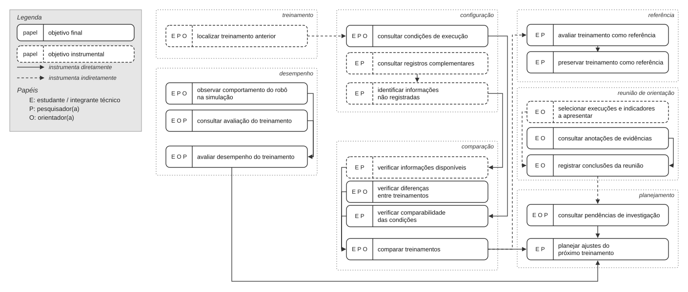

# Entrega 9 — Modelo conceitual e design centrado na comunicação

**Data:** 06/11/2026
**Status:** 🟨 em andamento
**Responsabilidade:** soluções individuais, com consolidação da equipe para mapa de objetivos e esquema de signos.

## Objetivo da atividade

Passar do cenário de problema para uma concepção da interação, explicitando objetivos, tópicos de conversa, falas e signos que a interface deverá comunicar/manipular.

## Transformando resultados técnicos em conceitos compreensíveis

Em TCCs algorítmicos ou orientados a dados, esta entrega deve evitar que a interface exponha apenas estruturas internas do código. Identifique os **conceitos e signos que fazem sentido para o usuário**.

Exemplos:

- `query plan`, custo estimado, recomendação e impacto para um DBA;
- modelo, dataset, versão, execução e métrica para engenheiro de IA;
- período, indicador, grupo, tendência e filtro para gestor/analista;
- alerta, severidade, evidência, responsável e status para analista de segurança.

Se um termo técnico for necessário, modele como será comunicado, explicado e relacionado à tarefa.

Dashboards, relatórios, filtros e CRUDs devem aparecer no modelo conceitual por meio dos **objetivos, signos e conversas** que justificam sua existência.

# 1. Cenários de interação

## CI01 Análise do desempenho do robô

**Autor(a):** Letizia Lowatzki Baptistella  22.125.063-2  
**Origem:** cenário problema C01  Análise de Performance do Robô.

### Cenário de interação

Rafael Martins, estudante e integrante técnico de uma equipe de robótica humanoide, está desenvolvendo e testando o comportamento de caminhada do robô para partidas de futebol. Após realizar um novo treinamento, ele precisa verificar se o resultado representa uma melhoria em relação aos experimentos anteriores e decidir quais ajustes devem ser realizados no próximo treinamento.
Durante o desenvolvimento, Rafael acompanha o resultado do treinamento por meio das métricas obtidas e da observação do comportamento do robô. Nessa análise, verifica a velocidade média, a distância percorrida, a taxa de quedas, a estabilidade durante o movimento e a localização do robô. **Na interface, ele consulta essas informações relacionadas à execução selecionada, podendo observar os indicadores e o comportamento correspondente do robô na simulação.**
Antes de executar um treinamento, Rafael e a equipe definem metas de desempenho relacionadas à distância percorrida, à velocidade, à frequência de quedas e ao equilíbrio do robô, pois, para conseguir marcar gols, o robô precisa caminhar de forma estável durante a partida. **A interface permite consultar essas metas durante a avaliação, para que Rafael considere os resultados em relação ao desempenho esperado pela equipe.**
Rafael realiza ajustes nos parâmetros da caminhada e observa uma melhora na velocidade. Apesar disso, o robô permanece menos tempo equilibrado, percorre uma distância maior, mas cai com frequência. O resultado, portanto, não representa necessariamente uma melhoria na capacidade de caminhar. **Ao consultar os indicadores em conjunto, Rafael consegue analisar quais aspectos apresentaram melhora e quais apresentaram piora, evitando considerar apenas uma métrica isolada.**
Para entender melhor o que aconteceu, Rafael compara as métricas e as configurações utilizadas anteriormente. **Ele consulta os resultados e os parâmetros de treinamentos anteriores que possam servir de referência, relacionando as diferenças encontradas às alterações realizadas na caminhada.**
**Durante a comparação, Rafael verifica se as informações disponíveis permitem relacionar as execuções. Quando faltam dados sobre algum treinamento, ele precisa considerar essa limitação antes de concluir quais alterações podem ter influenciado o desempenho.**
Ao final da análise, Rafael considera o conjunto das métricas e o comportamento observado para decidir se mantém os parâmetros utilizados ou realiza novos ajustes no próximo treinamento. **Dessa forma, utiliza os resultados das execuções anteriores como apoio para definir os próximos experimentos.**
A análise é realizada durante os ciclos de desenvolvimento do robô, em um computador utilizado para executar os treinamentos. Como novos treinamentos são realizados a partir dos resultados anteriores, uma interpretação incorreta pode levar Rafael e a equipe a escolher parâmetros inadequados para o próximo experimento, desperdiçando tempo computacional e prolongando os ciclos de desenvolvimento.

### Diferenças relevantes

| Alteração | Por que foi necessária | Evidência/artefato que justifica |
|---|---|---|
| Consulta conjunta das métricas e do comportamento visual | Permitir que Rafael relacione os valores ao comportamento do robô. | C01 refinado e Entrega 3, P01: necessidade de analisar diferentes métricas e relacioná-las ao comportamento observado. |
| Consulta das metas de desempenho | Dar contexto aos indicadores e permitir avaliar o resultado em relação ao que a equipe pretendia alcançar. | C01 refinado, questão Q8: metas de distância, velocidade, quedas e equilíbrio. |
| Análise conjunta dos indicadores | Evitar que uma melhora isolada seja interpretada como melhoria geral. | C01 refinado, questão Q1: considerar as informações em conjunto para avaliar o treinamento. |
| Comparação de treinamentos anteriores | Facilitar a identificação de diferenças entre métricas e configurações. | C01 refinado, questões Q4 e Q5: escolha de treinamentos de referência e comparação de resultados e configurações. |
| Consideração de informações ausentes | Evitar conclusões sem evidências suficientes para relacionar os resultados às configurações. | Entrega 3, P01: informações distribuídas entre execuções; C01: necessidade de consultar e relacionar resultados anteriores. |
| Utilização dos resultados para decidir novos ajustes | Apoiar a escolha dos parâmetros do próximo treinamento. | C01 refinado, questão Q7: decidir se mantém os parâmetros ou realiza novos ajustes. |

## CI02 Recuperação da configuração de um treinamento anterior

**Autor(a):** Manuella Filipe Peres 22.224.029-3  
**Origem:** cenário problema C02 Recuperação da configuração de um treinamento anterior.

### Cenário de interação

Marina Oliveira, pesquisadora de robótica, está investigando diferentes estratégias utilizadas para melhorar a caminhada de um robô humanoide em simulação. Durante sua pesquisa, ela analisa resultados de treinamentos anteriores para compreender como as alterações nos parâmetros influenciam o comportamento do robô e identificar experimentos que possam servir de referência para novas investigações.
Após consultar resultados recentes que não apresentaram melhorias significativas, Marina se lembra de um treinamento realizado algumas semanas antes, no qual o robô percorreu uma distância maior e apresentou menor frequência de quedas. Ela decide investigar esse experimento para compreender quais configurações contribuíram para o resultado obtido.
**Para localizar o treinamento, Marina consulta os registros das execuções e examina os arquivos de métricas disponíveis, procurando identificar o experimento que apresentou os resultados que deseja investigar.**
Para isso, Marina precisa identificar os parâmetros utilizados naquela execução. Entretanto, os parâmetros são configurados diretamente no código antes dos treinamentos, e diferentes alterações foram realizadas desde então. Ao consultar a pasta do experimento, ela encontra o modelo salvo e algumas anotações da equipe, mas essas informações não reúnem todos os valores utilizados na configuração original.
**Na interface, Marina consulta as informações disponíveis sobre a execução selecionada, incluindo os resultados, os parâmetros registrados e as observações associadas ao experimento. Quando necessário, ela também precisa consultar os arquivos de configuração e o histórico do código para recuperar informações que não estejam reunidas nos registros da execução.**
**Quando algum parâmetro não está disponível, a interface indica que a informação não foi registrada, sem apresentar um valor presumido. Assim, Marina consegue distinguir os dados recuperados daqueles que ainda precisam ser investigados.**
Marina procura relacionar os resultados do treinamento anterior aos das execuções recentes, mas encontra dificuldades para confirmar se os experimentos foram realizados nas mesmas condições. **Para verificar se os resultados podem ser comparados, ela consulta as informações disponíveis sobre os parâmetros, as configurações e as condições de execução. Quando os registros não são suficientes, precisa buscar esclarecimentos com os integrantes responsáveis pelos experimentos.**
Sem essa confirmação, Marina não consegue determinar com segurança quais alterações podem ter influenciado as diferenças observadas no desempenho do robô. **Quando não consegue confirmar as configurações utilizadas, ela avalia se o treinamento pode ser utilizado como referência ou se será necessário obter informações adicionais ou realizar uma nova execução.**
**Depois de identificar o experimento relevante, Marina pretende manter suas informações como referência e backup para avaliar, após novos ajustes, se o desempenho do robô melhorou ou piorou.**
Essa situação facilita a interpretação dos resultados e reduz a dependência da busca manual por informações distribuídas entre diferentes arquivos e registros, apoiando a escolha de experimentos anteriores como referência para novas investigações.

### Diferenças relevantes

| Alteração | Por que foi necessária | Evidência/artefato que justifica |
|---|---|---|
| Consulta aos registros e arquivos de métricas para localizar uma execução | Representar como Marina identifica o treinamento que deseja investigar. | C02 refinado, questão Q1: localização do treinamento entre pastas e arquivos de métricas. |
| Consulta das configurações e dos registros associados à execução | Permitir recuperar os parâmetros utilizados sem depender apenas das anotações. | C02 refinado, questão Q2: informações incompletas nas anotações e necessidade de consultar arquivos de configuração e histórico do código. |
| Identificação de parâmetros não registrados | Evitar que informações ausentes sejam tratadas como conhecidas. | C02 refinado, questão Q2: as anotações nem sempre apresentam todos os parâmetros. |
| Consulta das condições dos experimentos | Verificar se diferentes treinamentos podem ser comparados. | C02 refinado, questão Q3: necessidade de verificar se os experimentos foram realizados em condições comparáveis. |
| Busca de esclarecimentos com integrantes da equipe | Permitir recuperar informações que não estão disponíveis nos registros consultados. | C02 refinado, questões Q3 e Q4: necessidade de consultar os responsáveis pelos treinamentos e pelas alterações. |
| Avaliação sobre utilizar o treinamento como referência ou realizar nova execução | Representar a decisão tomada quando não é possível confirmar as configurações. | C02 refinado, questão Q5: avaliar se o experimento pode ser utilizado como referência ou se são necessárias informações adicionais ou nova execução. |
| Preservação das informações do experimento como referência e backup | Apoiar a comparação com treinamentos posteriores e a recuperação do contexto da pesquisa. | C02 refinado, questão Q7: utilização do treinamento como referência e manutenção das informações como backup. |

## CI03   Avaliação de treinamentos em reunião de orientação

**Autor(a):** Rafaela Altheman de Campos 22.125.062-4  
**Origem:** cenário problema C03 Avaliação de treinamentos em reunião de orientação.

### Cenário de interação

Carlos Almeida, professor e orientador de uma equipe universitária de robótica humanoide, acompanha o desenvolvimento da caminhada de um robô projetado para jogar futebol. Como não participa diretamente de todos os treinamentos, utiliza as reuniões com os estudantes para compreender os resultados obtidos e orientar as próximas etapas do desenvolvimento.
**Antes da reunião, a estudante responsável pela apresentação seleciona os resultados que pretende discutir com Carlos. A interface permite consultar as informações das execuções e organizar os indicadores relevantes para a apresentação, considerando o tempo disponível para a discussão.**
Durante uma reunião de acompanhamento, uma estudante apresenta os resultados de um treinamento recente. O gráfico da recompensa indica um aumento em relação à execução anterior, sugerindo inicialmente uma possível melhoria. Entretanto, Carlos precisa compreender se essa evolução numérica corresponde a um avanço real no comportamento do robô.
**Para avaliar o treinamento, Carlos consulta a recompensa em conjunto com outros indicadores, como distância percorrida, velocidade, estabilidade e frequência de quedas. Também pode relacionar esses resultados ao comportamento do robô durante a simulação.**
Para isso, pergunta qual foi a distância percorrida, quantas quedas ocorreram e quais alterações foram realizadas em comparação ao treinamento anterior. **Quando precisa investigar algum resultado, Carlos consulta as informações da execução, incluindo os arquivos de métricas, as anotações da equipe e a visualização do robô no simulador, sem depender apenas do gráfico apresentado inicialmente.**
Ao observar o comportamento do robô, Carlos percebe que ele permanece equilibrado durante parte da execução, mas apresenta pouco deslocamento. Dessa forma, o aumento da recompensa não representa necessariamente uma melhoria na capacidade de caminhar. **A consulta conjunta dos indicadores e do comportamento observado permite que Carlos e a estudante discutam as diferenças entre o resultado numérico e o desempenho apresentado pelo robô.**
Como algumas informações precisam ser recuperadas e comparadas durante a reunião, a equipe encontra dificuldades para concluir a avaliação no tempo disponível. **As conclusões discutidas durante o acompanhamento podem ser registradas nas anotações compartilhadas do projeto, incluindo os problemas identificados, os pontos que exigem investigação e os próximos ajustes propostos.**
Ao final da discussão, Carlos utiliza as informações apresentadas para orientar a equipe sobre quais aspectos precisam ser investigados e quais ajustes podem ser considerados nos próximos treinamentos. **Caso a avaliação não possa ser concluída, a equipe identifica quais informações ainda precisam ser analisadas antes de definir os próximos ajustes.**
Dessa forma, a reunião consegue se concentrar na interpretação dos resultados e na definição dos próximos passos, reduzindo o tempo gasto para recuperar informações e facilitando o acompanhamento da evolução do projeto.

### Diferenças relevantes

| Alteração | Por que foi necessária | Evidência/artefato que justifica |
|---|---|---|
| Seleção prévia dos resultados para apresentação | Permitir que a estudante organize as informações relevantes antes da reunião. | C03 refinado, questões Q1 e Q3: preparação da apresentação e ausência de indicadores importantes. |
| Visão conjunta dos principais indicadores | Permitir que Carlos avalie o desempenho sem depender apenas da recompensa. | C03 refinado, questão Q2: considerar distância, velocidade, estabilidade e frequência de quedas. |
| Relação entre indicadores e execução visual | Ajudar a interpretar se a evolução numérica corresponde à melhoria real da caminhada. | C03 refinado, questões Q2 e Q4: relacionar métricas ao comportamento observado e questionar resultados aparentemente positivos. |
| Consulta dos detalhes durante a reunião | Permitir investigar dúvidas sem depender da busca manual em diferentes arquivos e registros. | C03 refinado: necessidade de consultar arquivos de métricas, anotações e simulador durante a reunião. |
| Registro das conclusões e orientações | Preservar os pontos discutidos para apoiar as atividades posteriores da equipe. | C03 refinado, questão Q5: registrar problemas, pontos que exigem investigação e próximos ajustes nas anotações compartilhadas do projeto. |
| Identificação de pontos que exigem análise complementar | Evitar decisões precipitadas quando a avaliação não pode ser concluída durante a reunião. | C03 refinado, questão Q6: adiamento da decisão e impacto no planejamento dos próximos treinamentos. |

# 2. Design centrado na comunicação

## CI01   Análise do desempenho do robô

| Tópico > subtópico | Falas e signos envolvidos | Intenção/efeito esperado |
|---|---|---|
| Avaliar desempenho | `U: Quero verificar se o treinamento melhorou a caminhada do robô.` / `D: Consulte os indicadores e o comportamento do robô nesta execução.` | Permitir uma avaliação baseada em diferentes informações. |
| > Consultar métricas | `U: Quero analisar a velocidade, a distância, as quedas e a estabilidade.` / `D: Estes são os indicadores registrados para esta execução.` | Apresentar os principais indicadores do treinamento. |
| > Observar comportamento | `U: Quero verificar como o robô se comportou durante a execução.` / `D: Consulte a visualização correspondente ao treinamento.` | Relacionar resultados quantitativos ao comportamento observado. |
| Consultar metas | `U: Quero verificar se o resultado atingiu o que a equipe esperava.` / `D: Estas são as metas de distância, velocidade, quedas e equilíbrio definidas para o treinamento.` | Relacionar a avaliação aos objetivos definidos pela equipe. |
| Comparar treinamentos | `U: Quero comparar esta execução com uma anterior.` / `D: Consulte os resultados e as configurações das execuções que deseja comparar.` | Permitir identificar diferenças entre experimentos. |
| > Verificar diferenças | `U: O que mudou entre os treinamentos?` / `D: Consulte as diferenças entre as métricas e os parâmetros disponíveis.` | Relacionar alterações de configuração aos resultados. |
| > Considerar informações disponíveis | `U: Tenho informações suficientes para comparar estas execuções?` / `D: Verifique os registros disponíveis para cada treinamento e considere os dados que não foram registrados.` | Comunicar limitações e evitar conclusões sem evidência suficiente. |
| Planejar ajustes | `U: Quero decidir o que devo ajustar no próximo treinamento.` / `D: Considere o conjunto das métricas, o comportamento observado e as diferenças entre as execuções.` | Apoiar a decisão sobre novos experimentos. |

## CI02   Recuperação da configuração de um treinamento anterior

| Tópico > subtópico | Falas e signos envolvidos | Intenção/efeito esperado |
|---|---|---|
| Recuperar treinamento | `U: Quero encontrar um treinamento realizado anteriormente.` / `D: Consulte os registros e os arquivos das execuções disponíveis.` | Facilitar a localização de uma execução. |
| > Localizar execução | `U: Quero encontrar o treinamento que apresentou menor frequência de quedas.` / `D: Consulte os arquivos de métricas para identificar a execução com esse resultado.` | Ajudar a identificar o experimento desejado. |
| Consultar resultados | `U: Quero verificar o desempenho desse treinamento.` / `D: Estes são os resultados registrados para a execução selecionada.` | Apresentar os indicadores relacionados ao experimento. |
| Recuperar configurações | `U: Quero saber quais parâmetros foram utilizados.` / `D: Consulte as configurações e os registros disponíveis para esta execução.` | Permitir recuperar o contexto técnico do treinamento. |
| > Consultar registros complementares | `U: Quero verificar se existem outras informações sobre essa configuração.` / `D: Consulte as anotações da equipe, os arquivos de configuração e o histórico do código.` | Orientar a recuperação de informações distribuídas entre diferentes registros. |
| > Identificar dados ausentes | `U: Por que não aparece o valor deste parâmetro?` / `D: Esta informação não está disponível nos registros consultados.` | Comunicar ausência de informação sem presumir valores. |
| Comparar execuções | `U: Quero comparar esse treinamento com outro mais recente.` / `D: Consulte as métricas, os parâmetros e as condições disponíveis para cada execução.` | Facilitar a identificação de diferenças entre experimentos. |
| > Verificar condições | `U: Os treinamentos foram realizados nas mesmas condições?` / `D: Verifique as informações disponíveis. Quando os registros não forem suficientes, será necessário buscar esclarecimentos com os responsáveis pelos experimentos.` | Evitar comparações inadequadas. |
| Avaliar referência | `U: Posso utilizar esse treinamento como referência?` / `D: Considere as configurações e as condições registradas. Se faltarem informações, avalie a necessidade de obter dados adicionais ou realizar uma nova execução.` | Apoiar a decisão sobre a confiabilidade do experimento como referência. |
| Preservar informações | `U: Quero manter esse treinamento como referência para minha pesquisa.` / `D: Mantenha os registros disponíveis associados à identificação do experimento para consultas futuras.` | Apoiar novas investigações e a recuperação do experimento. |

## CI03 Avaliação de treinamentos em reunião de orientação

| Tópico > subtópico | Falas e signos envolvidos | Intenção/efeito esperado |
|---|---|---|
| Preparar apresentação | `U: Quero apresentar os resultados mais relevantes do treinamento.` / `D: Consulte a execução e selecione os indicadores que serão discutidos na reunião.` | Organizar as informações para a reunião. |
| Consultar visão geral | `U: Quero entender rapidamente como foi o desempenho.` / `D: Consulte os principais indicadores registrados para esta execução.` | Facilitar a leitura geral pelo orientador. |
| > Analisar métricas | `U: A recompensa aumentou. Isso significa que a caminhada melhorou?` / `D: A recompensa deve ser analisada junto à distância, velocidade, estabilidade e frequência de quedas.` | Evitar conclusões baseadas em uma única métrica. |
| > Observar execução | `U: Quero ver como o robô se comportou.` / `D: Consulte a visualização da execução correspondente no simulador.` | Relacionar os indicadores ao comportamento do robô. |
| Comparar resultados | `U: Como esse treinamento se compara ao anterior?` / `D: Consulte as diferenças entre os indicadores e as configurações das execuções.` | Apoiar a discussão sobre a evolução do treinamento. |
| Consultar detalhes | `U: Quero entender quais alterações foram realizadas.` / `D: Consulte os parâmetros e as informações registradas para cada execução.` | Permitir aprofundamento quando surgirem dúvidas. |
| Registrar orientação | `U: Quero guardar os pontos discutidos para a equipe.` / `D: Registre os problemas identificados, os pontos que precisam de investigação e os próximos ajustes nas anotações compartilhadas do projeto.` | Preservar as decisões da reunião. |
| Planejar próximos passos | `U: O que ainda precisamos investigar antes de iniciar outro treinamento?` / `D: Consulte os pontos identificados durante a reunião e as informações que ainda precisam ser verificadas.` | Apoiar o planejamento dos próximos experimentos. |

**Convenção:** `U` = usuário; `D` = preposto do designer/sistema, conforme a abordagem de Engenharia Semiótica adotada na disciplina.

## 3. Mapa de objetivos

Cada integrante apresenta seu mapa e a equipe cria um **mapa consolidado**, eliminando duplicidades e resolvendo conflitos de nomenclatura.

### Dicionário de objetivos

| ID | Objetivo | Persona(s) | Cenário(s) | Prioridade |
|---|---|---|---|---|
| O01 | {{...}} | {{P01}} | {{CI01}} | {{...}} |

## 4. Esquema conceitual de signos

Consolide as informações em **uma tabela única**.

| Grupo | Signo | Origem | Observações/semântica | Tipo de conteúdo | Restrição | Valor padrão | Prevenção | Recuperação |
|---|---|---|---|---|---|---|---|---|
| Credenciais | usuário | domínio | {{...}} | texto | não nulo | — | {{...}} | {{...}} |

### Regras para os signos

- Use o vocabulário do domínio do usuário.
- Evite duplicar o mesmo conceito com nomes diferentes.
- Diferencie informação fornecida pelo usuário, produzida pelo sistema e derivada do domínio.
- Registre prevenção e recuperação apenas quando fizer sentido; explique as siglas usadas.

## Síntese

Quais objetivos/tópicos/signos deverão necessariamente aparecer nos diagramas MoLIC?

## Checklist

- [ ] Cenários de interação mostram alterações em relação aos cenários de problema.
- [ ] Cada solução individual identifica autor e cenário de origem.
- [ ] Tópicos/falas/signos são coerentes com objetivos do usuário.
- [ ] Mapas individuais foram consolidados.
- [ ] O esquema de signos está em uma tabela única e sem duplicações conceituais.
- [ ] Nomes de objetivos/signos serão reutilizados na Entrega 10.
- [ ] Em TCC técnico, signos representam conceitos do domínio compreensíveis ao usuário, não apenas variáveis/estruturas internas.
- [ ] Padrões como dashboard, relatório, filtros, administração e CRUD possuem objetivos e signos correspondentes.
- [ ] A interface comunica não só o resultado técnico, mas também seu significado para a tarefa.
