# Entrega 11 — Protótipo no Figma

**Data:** 16/11/2026  
**Status:** em andamento  
**Responsabilidade:** 1 protótipo integrado por equipe cobrindo os fluxos MoLIC. Se a turma exigir divisão individual, identifique o responsável por cada fluxo/tela.

## Objetivo da atividade

Materializar o modelo de interação em um protótipo navegável, preservando a lógica dos objetivos, tópicos, signos, feedbacks, alternativas e recuperações definidos anteriormente.

## Biblioteca de possibilidades para projetos técnicos

O protótipo deve materializar os fluxos definidos nas entregas anteriores. Dependendo do escopo, podem fazer sentido:

1. **Dashboard:** indicadores, alertas, estado, tendências e atalhos para tarefas frequentes.
2. **Configuração/parametrização:** escolhas, presets, validação e explicação de opções técnicas.
3. **Entrada de dados:** upload, conexão, seleção, pré-visualização e validação.
4. **Processamento:** fila, status, progresso, cancelamento, falha e reexecução.
5. **Relatório/resultados:** síntese, métricas, gráficos, explicação, exportação e compartilhamento.
6. **Histórico:** busca, filtros, ordenação, paginação, detalhes e repetição de execução.
7. **Comparação:** antes/depois, modelo A/B, execução A/B, baseline ou períodos.
8. **Explicabilidade:** confiança, fatores, evidências, limitações e correção/contestação.
9. **Administração:** usuários, grupos, perfis, permissões, integrações e políticas.
10. **CRUDs de domínio:** somente quando criar/consultar/editar/excluir representa tarefa real.
11. **Auditoria/logs:** histórico de alterações e eventos em linguagem adequada.
12. **Alertas/ocorrências:** severidade, impacto, ação, responsável e resolução.
13. **Ajuda/documentação:** apoio contextual a tarefas complexas.

### Estados que não podem ser esquecidos

Quando aplicável, considere: vazio/sem dados; carregamento/processamento; sucesso; erro de entrada; erro de processamento; filtro sem resultados; permissão insuficiente; confirmação de ação destrutiva; cancelamento/desfazer/recuperação; dados desatualizados/conflito.

> Esta lista é repertório de design, **não uma exigência de quantidade de telas**. A rastreabilidade deve explicar por que cada tela existe.

## Link do Figma

**Protótipo:** [{{Prototipo}}](https://www.figma.com/proto/qHpoJxQF4Sthdy99w7Scul/IHC?node-id=32-2023&t=MJOhlZgAfoJJp8Dt-1&scaling=min-zoom&content-scaling=fixed&page-id=0%3A1&starting-point-node-id=32%3A2023)  
**Arquivo editável:** [{{Projeto}}](https://www.figma.com/design/qHpoJxQF4Sthdy99w7Scul/IHC?node-id=0-1&t=Lsz7doMdhB6yaEhp-1)  
**Última verificação de permissão:** 16/11/2026

> Teste o link em janela anônima. O avaliador deve conseguir abrir o protótipo sem solicitar permissão.

## Cobertura MoLIC → Figma

| MoLIC | Objetivo | Fluxo/telas no Figma | Estados de erro/recuperação | Responsável |
|---|---|---|---|---|
| M01 | O01 | F02 → F03 | F02E/F27 → F02 | Letizia |
| M01 | O02 | F08 → F30/F61 → F08 | Retorno à avaliação; evidência indisponível quando aplicável | Letizia |
| M01 | O03 | F02 → F08 | — | Letizia |
| M01 | O04 | F08 → F09 | Revisar classificação ou tentar salvar novamente | Letizia |
| M01 | O07 | F23 → F24 | Confirmar envio incompleto ou revisar arquivos | Letizia |
| M01 | O08 | F03 → F04 → F05 | F36 — informações não registradas | Letizia |
| M01 | O09 | F03 → F04 | F05 — limitações das condições | Letizia |
| M01 | O11 | F02 → F03 → F04 → F05 | F02E/F27 — busca sem resultados; F36 — dados ausentes | Letizia |
| M01 | O17 | F09 → F12 | Revisar a proposta de próximo ajuste | Letizia |
| M01 | O18 | F23 → F24 | Revisar arquivos ou confirmar envio incompleto | Letizia |
| M02 | O01 | F02 → F03 | F02E/F27 → F02 | Manuella |
| M02 | O05 | F02 → F03 → F04 | F36 — condições não registradas | Manuella |
| M02 | O06 | F04 → F36 | Consultar fontes externas quando necessário | Manuella |
| M02 | O07 | F04 → F36 | Informação não registrada; consultar fontes complementares | Manuella |
| M02 | O08 | F03 → F04 → F05 | F36 — informações insuficientes | Manuella |
| M02 | O09 | F03 → F04 | F05 — condições não confirmadas | Manuella |
| M02 | O10 | F04 → F05 | F36 — investigar informações ausentes | Manuella |
| M02 | O11 | F02 → F03 → F04 → F05 | F02E/F27 — busca sem resultados; F36 — dados ausentes | Manuella |
| M02 | O12 | F05 → F06 → F07 → F10 | Registrar ressalvas ou manter decisão pendente | Manuella |
| M03 | O02 | F15 → F48 → F15 | Retornar à apresentação no mesmo ponto | Rafaela |
| M03 | O09 | F15 → F04 | Registrar limitações da comparação | Rafaela |
| M03 | O11 | F15 → F04  | Condições não confirmadas; retorno à apresentação | Rafaela |
| M03 | O13 | F14 → F01 → F15 | Revisar seleção; P10 — período sem dados | Rafaela |
| M03 | O14 | F15 → F20 | Consultar registros e pendências disponíveis | Rafaela |
| M03 | O15 | F18 → F21 | F18 → F43 → F18 | Rafaela |
| M03 | O16 | F18 → F20 → F21 | Manter pendências registradas | Rafaela |
| M03 | O17 | F18 → F12 → F20 | Revisar o próximo ajuste proposto | Rafaela |

## Catálogo de telas/estados

### F01 - Painel geral

Objetivo do usuário: Obter uma síntese do desempenho e selecionar um período para analisar resultados.  
Signos principais: período selecionado, velocidade média, distância, taxa de quedas, estabilidade, gráfico de evolução, pontos de atenção, abrir evidência.  
Origem no MoLIC: M01/O02 e M03/O13.  

### F02 — Histórico — localizar treinamento

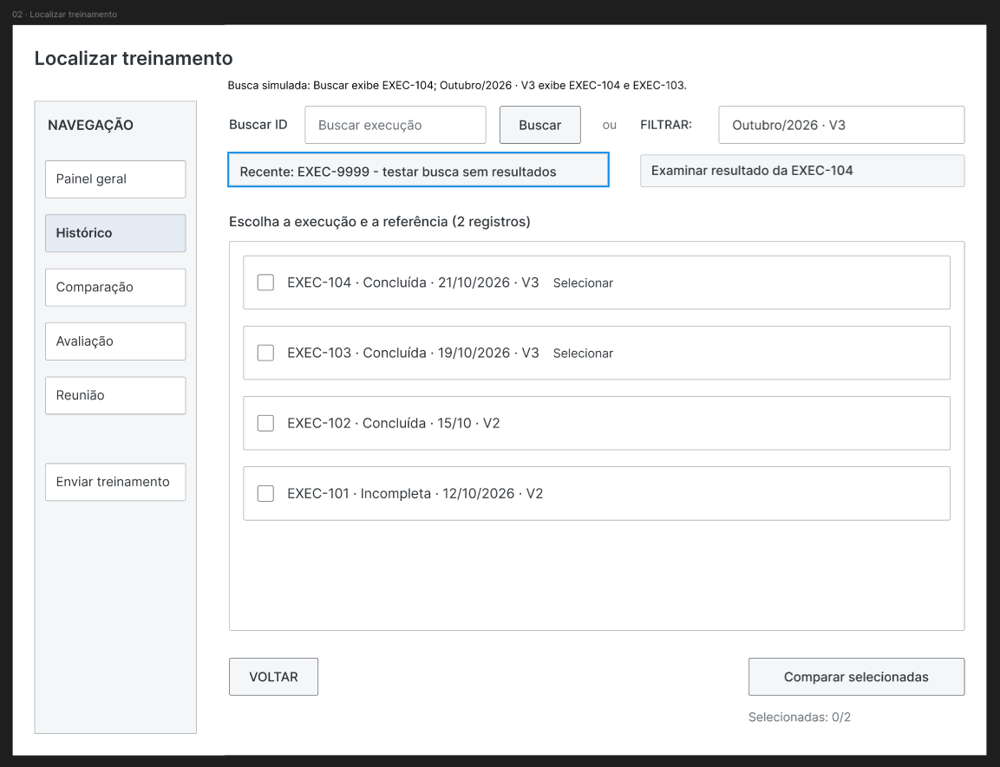

Objetivo do usuário: Localizar uma execução por identificador ou filtro e selecionar treinamentos anteriores.  
Signos principais: busca por ID, período/versão, estado concluída/incompleta, comparar selecionadas.  
Origem no MoLIC: M01/O01 e M02/O01.  

### F02E — Histórico sem resultados

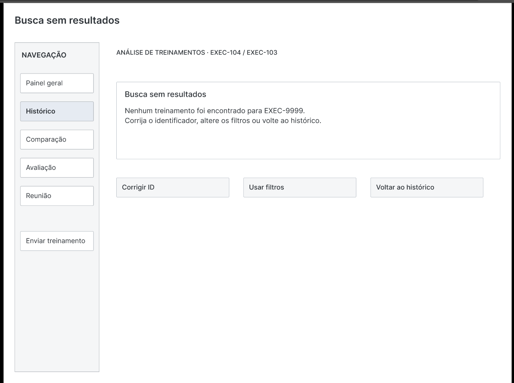

Objetivo do usuário: Perceber que a busca não retornou resultados e revisar seus critérios.  
Signos principais: ID pesquisado, nenhum resultado, corrigir busca, revisar filtros, voltar ao histórico.  
Origem no MoLIC: M01/O01 e M02/O01 (recuperação).  

### F03 — Seleção de execuções

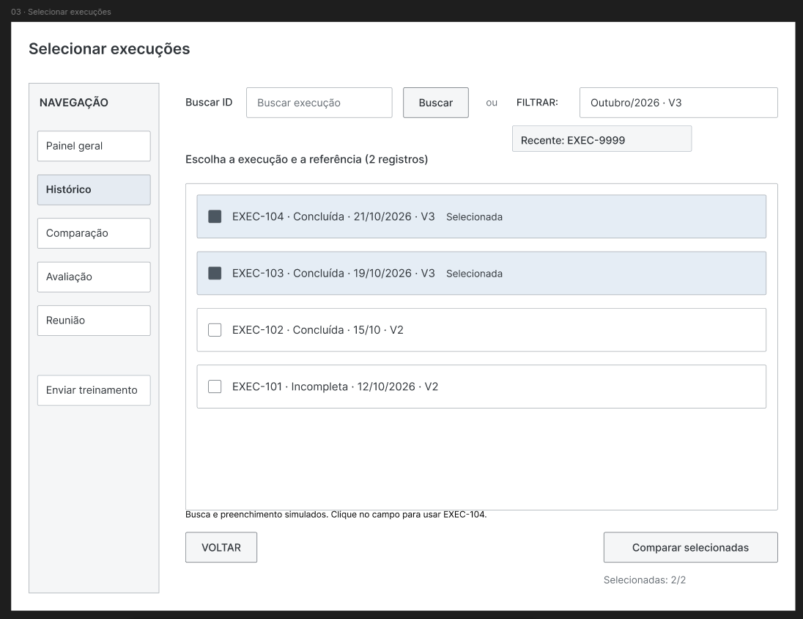

Objetivo do usuário: Conferir as execuções escolhidas antes de compará-las.  
Signos principais: execuções selecionadas, identificadores e versões, quantidade selecionada, ação de comparação.  
Origem no MoLIC: M01/O09 e M02/O09.  

### F04 — Comparação de métricas e parâmetros

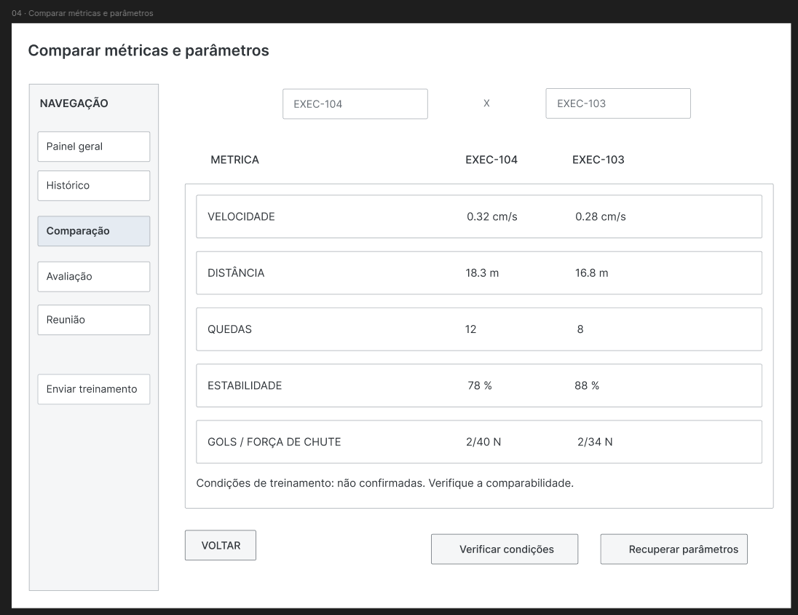

Objetivo do usuário: Comparar resultados e parâmetros associados a dois treinamentos.  
Signos principais: EXEC-104, EXEC-103, velocidade, unidades, métricas comparadas, condições de treinamento, diferenças.  
Origem no MoLIC: M01/O11 e M02/O11.   

### F05 — Verificar comparabilidade

Objetivo do usuário: Identificar se há informações suficientes para considerar duas execuções comparáveis.  
Signos principais: condições não confirmadas, parâmetros, ressalvas, comparação.  
Origem no MoLIC: M01/O11 e M02/O11.   

### F06 — Registrar hipótese e ressalvas

Objetivo do usuário: Registrar uma interpretação preliminar e suas limitações, vinculadas às execuções comparadas.  
Signos principais: hipótese, ressalvas, execuções de referência, salvar, voltar.  
Origem no MoLIC: M02/O12.  

### F07 — Conferir hipótese registrada

Objetivo do usuário: Confirmar que a hipótese e as ressalvas foram registradas e vinculadas às execuções comparadas.  
Signos principais: hipótese salva, EXEC-104, EXEC-103, confirmação do registro, retorno à comparação.  
Origem no MoLIC: M02/O12 (feedback).  

### F08 — Avaliação de desempenho

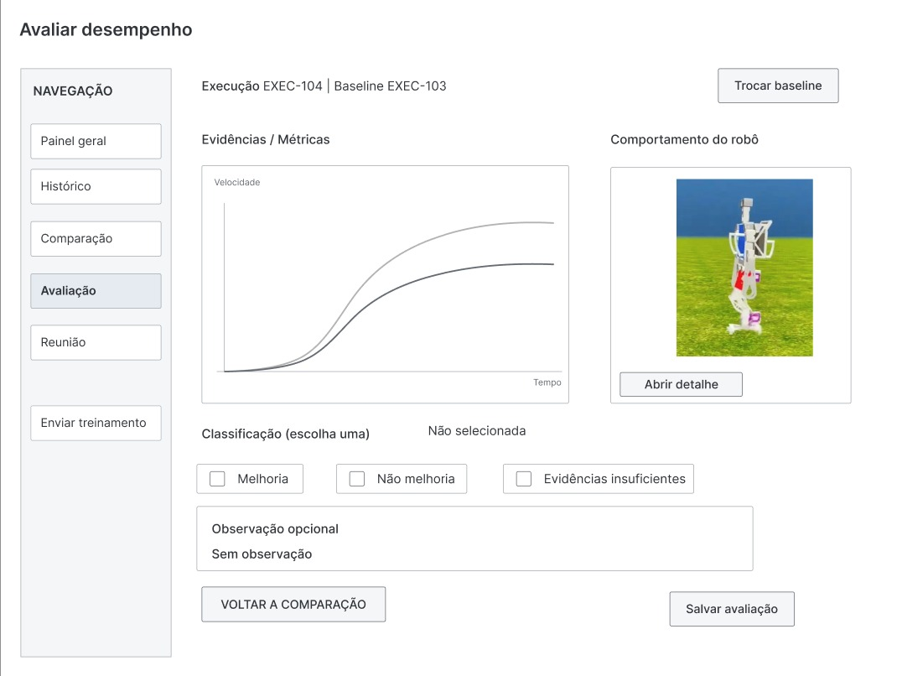

Objetivo do usuário: Avaliar se o resultado representa melhora efetiva e justificar a classificação.  
Signos principais: métricas do treinamento, classificação, observação, evidências, salvar avaliação.  
Origem no MoLIC: M01/O04.  

### F09 — Conferir avaliação registrada

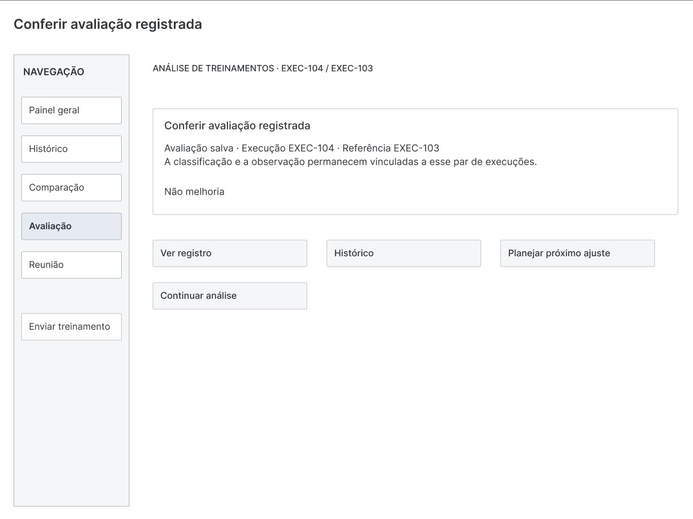

Objetivo do usuário: Receber confirmação e conferir qual execução foi avaliada.  
Signos principais: avaliação salva, execução, classificação, observação, confirmação.  
Origem no MoLIC: M01/O04 (feedback).  

### F10 — Avaliar treino como referência

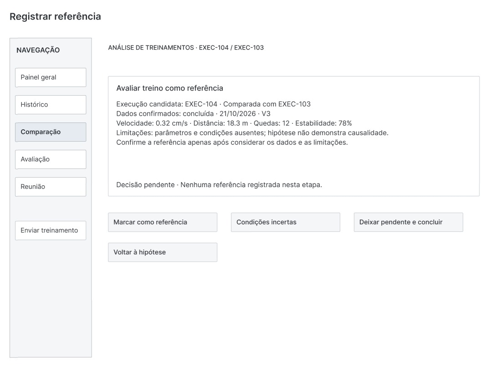

Objetivo do usuário: Decidir se a execução anterior pode ser usada como referência ou se é necessário investigar limitações.  
Signos principais: execução de referência, comparabilidade, limitações, decisão.  
Origem no MoLIC: M02/O12.  

### F12 — Próximo ajuste

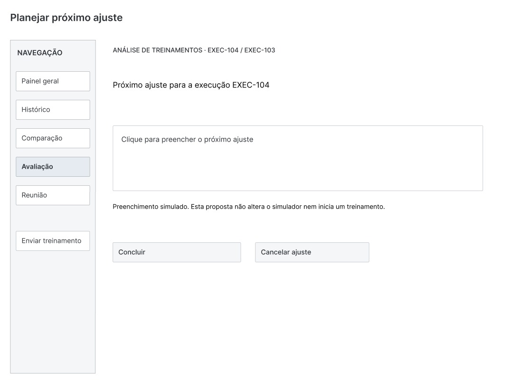

Objetivo do usuário: Registrar ou consultar os pontos que deverão orientar uma investigação posterior.  
Signos principais: próximo ajuste, observação, execução associada, registrar.  
Origem no MoLIC: M01/O17 e M03/O17.  

### F14 — Preparar conversa para reunião

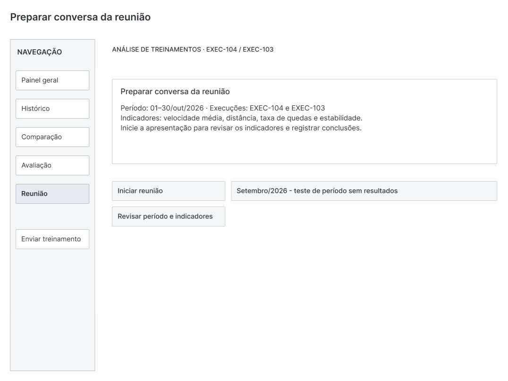

Objetivo do usuário: Selecionar o contexto e as informações a apresentar na reunião.  
Signos principais: execução, indicadores selecionados, reunião, iniciar apresentação.  
Origem no MoLIC: M03/O13.  

### F15 — Apresentar indicadores — reunião

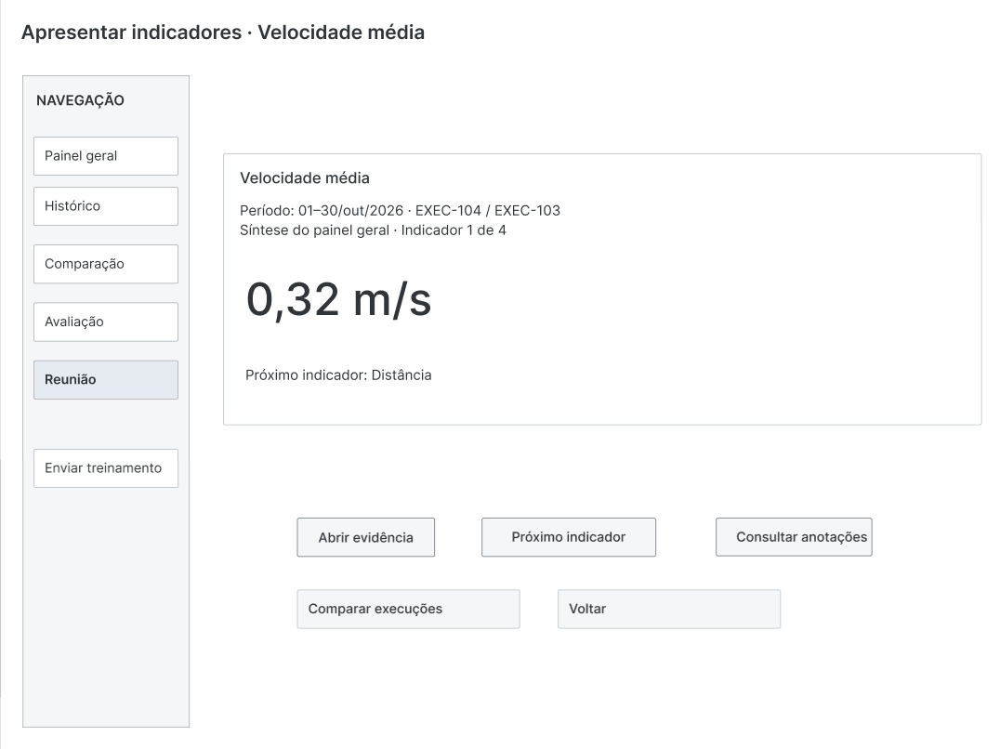

Objetivo do usuário: Explicar indicadores à equipe durante a apresentação e acessar evidências.  
Signos principais: indicador atual, velocidade média, execução, abrir evidência, próximo indicador.  
Origem no MoLIC: M03/O13, O02.  

### F18 — Registrar conclusões e orientações

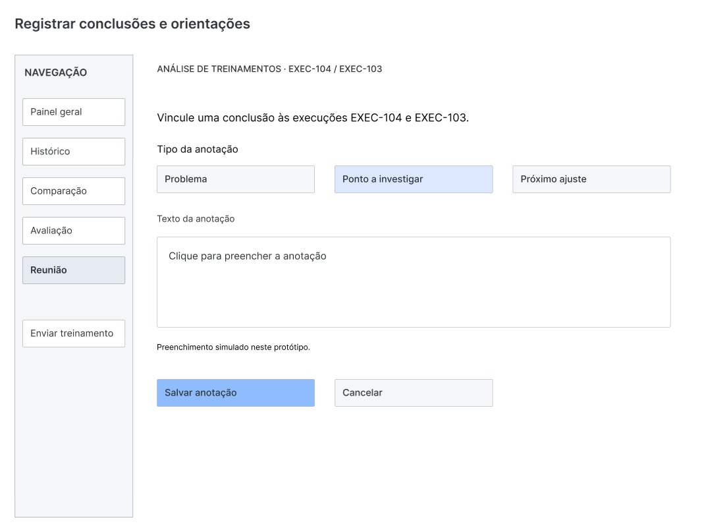

Objetivo do usuário: Registrar conclusões discutidas na reunião e os próximos pontos de investigação.  
Signos principais: conclusão, anotação, orientação, próximo ajuste, salvar.  
Origem no MoLIC: M03/O15 e O17.  

### F20 — Consultar pendências de investigação

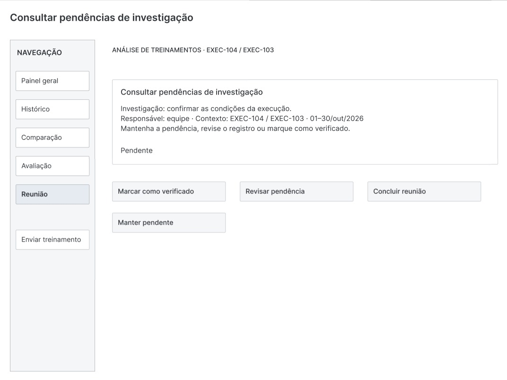

Objetivo do usuário: Consultar os assuntos que continuam sem resposta ao fim da análise.  
Signos principais: pendências, descrição, situação, investigação, responsável se registrado.  
Origem no MoLIC: M03/O16.  

### F21 — Reunião concluída

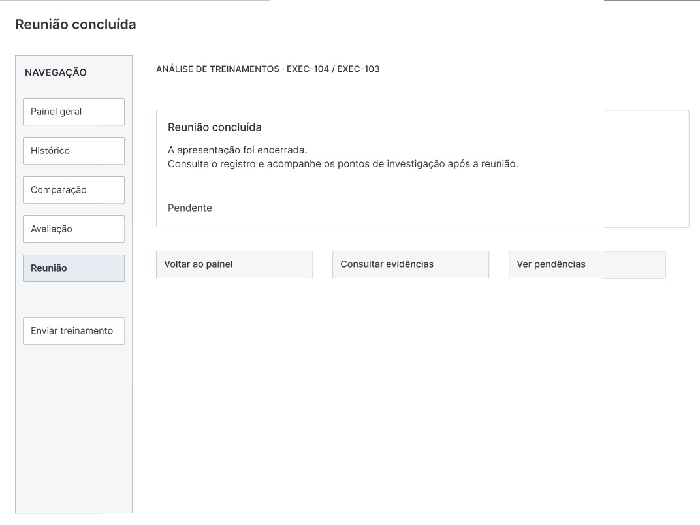

Objetivo do usuário: Identificar que o registro da reunião foi concluído e compreender o próximo passo.  
Signos principais: confirmação, conclusão da reunião, pendências, retorno.  
Origem no MoLIC: M03/O15 (feedback).  

### F23 — Enviar treinamento

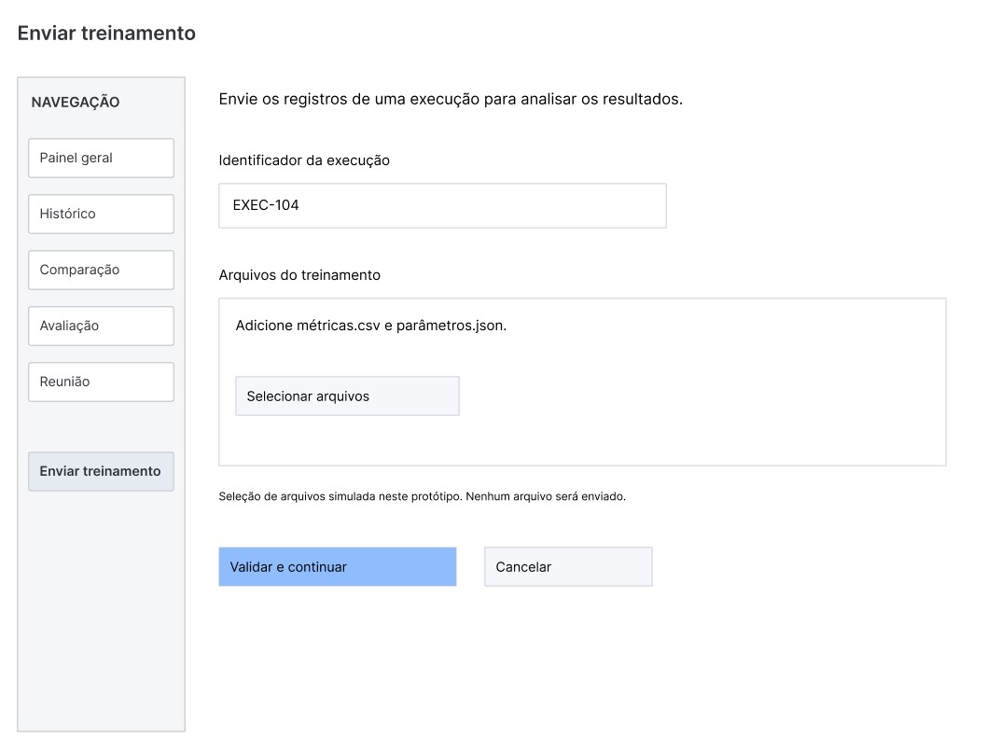

Objetivo do usuário: Incluir arquivos ou registros de uma execução de treinamento realizada fora da interface.  
Signos principais: arquivos, identificação de treinamento, envio, seleção de arquivo.  
Origem no MoLIC: M01/O18.  

### F24 — Confirmar envio incompleto

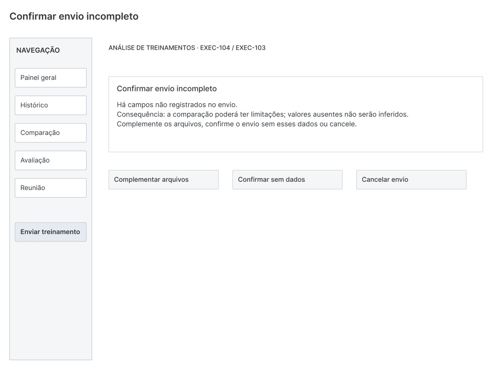

Objetivo do usuário: Reconhecer que o envio não contém todos os dados e escolher como prosseguir.  
Signos principais: arquivos ausentes, confirmação, enviar incompleto, revisar.  
Origem no MoLIC: M01/O18 (ressalva/recuperação).  

### F27 — Busca sem resultado

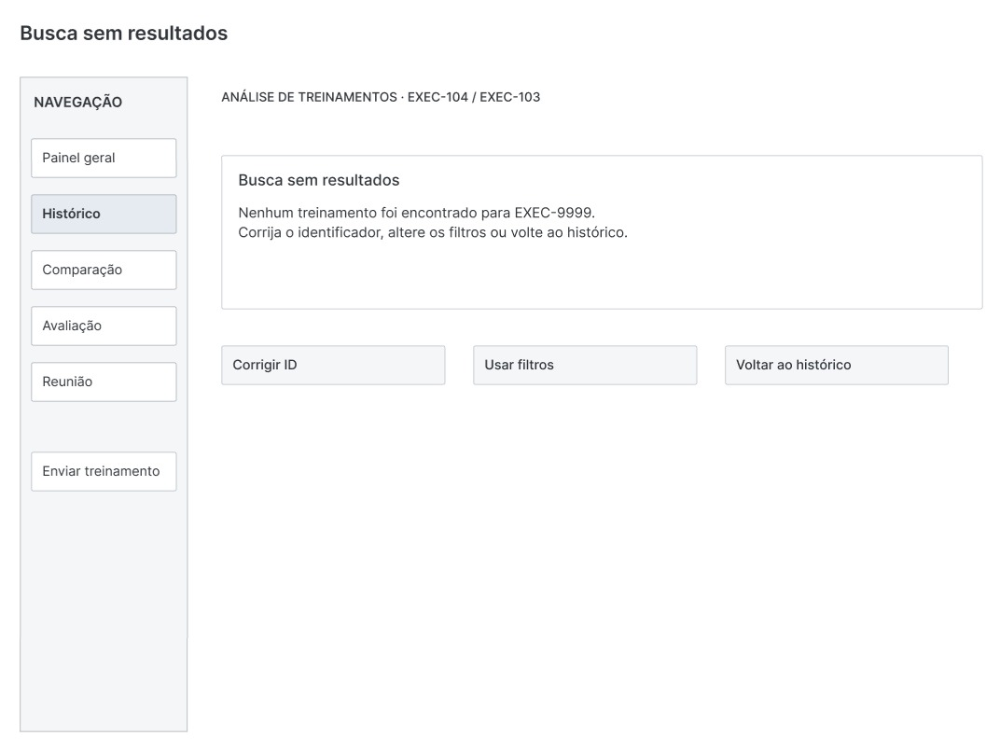

Objetivo do usuário: Recuperar-se de uma pesquisa sem correspondência e refinar a localização da execução.  
Signos principais: busca, ID, nenhum resultado, corrigir ID, filtros, voltar.  
Origem no MoLIC: M02/O01 (recuperação).  

### F30 — Observar evidência — análise

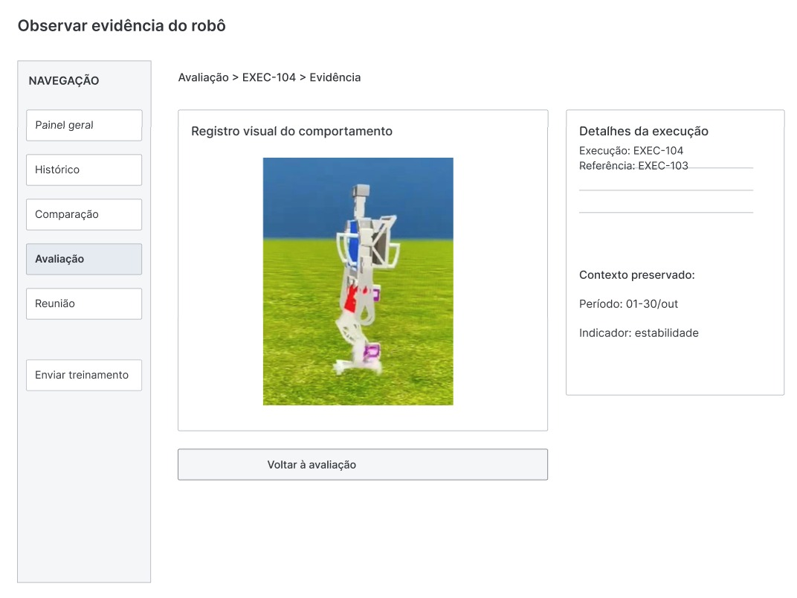

Objetivo do usuário: Consultar evidência de uma execução durante a avaliação de desempenho.  
Signos principais: execução, evidência, indicador, período, voltar.  
Origem no MoLIC: M01/O03.  

### F36 — Reconhecer limitação

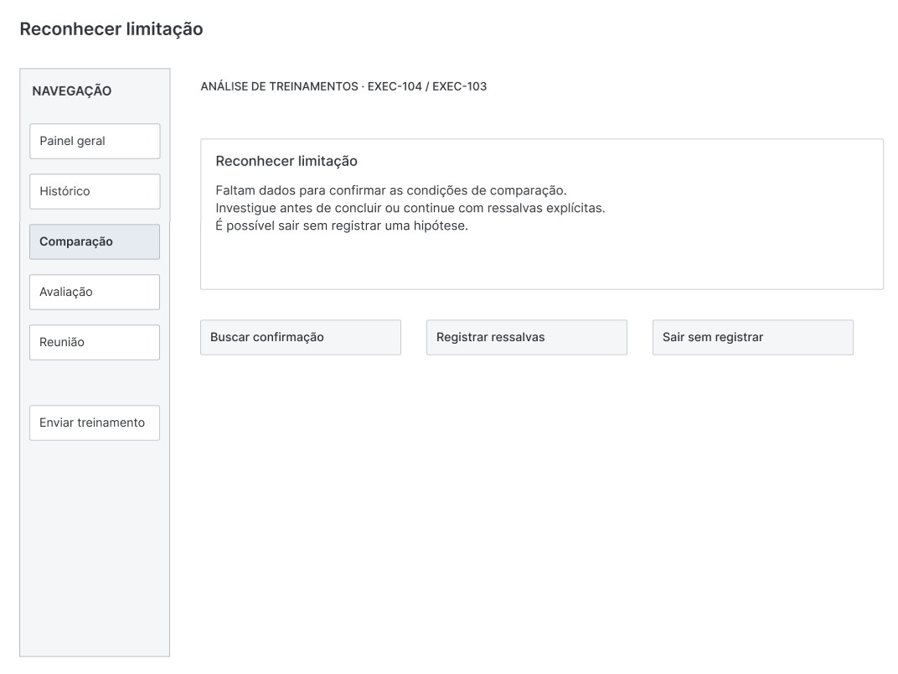

Objetivo do usuário: Identificar quando uma informação técnica não foi registrada e evitar conclusão indevida.  
Signos principais: dado não registrado, condição, limitação, fontes de consulta.  
Origem no MoLIC: M02/O08 e O11.  

### F43 — Recuperar erro de registro

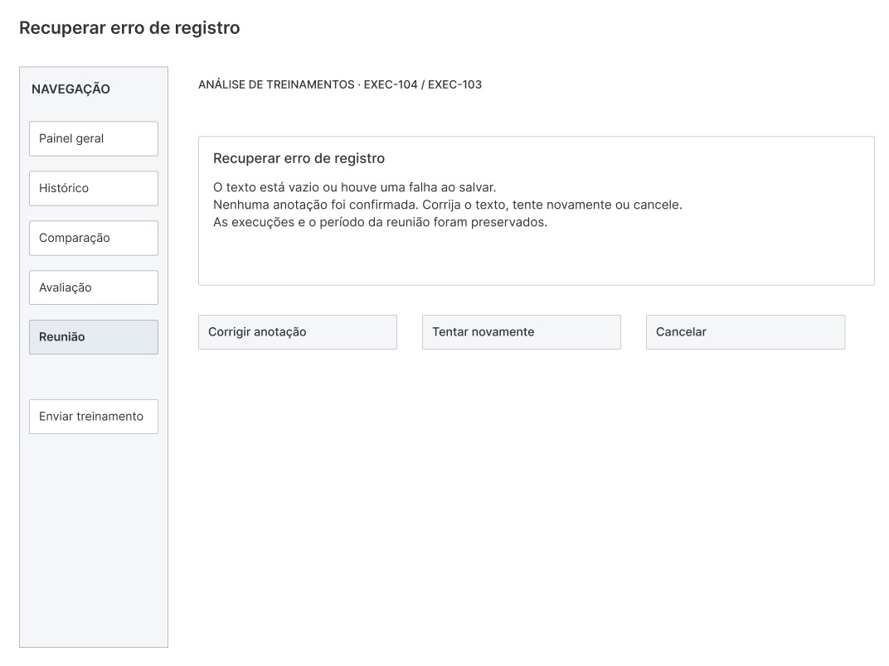

Objetivo do usuário: Entender por que a anotação não foi confirmada e escolher uma alternativa.  
Signos principais: falha no registro, nenhuma anotação confirmada, corrigir, tentar novamente, cancelar.  
Origem no MoLIC: M03/O15 (recuperação).   

### F48 — Observar evidência — reunião

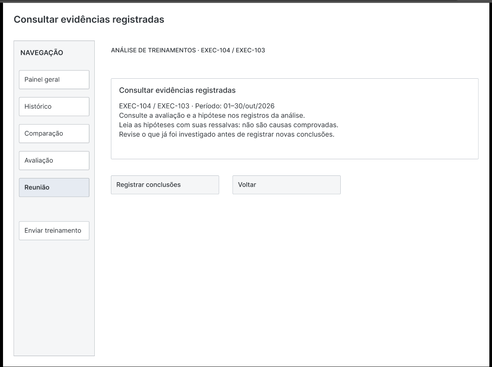

Objetivo do usuário: Consultar uma evidência sem perder o contexto da apresentação.  
Signos principais: execução, evidência, indicador, período, voltar à apresentação no mesmo ponto.  
Origem no MoLIC: M03/O02.  

### F61 — Observar evidência — treinamento

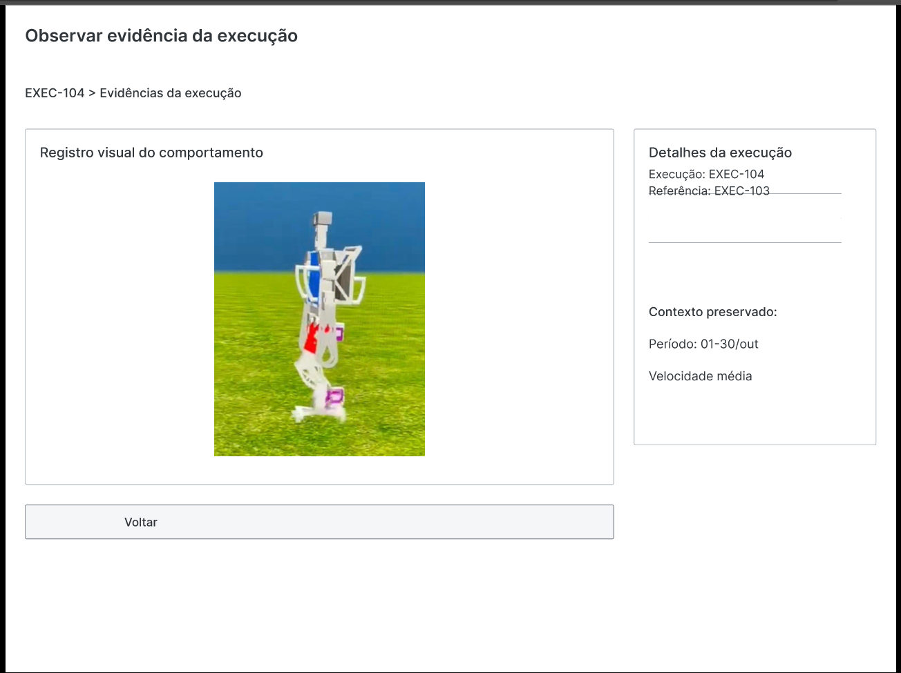

Objetivo do usuário: Examinar evidência complementar do treinamento para sustentar a avaliação.  
Signos principais: treinamento, evidência, contexto, indicador e retorno.  
Origem no MoLIC: M01/O03.

## Sistema visual e consistência

| Elemento | Regra adotada | Justificativa |
|---|---|---|
| Tipografia | Utilização de tipografia sans-serif, com hierarquia visual entre títulos das telas, títulos de seções, rótulos de campos, indicadores numéricos e textos explicativos. As métricas principais, como velocidade média, distância percorrida, taxa de quedas e estabilidade, recebem maior destaque visual. | Facilita a leitura rápida dos resultados, a identificação de informações relevantes e a comparação entre treinamentos, reduzindo o esforço cognitivo dos integrantes da equipe de robótica. |
| Cores | Utilização de cores de fundo, superfícies e elementos de destaque para diferenciar a navegação, os cartões de indicadores, as áreas de comparação e os botões de ação. Estados de confirmação, alerta, erro e informações não confirmadas devem ser diferenciados visualmente e acompanhados de mensagens textuais, sem depender exclusivamente da cor. | Organiza visualmente informações técnicas, facilita o reconhecimento de situações que exigem atenção e reduz o risco de interpretações equivocadas durante a avaliação dos treinamentos. |
| Componentes | Layout desktop de referência de 1440 × 1080 px, com navegação lateral, área principal de conteúdo, cartões de indicadores, gráficos, listas de execuções, campos de busca, filtros, tabelas comparativas e botões de ação. Elementos equivalentes devem preservar padrões de alinhamento, agrupamento, identificação e navegação nas telas de painel geral, histórico, comparação, avaliação e reunião. | Mantém a previsibilidade da interface e facilita a transição entre os fluxos de consulta de resultados (M01), recuperação e comparação de treinamentos anteriores (M02) e apresentação de resultados em reunião (M03). |
| Feedback | Apresentação de mensagens explícitas para confirmar registros de avaliação (F09) e hipóteses (F07), informar buscas sem resultados (F02E e F27), alertar sobre informações ausentes ou condições não confirmadas (F05, F24 e F36) e orientar a recuperação de falhas de registro (F43). A consulta de evidências durante reuniões deve permitir retornar à apresentação preservando seu contexto (F48). | Atende aos princípios de visibilidade do estado do sistema, prevenção de erros, controle do usuário e recuperação de falhas. Permite compreender o resultado das ações, reconhecer limitações dos dados e continuar as tarefas sem perder o contexto da análise. |

## Verificação de acessibilidade básica

Para produto Web, considere critérios pertinentes da WCAG vigente (por exemplo, contraste, foco, tamanho de alvo, texto alternativo e navegação por teclado quando aplicáveis). Para outras plataformas, use as recomendações adequadas ao contexto.

- Contraste de títulos, textos secundários, indicadores e botões.
- O significado de erro, sucesso e seleção está disponível também por texto, não apenas por cor.
- Ordem de leitura, rótulos de campos e clareza dos botões.
- Alvos clicáveis e legibilidade em diferentes tamanhos.
- Navegação por teclado e foco visível.

## Checklist

- [X] Link do Figma está acessível.
- [X] Há screenshots representativos no repositório.
- [X] Todos os MoLIC relevantes estão cobertos.
- [X] Estados de erro, feedback e recuperação foram prototipados.
- [X] Terminologia/signos são consistentes com Entrega 9.
- [X] Componentes equivalentes se comportam de forma consistente.
- [X] Fluxos críticos são clicáveis do início ao fim.
- [X] O protótipo está pronto para inspeção e testes, sem “links mortos” nas tarefas avaliadas.
- [X] Dashboards, relatórios, históricos, filtros, administração e CRUDs presentes possuem justificativa rastreável.
- [X] Estados de vazio, processamento, erro e recuperação foram considerados quando pertinentes.
- [X] Resultados técnicos são apresentados de forma interpretável para o perfil de usuário.
- [X] A equipe distingue no protótipo o que é interação simulada e o que é funcionalidade técnica realmente integrada, quando necessário.
