# Entrega 14 — Avaliação de usabilidade por observação de usuários

**Data:** {{22/11/2026}}   
**Status:**  em andamento  
**Responsabilidade:** solução consolidada por equipe. O número de participantes finais observados deve ser igual ao número de integrantes, conforme o modelo da disciplina; recomenda-se que cada integrante seja responsável por conduzir/analisar ao menos um participante.

## Objetivo da atividade

Observar usuários representativos realizando tarefas reais ou realisticamente simuladas para identificar problemas de eficácia, eficiência, compreensão e satisfação que não podem ser inferidos apenas por inspeção.

> **Participantes finais não devem ser membros da equipe.** Um integrante pode participar do teste piloto apenas para validar roteiro/equipamentos, sem contar na amostra final.

### Quando o usuário é um perfil profissional especializado

Em TCCs técnicos, o público pode ser DBA, analista, pesquisador, administrador, técnico ou outro especialista. Priorize participantes que possuam relação real com as tarefas. Se não for possível recrutar o perfil ideal, qualquer participante aproximado/proxy deve ser **justificado previamente e tratado como limitação**; não apresente o resultado como equivalente ao de especialistas reais.

O teste avalia a **interação com o protótipo**. Não é necessário que o participante valide o desempenho científico do algoritmo. Resultados simulados podem ser usados quando declarados e coerentes com a tarefa.

Tarefas podem envolver, por exemplo, interpretar um dashboard, configurar uma análise, encontrar uma execução no histórico usando filtros, comparar resultados, gerar relatório, revisar alerta ou administrar permissões.

## A. Fluxograma do processo — equipe

O fluxograma deve representar, no mínimo: planejamento → recrutamento → consentimento → preparação → execução das tarefas/observação → pós-teste → consolidação/análise → recomendações.

## B. Procedimento de preparação e execução — equipe

### Passo 1 — Objetivos e versão avaliada

**Versão/commit/Figma:** Protótipo navegável desenvolvido na Entrega 11, disponível em [Figma — IHC](https://www.figma.com/proto/qHpoJxQF4Sthdy99w7Scul/IHC?node-id=32-2023&p=f&scaling=min-zoom&content-scaling=fixed&page-id=0%3A1&starting-point-node-id=32%3A2023).

**Metas de usabilidade relacionadas:** MU01, MU02, MU03, MU04, MU05, MU06, MU07 e MU08, estabelecidas nas entregas anteriores e utilizadas no planejamento DECIDE da Entrega 12.

A avaliação foi realizada em 22/11/2026, utilizando o protótipo da plataforma de análise de desempenho de robôs humanoides desenvolvido no Figma. Conforme o registro da equipe, as três participantes utilizaram a mesma versão da interface.

O objetivo foi observar como pessoas externas ao desenvolvimento do projeto realizam as tarefas de avaliação de desempenho, comparação de treinamentos e apresentação de resultados, identificando dificuldades de navegação, compreensão, eficiência, eficácia e satisfação.

Foram consideradas as três tarefas principais:

- **T01 — Avaliar o desempenho de um treinamento:** interpretar indicadores e verificar se os resultados representam uma melhoria efetiva no desempenho do robô.
- **T02 — Localizar e comparar execuções anteriores:** consultar o histórico, comparar resultados, verificar limitações e registrar interpretações.
- **T03 — Apresentar resultados em reunião:** consultar indicadores e evidências durante uma reunião, preservando o contexto da apresentação.

As tarefas estão relacionadas aos cenários CI01, CI02 e CI03 da Entrega 9 e aos diagramas MoLIC M01, M02 e M03 da Entrega 10.

Os dados e as interações apresentados no protótipo são demonstrativos. A avaliação se concentrou na usabilidade da interface, não na validação científica do algoritmo de aprendizado por reforço desenvolvido no TCC.

### Passo 2 — Participantes

A avaliação contou com **três participantes externos à equipe**, correspondendo ao número de integrantes previsto pelo enunciado da disciplina.

Foram utilizadas participantes de perfil aproximado (*proxy*), uma vez que nenhuma delas possui experiência específica com robótica humanoide. Essa escolha permitiu avaliar a compreensão inicial da interface, a clareza das informações e a facilidade de navegação, mas limita a generalização dos resultados para profissionais especializados.

| ID | Perfil | Critérios que justificam participação | Integrante responsável |
|---|---|---|---|
| U01 | Participante sem conhecimento prévio em robótica, com pouca familiaridade com computadores e gráficos. | Permitiu observar as dificuldades de uma pessoa sem experiência com indicadores técnicos, sistemas de análise e terminologia de robótica. | Letizia Lowatzki Baptistella |
| U02 | Participante sem conhecimento em robótica, com familiaridade básica com gráficos e uso diário de computador. | Permitiu observar a compreensão das métricas, a identificação das telas e a comparação de resultados por uma usuária não especializada. | Manuella Filipe Peres |
| U03 | Estudante de IHC, sem conhecimento prévio em robótica, com familiaridade intermediária com gráficos e indicadores. | Colega de turma que já teve contato com conceitos de usabilidade, Power BI e Figma, mas não participou do desenvolvimento do projeto. Sua participação permitiu avaliar a interface sem influência das decisões da equipe. | Rafaela Altheman de Campos |

As três participantes foram avaliadas nas tarefas UT01, UT02 e UT03, totalizando **nove registros de execução de tarefas**.

### Passo 3 — Consentimento e privacidade

- **Termo/registro de consentimento:** foi preparado um modelo de consentimento na Entrega 12 para informar o objetivo acadêmico, o caráter voluntário da participação e a utilização dos resultados. Os comprovantes individuais de aceite não constam dos materiais analisados.
- **Gravação de tela/áudio/vídeo:** as três avaliações possuem gravações vinculadas aos respectivos registros na Seção C. 
- **Forma de anonimização:** as participantes são identificadas pelos códigos `U01`, `U02` e `U03` nas tabelas de análise
- **Local e período de armazenamento:** as gravações foram compartilhadas por links e arquivos digitais para análise acadêmica. As permissões de acesso e o período de retenção não foram especificados nos registros examinados, devendo respeitar o consentimento obtido.

Os resultados são apresentados de forma agregada ou por identificador, evitando associar dificuldades e avaliações a nomes pessoais.

### Passo 4 — Teste piloto

**Data registrada:** 22/11/2026.

**O que foi validado:**

A preparação do teste contemplou a verificação do acesso ao protótipo do Figma, a navegação entre as telas, a sequência das tarefas UT01, UT02 e UT03, o roteiro de moderação, os questionários e os procedimentos de observação.

Também foram considerados o tempo necessário para executar as atividades, a clareza das instruções e a possibilidade de registrar erros, dúvidas, ajudas e satisfação.

**Mudanças após piloto:** nenhuma alteração foi realizada.

### Passo 5 — Tarefas

As três tarefas foram estabelecidas previamente no planejamento DECIDE da Entrega 12, com instruções voltadas aos objetivos dos usuários, sem indicar os botões ou caminhos que deveriam utilizar.

| ID | Cenário/instrução apresentada | Critério de sucesso | Métricas | Ligação com modelo |
|---|---|---|---|---|
| UT01 | "Sua equipe terminou um treinamento e quer decidir se o resultado representa uma melhoria real. Use as informações disponíveis para examinar a execução e chegar a uma conclusão que possa ser comunicada ao grupo." | Identificar a execução, analisar pelo menos dois indicadores, reconhecer melhorias e possíveis regressões e apresentar uma classificação coerente. Confirmar o registro quando disponível. Limite operacional de 8 minutos. | Grau de sucesso, tempo, erros, ajudas, satisfação e interpretação dos indicadores. | T01 / CI01 / M01 / O02, O03, O04, O09 e O11 / F02, F03, F04, F08 e F09. |
| UT02 | "Um resultado antigo parece promissor, mas vocês não sabem se ele pode servir de referência para um experimento recente. Encontre os dois registros, examine as informações disponíveis e deixe documentada sua interpretação e eventuais limitações." | Localizar duas execuções distintas, comparar métricas e condições, identificar limitações e registrar hipótese ou ressalvas. Limite operacional de 8 minutos. | Grau de sucesso, tempo, erros, ajudas, satisfação e reconhecimento de limitações. | T02 / CI02 / M02 / O01 e O05–O12 / F02, F03, F04, F05, F06, F07 e F10. |
| UT03 | "Durante uma reunião de orientação, surge uma dúvida sobre um resultado apresentado. Consulte os dados necessários, aprofunde a evidência e depois retome a discussão exatamente do ponto em que estava." | Consultar o indicador, abrir uma evidência e retornar preservando a mesma execução, período e indicador. Limite operacional de 6 minutos. | Grau de sucesso, tempo, erros, ajudas, satisfação e preservação do contexto da apresentação. | T03 / CI03 / M03 / O02, O09 e O13–O16 / F14, F15 e F48. |

As tarefas foram avaliadas conforme os critérios de **sucesso total, sucesso parcial, falha ou não avaliável**, definidos na Entrega 12.

Para o cálculo das metas de eficácia, somente as execuções completas **sem ajuda de navegação** são consideradas sucessos totais. A realização de um fluxo com ajuda pode demonstrar compreensão e recuperação, mas não corresponde ao sucesso independente exigido pela meta.

### Passo 6 — Protocolo do moderador

O roteiro padronizado da avaliação foi organizado nas seguintes etapas:

1. **Recepção:** apresentar o objetivo da avaliação, esclarecendo que a interface estava sendo avaliada, e não a capacidade da participante.

2. **Consentimento:** informar o caráter voluntário da participação, explicar o uso acadêmico das informações e solicitar autorização para a gravação, quando aplicável.

3. **Pré-teste:** aplicar o questionário de caracterização, abordando familiaridade com computadores, gráficos, dashboards, Figma, robótica e IHC.

4. **Apresentação do protótipo:** explicar que a participante utilizaria uma interface navegável no Figma, com dados e ações demonstrativos.

5. **Execução das tarefas:** apresentar UT01, UT02 e UT03 individualmente, observando navegação, tempo, erros, dúvidas, dificuldades e eventuais ajudas.

6. **Verbalização:** permitir que a participante comentasse suas dúvidas e decisões durante a interação, sem exigir conhecimentos especializados sobre robótica.

7. **Satisfação após cada tarefa:** registrar uma nota de satisfação de 1 a 5, separadamente da avaliação geral do pós-teste.

8. **Pós-teste:** aplicar o questionário sobre facilidade de uso, compreensão dos indicadores, dificuldades, aspectos positivos, sugestões de melhoria e satisfação geral.

9. **Encerramento:** agradecer a participação e informar que os resultados seriam utilizados na análise acadêmica da interface.

As sessões produziram registros de observação e questionários, apresentados na Seção C. Houve necessidade de ajuda em algumas tarefas, conforme indicado nas fichas; por isso, essas ocorrências foram consideradas na classificação de sucesso e na análise das metas.

Após as três avaliações, os resultados foram consolidados por tarefa e comparados com as metas MU01–MU08 e os problemas identificados na inspeção heurística da Entrega 13.

## C. Resultados — por participante

### U01 — Participante sem conhecimento prévio na área

obs: a Satisfação foi coletada após o vídeo ser gravado

| Tarefa | Grau de sucesso | Erros | Tipos de erro/dificuldade | Ajudas | Tempo | Satisfação | Evidência/observação |
|---|---|---:|---|---:|---|---|---|
| UT01 | parcial | 1 | Entrou no lugar correto, mas não conseguiu completar o fluxo. Isso levou a um recomeço na tentativa. Além disso, ficou confusa sobre a finalização da tarefa. | 0 | 02:10 | 3 | "Será que é aqui que clica?", "Será que foi?". Pareceu incerta sobre o que deveria aingir e se de fato havia concluido o que foi solicitado. Apesar de ter dificuldades, ela conclluiu o fluxo. |
| UT02 | parcial| 4 | Acessou, primeiramente, o local errado para inicair a tarefa. Isso levou a um recomeço na tentativa. Não soube onde clicar após entrar na tela de comparação. Ficou na dúvida sobre a finalização da tarefa | 0 | 03:11 | 3 | "Será que é aqui de novo?". Não localizou facilmente o quadro de "Comparação" e, mais uma vez, não entendeu se havia finalizado a tarefa solicitada. Demorou para processar as informações na tela, mas concluiu o objetivo  |
| UT03 | parcial | 1 | Encerrou a reunião com pendências, sem corrigí-las antes de salvar o registro da reunião. | 1 | 03:00 | 3 | Seguiu o fluxo com naturalidade, pareceu mais certeira nas ações que estava tomando. Apesar da tela ter avisado que havia pendências no registro, a participante não corrigiu a pendência e concluiu a tarefa desta forma. A interface permite esse tipo de conclusão, a medida que pode-se ter registros incompletos caso necessário. |

**Link da gravação:** https://youtu.be/w8avTW-YeKE

# Questionário Pré-Teste — Avaliação de Usabilidade

*Projeto:* Plataforma de Análise de Desempenho de Robôs Humanoides  
*Entrega:* 14 — Avaliação de usabilidade por observação de usuários

*Participante:* U01 Lis Yu Yoneya Shinyome
*Data:* 22/11/2026  
*Responsável pela aplicação:* Letizia Lowatzki Baptistella 

*Objetivo:* Conhecer a experiência prévia do participante com tecnologia e interfaces de análise, antes de sua interação com o protótipo.

### 1. Você utiliza computadores ou notebooks com que frequência?

- [ ] Diariamente
- [ ] Algumas vezes por semana
- [X] Raramente
- [ ] Nunca ou quase nunca

### 2. Qual é sua familiaridade com gráficos, tabelas e indicadores numéricos?

- [X] Nenhuma
- [ ] Básica
- [ ] Intermediária
- [ ] Avançada

### 3. Você já utilizou algum sistema para visualizar ou comparar resultados, como dashboards ou ferramentas de análise de dados?

- [ ] Sim
- [X] Não

*Se sim, qual?* ______

### 4. Você possui algum conhecimento ou experiência com robótica, simulações ou treinamentos de robôs?

- [X] Nenhum
- [ ] Básico
- [ ] Intermediário
- [ ] Avançado

### 5. Você já estudou ou teve contato com conceitos de usabilidade ou Interação Humano-Computador (IHC)?

- [ ] Sim, em disciplina acadêmica
- [ ] Sim, por experiência prática ou outros estudos
- [X] Não

### 6. Você já utilizou ou visualizou protótipos no Figma?

- [X] Sim
- [ ] Não
- [ ] Não tenho certeza

### 7. Você participou do desenvolvimento ou já teve acesso às telas deste projeto?

- [X] Não
- [ ] Sim

*Observação do avaliador:* Se a resposta for sim, verificar a elegibilidade do participante antes de iniciar, pois o teste busca observar pessoas externas ao desenvolvimento do projeto.

# Questionário Pós-Teste — Avaliação de Usabilidade

### 1. De maneira geral, como você avalia a facilidade de utilização da interface?

- [ ] 1 — Muito difícil
- [X] 2 — Difícil
- [ ] 3 — Nem fácil, nem difícil
- [ ] 4 — Fácil
- [ ] 5 — Muito fácil

### 2. Qual das três atividades você considerou mais difícil? Por quê?

- [ ] UT01 — Avaliar o desempenho de um treinamento
- [ ] UT02 — Localizar e comparar treinamentos anteriores
- [X] UT03 — Consultar evidências durante uma reunião

*Por quê?*
Fiquei em duvida sobre o contexto da tarefa… o que de fato seria uma Reunião de metricas?

### 3. Os indicadores e as informações apresentados na interface foram fáceis de compreender?

- [X] Sim
- [ ] Parcialmente
- [ ] Não

*Houve algum termo, número ou informação que causou dúvida?*

Nenhum

### 4. Você conseguiu identificar facilmente para onde deveria navegar durante as atividades?

- [ ] Sim
- [X] Parcialmente
- [ ] Não

*Em algum momento ficou sem saber como como continuar?*

Sim, fiquei com duvidas em qual deveria ser o fluxo correto.

### 5. O que você mais gostou na interface?

Gostei do design, achei limpo.

### 6. O que você mudaria para tornar a interface mais fácil de utilizar?

Usaria termos mais genéricos, ou universais

### 7. Considerando toda a experiência, qual é sua satisfação geral com o protótipo?

- [ ] 1 — Muito insatisfeito(a)
- [ ] 2 — Insatisfeito(a)
- [ ] 3 — Neutro(a)
- [X] 4 — Satisfeito(a)
- [ ] 5 — Muito satisfeito(a)

### Comentários adicionais (opcional)

Nenhum

### U02 — Participante sem conhecimento prévio na área

| Tarefa | Grau de sucesso | Erros | Tipos de erro/dificuldade | Ajudas | Tempo | Satisfação | Evidência/observação |
|---|---|---:|---|---:|---|---|---|
| UT01 | parcial | Entendimento das métricas | Dificuldade de reconhecimento das métricas, nível iniciante | Foi necessário ajudar no entendimento das tarefas e métricas | 3:24 | 4 | Demonstrou satisfação, apesar do desconhecimento do assunto, conseguiu entender bem o funcionamento da interface |
| UT02 | parcial | Reconhecimento de telas e entendimento dos gráficos | Erro de reconhecimento da interface | Foi necessário ajudar no entendimento dos gráficos (como qual linha do gráfico se refere à qual experimento) e métricas | 4:39 | 4,5 | Demonstrou satisfação apesar dos pontos que acreditou que poderiam ser melhorados como legenda nos gráficos, melhor explicação de qual tela o usuário está e interface mais colorida para chamar a atenção do usuário |
| UT03 | total | Não houve nenhum erro | Não houve | Não foi necessário | 4:15 | 5 | Ficou muito satisfeita com o desempenho das telas requeridas para a tarefa 3, tudo bem claro e botões bem objetivos. |

**Link da gravação:** {{[link](https://www.youtube.com/watch?v=_Eauqhbo4q0)}}  

# Questionário Pré-Teste — Avaliação de Usabilidade

*Projeto:* Plataforma de Análise de Desempenho de Robôs Humanoides
*Entrega:* 14 — Avaliação de usabilidade por observação de usuários

*Participante:* Juliana Silva do Nascimento
*Data:* 22/11/2026
*Responsável pela aplicação:* Manuella Filipe Peres

*Objetivo:* Conhecer a experiência prévia do participante com tecnologia e interfaces de análise, antes de sua interação com o protótipo.

### 1. Você utiliza computadores ou notebooks com que frequência?

- [ x] Diariamente
- [ ] Algumas vezes por semana
- [ ] Raramente
- [ ] Nunca ou quase nunca

### 2. Qual é sua familiaridade com gráficos, tabelas e indicadores numéricos?

- [ ] Nenhuma
- [ x] Básica
- [ ] Intermediária
- [ ] Avançada

### 3. Você já utilizou algum sistema para visualizar ou comparar resultados, como dashboards ou ferramentas de análise de dados?

- [ ] Sim
- [x ] Não

*Se sim, qual?* ______

### 4. Você possui algum conhecimento ou experiência com robótica, simulações ou treinamentos de robôs?

- [ x] Nenhum
- [ ] Básico
- [ ] Intermediário
- [ ] Avançado

### 5. Você já estudou ou teve contato com conceitos de usabilidade ou Interação Humano-Computador (IHC)?

- [ ] Sim, em disciplina acadêmica
- [ ] Sim, por experiência prática ou outros estudos
- [x ] Não

### 6. Você já utilizou ou visualizou protótipos no Figma?

- [ x] Sim
- [ ] Não
- [ ] Não tenho certeza

### 7. Você participou do desenvolvimento ou já teve acesso às telas deste projeto?

- [ x] Não
- [ ] Sim

*Observação do avaliador:* Se a resposta for sim, verificar a elegibilidade do participante antes de iniciar, pois o teste busca observar pessoas externas ao desenvolvimento do projeto.

# Questionário Pós-Teste — Avaliação de Usabilidade
### 1. De maneira geral, como você avalia a facilidade de utilização da interface?
- [ ] 1 — Muito difícil
- [ ] 2 — Difícil
- [ ] 3 — Nem fácil, nem difícil
- [x] 4 — Fácil
- [ ] 5 — Muito fácil
### 2. Qual das três atividades você considerou mais difícil? Por quê?
- [ ] UT01 — Avaliar o desempenho de um treinamento
- [x] UT02 — Localizar e comparar treinamentos anteriores
- [ ] UT03 — Consultar evidências durante uma reunião
**Por quê?**
Achou difícil entender em qual tela estava, se confundiu com a tela inicial
### 3. Os indicadores e as informações apresentados na interface foram fáceis de compreender?
- [x] Sim
- [ ] Parcialmente
- [ ] Não
**Houve algum termo, número ou informação que causou dúvida?**
Não
### 4. Você conseguiu identificar facilmente para onde deveria navegar durante as atividades?
- [x] Sim
- [ ] Parcialmente
- [ ] Não
**Em algum momento ficou sem saber como continuar?**
Não
### 5. O que você mais gostou na interface?
A parte visual, como a foto do robô, deixando mais claro sobre qual treinamento e modelo de robô estamos falando
### 6. O que você mudaria para tornar a interface mais fácil de utilizar?
Deixaria mais colorido e mais claro sobre em que página está, quais métricas estamos comparando (como legenda nos gráficos)
### 7. Considerando toda a experiência, qual é sua satisfação geral com o protótipo?
- [ ] 1 — Muito insatisfeito(a)
- [ ] 2 — Insatisfeito(a)
- [ ] 3 — Neutro(a)
- [ ] 4 — Satisfeito(a)
- [x] 5 — Muito satisfeito(a)
### Comentários adicionais (opcional)
N/A

### U03 — Estudante de IHC, sem conhecimento prévio de robótica

**Data da avaliação:** 22/11/2026  
**Responsável:** Rafaela Altheman de Campos  
**Perfil:** colega de turma que cursa IHC, externa ao projeto. Usa computador diariamente, declara familiaridade intermediária com gráficos/indicadores e já utilizou Power BI, DesemProv e Figma. Não possui experiência em robótica, sendo participante aproximada (*proxy*).

| Tarefa | Grau de sucesso | Erros | Tipos de erro/dificuldade | Ajudas | Tempo | Satisfação | Evidência/observação |
|---|---|---:|---|---:|---|---|---|
| UT01 | Parcial | 1 | Passou por histórico, comparação e avaliação, selecionou “Melhoria” e abriu evidência do robô. Não foi observada a tela de confirmação da avaliação | Teve dificuldades ao confirmar a avaliação | 4:58 | 4 | Demonstrou satisfação, apesar do desconhecimento do assunto, conseguiu entender bem o funcionamento da interface |
| UT02 | sucesso integral | 1 | Apareceu “Revisar seleção”; a participante recuperou a navegação, comparou EXEC-104/EXEC-103, preencheu hipótese e ressalvas e chegou à confirmação “Conferir hipótese registrada”, seguindo para decisão sobre referência. | 1 | 3:37 | 4 | Navegação observável por volta de 08:40–12:00. No pós-teste, considerou UT02 a mais difícil por ter esquecido a tarefa, mas julgou botões/fluxo claros. |
| UT03 | Parcial | 1 | Abriu evidência a partir do painel, voltou à visão geral, acessou “Preparar conversa da reunião” e explorou “Período sem resultados”. Não se vê apresentação iniciada seguida de retorno ao mesmo indicador. | 1| 1:50 | 3 | Trecho observável aproximadamente entre 12:15 e o fim da gravação, na preparação da reunião. |

**Link da gravação:** [Teste U03 — YouTube](https://youtu.be/mHZoiHFV2fA). 

# Questionário Pré-Teste — Avaliação de Usabilidade

*Projeto:* Plataforma de Análise de Desempenho de Robôs Humanoides  
*Entrega:* 14 — Avaliação de usabilidade por observação de usuários

*Participante:* U___  
*Data:* 22/11/2026  
*Responsável pela aplicação:* Rafaela Altheman 

*Objetivo:* Conhecer a experiência prévia do participante com tecnologia e interfaces de análise, antes de sua interação com o protótipo.

### 1. Você utiliza computadores ou notebooks com que frequência?

- [x] Diariamente
- [ ] Algumas vezes por semana
- [ ] Raramente
- [ ] Nunca ou quase nunca

### 2. Qual é sua familiaridade com gráficos, tabelas e indicadores numéricos?

- [ ] Nenhuma
- [ ] Básica
- [x] Intermediária
- [ ] Avançada

### 3. Você já utilizou algum sistema para visualizar ou comparar resultados, como dashboards ou ferramentas de análise de dados?

- [x] Sim
- [ ] Não

*Se sim, qual?* um dashboard do powerBi e meu sistema de tcc (DesmProv)

### 4. Você possui algum conhecimento ou experiência com robótica, simulações ou treinamentos de robôs?

- [x] Nenhum
- [ ] Básico
- [ ] Intermediário
- [ ] Avançado

### 5. Você já estudou ou teve contato com conceitos de usabilidade ou Interação Humano-Computador (IHC)?

- [x] Sim, em disciplina acadêmica
- [ ] Sim, por experiência prática ou outros estudos
- [ ] Não

### 6. Você já utilizou ou visualizou protótipos no Figma?

- [x] Sim
- [ ] Não
- [ ] Não tenho certeza

### 7. Você participou do desenvolvimento ou já teve acesso às telas deste projeto?

- [x] Não
- [ ] Sim

*Observação do avaliador:* Se a resposta for sim, verificar a elegibilidade do participante antes de iniciar, pois o teste busca observar pessoas externas ao desenvolvimento do projeto.

# Questionário Pós-Teste — Avaliação de Usabilidade

*Projeto:* Plataforma de Análise de Desempenho de Robôs Humanoides  
*Participante:* U03 
*Data:* 22/11/2026

*Objetivo:* Identificar a percepção geral do participante sobre a facilidade de uso, compreensão das informações e dificuldades encontradas durante a interação com o protótipo.

### 1. De maneira geral, como você avalia a facilidade de utilização da interface?

- [ ] 1 — Muito difícil
- [ ] 2 — Difícil
- [x] 3 — Nem fácil, nem difícil
- [ ] 4 — Fácil
- [ ] 5 — Muito fácil

### 2. Qual das três atividades você considerou mais difícil? Por quê?

- [ ] UT01 — Avaliar o desempenho de um treinamento
- [X] UT02 — Localizar e comparar treinamentos anteriores
- [ ] UT03 — Consultar evidências durante uma reunião

*Por quê?*

Pois eu esqueci o que era pra ser feito, porem os botões da aplicação a o seu fluxo foi claro.

### 3. Os indicadores e as informações apresentados na interface foram fáceis de compreender?

- [x] Sim
- [ ] Parcialmente
- [ ] Não

*Houve algum termo, número ou informação que causou dúvida?*

Acredito que 

### 4. Você conseguiu identificar facilmente para onde deveria navegar durante as atividades?

- [ ] Sim
- [x] Parcialmente
- [ ] Não

*Em algum momento ficou sem saber como continuar?*

Ficou um pouco difícil pois não sabia direiuto os termos afinal robos não é minha área

### 5. O que você mais gostou na interface?

A imagem do robo e as informações dos das sessões

### 6. O que você mudaria para tornar a interface mais fácil de utilizar?

Considerando

### 7. Considerando toda a experiência, qual é sua satisfação geral com o protótipo?

- [ ] 1 — Muito insatisfeito(a)
- [ ] 2 — Insatisfeito(a)
- [ ] 3 — Neutro(a)
- [X] 4 — Satisfeito(a)
- [ ] 5 — Muito satisfeito(a)

### Comentários adicionais (opcional)

Sistema interessante paara pessoas da reais

## D. Consolidação por tarefa

A consolidação foi realizada a partir dos registros de observação de U01, U02 e U03, considerando as tarefas UT01, UT02 e UT03, os questionários aplicados e os critérios definidos na Entrega 12.

Para a análise de eficácia, somente o sucesso completo sem ajuda de navegação foi considerado como atendimento integral da tarefa. Com três participantes, a meta de 80% exige três sucessos completos em três tentativas avaliáveis.

Os tempos típicos foram calculados pela mediana dos três tempos registrados em cada tarefa. A interpretação pressupõe que a cronometragem tenha seguido o mesmo critério nas três sessões.

| Tarefa | Taxa de sucesso | Tempo típico | Erros recorrentes | Satisfação | Meta atendida? | Problemas prioritários |
|---|---:|---|---|---|---|---|
| UT01 | 0/3 — **0%** de sucesso total sem ajuda. As três participantes foram classificadas como parciais. | **03:24** (mediana de 02:10, 03:24 e 04:58). | Dificuldade na compreensão de métricas, interpretação da avaliação e reconhecimento da conclusão do fluxo. | Notas 3, 4 e 4; mediana **4/5**. | **MU01: não. MU04: sim**, conforme os tempos registrados. Satisfação mediana da tarefa dentro de MU06. | Melhorar explicações dos indicadores, identificação das etapas e confirmação do registro da avaliação. |
| UT02 | 0/3 — **0%** de sucesso total sem ajuda. U01 e U02 foram parciais; U03 concluiu o fluxo, mas recebeu uma ajuda. | **03:37** (mediana de 03:11, 03:37 e 04:39). | Dificuldade em reconhecer telas, interpretar gráficos e selecionar corretamente as execuções. | Notas 3, 4,5 e 4; mediana **4/5**. A nota 4,5 precisa ser conferida com a escala utilizada. | **MU02: não. MU04: sim**, conforme os tempos registrados. Satisfação mediana da tarefa dentro de MU06. | Melhorar identificação da tela atual, legendas dos gráficos e orientação na seleção de execuções. |
| UT03 | 1/3 — **33,3%** de sucesso total registrado (U02). U01 e U03 tiveram classificação parcial. | **03:00** (mediana de 01:50, 03:00 e 04:15). | Dificuldades na compreensão do contexto da reunião, tratamento de pendências e continuidade da apresentação. | Notas 3, 5 e 3; mediana **3/5**. | **MU03: não. MU05: sim**, conforme os tempos registrados. Satisfação mediana da tarefa abaixo de MU06. | Melhorar o contexto da reunião, o reconhecimento das pendências e a continuidade após consultar evidências. |

A UT02 foi considerada a mais difícil por U02 e U03 no questionário pós-teste. U02 relatou confusão na identificação da tela e das informações apresentadas, enquanto U03 afirmou ter esquecido o objetivo da tarefa, apesar de considerar o fluxo e os botões claros.

Os resultados demonstram que o protótipo permite alcançar diferentes etapas das atividades, mas a realização independente das tarefas ainda apresenta dificuldades, especialmente para participantes sem conhecimentos prévios em robótica.

### Verificação das metas MU01–MU08

| Meta | Critério estabelecido | Resultado da avaliação |
|---|---|---|
| MU01 | Pelo menos 80% de sucesso completo sem ajuda em UT01. | **Não atingida.** Nenhuma das três participantes obteve classificação de sucesso total. |
| MU02 | Pelo menos 80% de sucesso completo sem ajuda em UT02. | **Não atingida.** U03 concluiu o fluxo, mas teve uma ajuda registrada; U01 e U02 foram classificadas como parciais. |
| MU03 | Pelo menos 80% de sucesso completo sem ajuda em UT03. | **Não atingida.** Apenas U02 recebeu classificação de sucesso total, correspondendo a 33,3% das participantes. |
| MU04 | Tempo mediano de até 6 minutos em UT01 e UT02. | **Atingida segundo os tempos registrados.** UT01 apresentou mediana de 03:24 e UT02 de 03:37. |
| MU05 | Tempo mediano de até 4 minutos em UT03. | **Atingida segundo os tempos registrados.** A mediana foi de 03:00. |
| MU06 | Satisfação mediana de pelo menos 4/5. | **Atingida no conjunto das notas registradas, com ressalva.** A mediana das nove notas foi 4/5. Individualmente, UT01 e UT02 apresentaram mediana 4/5, enquanto UT03 apresentou 3/5. A nota 4,5 de U02/UT02 precisa ser conferida por não corresponder a uma alternativa inteira da escala planejada. |
| MU07 | Nenhum erro crítico durante as tarefas. | **Atingida** Foram registrados erros e dificuldades, mas não há classificação de criticidade completa de erro critico. |
| MU08 | Pelo menos 80% de retornos corretos ao mesmo contexto da apresentação. | **Atingida.** Os registros demonstram de maneira suficiente, para todas as participantes, o retorno à mesma execução, período e indicador após consultar evidência. |

### Síntese quantitativa

Os resultados mostram que as metas de eficiência MU04, MU07, MU08 e MU05 foram atendidas pelos tempos registrados, enquanto as metas de eficácia MU01, MU02 e MU03 não foram alcançadas.

A satisfação geral com o protótipo foi positiva: U01 atribuiu nota 4/5, U02 atribuiu 5/5 e U03 atribuiu 4/5 no questionário pós-teste, resultando em mediana **4/5** de satisfação geral.

Entretanto, a percepção positiva da interface não significou necessariamente a conclusão independente das tarefas. As dificuldades de navegação, compreensão e interpretação permaneceram relevantes, mesmo quando as participantes demonstraram satisfação com o aspecto visual e com as funcionalidades apresentadas.

## E. Achados e recomendações

A avaliação de usabilidade realizada com três participantes permitiu identificar dificuldades relacionadas à navegação, compreensão de indicadores, interpretação de gráficos e reconhecimento da conclusão das tarefas.

Os achados foram organizados a partir dos registros de observação, das respostas dos questionários pós-teste e da navegação documentada nas gravações. As recomendações propostas buscam aprimorar a clareza da interface e a realização das tarefas UT01, UT02 e UT03.

| ID | Achado | Evidência (quant. + qual.) | Impacto | Recomendação | Artefatos a revisar |
|---|---|---|---|---|---|
| AU01 | Dificuldade para identificar a tela atual e compreender o caminho de navegação. | **3/3 participantes** apresentaram ou relataram alguma dificuldade de orientação. U01 teve dúvidas sobre o fluxo e a finalização das tarefas; U02 relatou confusão sobre a tela em que estava durante UT02; U03 considerou a navegação apenas parcialmente fácil. | Pode provocar caminhos incorretos, repetição de ações e insegurança sobre a conclusão das atividades. | Destacar a localização atual do usuário, melhorar os títulos e indicadores de navegação e apresentar confirmações mais evidentes ao concluir cada etapa. | Figma F01, F02, F03, F08 e F09; MoLIC M01 e M02; signos de navegação da Entrega 9. |
| AU02 | Dificuldade de compreensão do vocabulário e do contexto técnico de robótica. | **2/3 participantes** relataram explicitamente dificuldades relacionadas ao contexto ou à terminologia. U01 questionou o significado de uma reunião de métricas e sugeriu termos mais universais. U03 mencionou dificuldades por não conhecer os termos de robótica. | Pode dificultar a interpretação das instruções e dos indicadores, especialmente para usuários não familiarizados com o domínio. | Incluir explicações contextuais, descrições curtas de termos técnicos e identificação mais clara do propósito de cada atividade, preservando a terminologia necessária ao público especializado. | Dicionário de signos da Entrega 9; Figma F01, F04, F14 e F15; MoLIC M01–M03. |
| AU03 | Dificuldade para interpretar as séries e os indicadores apresentados nos gráficos. | **1/3 participante (U02)** apresentou dificuldade registrada para identificar qual linha do gráfico correspondia a cada execução, necessitando de esclarecimentos. Também sugeriu a inclusão de legendas mais claras. | Pode levar à interpretação incorreta dos resultados e à associação de métricas à execução errada. | Utilizar legendas persistentes, identificar claramente cada execução e padronizar a apresentação das métricas, unidades e séries dos gráficos. | Figma F01, F04 e F08; recomendações RC03 e RC04 da Entrega 2; MoLIC M01 e M02. |
| AU04 | Dificuldade na seleção e comparação de execuções anteriores. | **3/3 participantes** tiveram alguma dificuldade registrada na UT02. U01 acessou inicialmente um caminho incorreto e teve quatro erros registrados; U02 apresentou dificuldades na identificação das telas e na leitura dos gráficos; U03 encontrou uma seleção inválida, mas conseguiu recuperar a navegação. **2/3 (U02 e U03)** indicaram UT02 como a tarefa mais difícil no pós-teste. | Aumenta o esforço necessário para localizar e comparar treinamentos, podendo causar confusão na escolha das execuções e na interpretação das diferenças. | Indicar claramente quantas execuções devem ser selecionadas, identificar as execuções escolhidas e melhorar a orientação durante a comparação, preservando a possibilidade de corrigir seleções inválidas. | Figma F02, F02E, F03, F04 e F05; MoLIC M02; objetivos O01, O09, O10 e O11. |
| AU05 | Falta de clareza sobre a conclusão e confirmação das atividades. | U01 demonstrou dúvidas sobre a finalização de UT01 e UT02, questionando se havia concluído corretamente. Na análise visual de U03, não foi identificada a confirmação final do registro da avaliação em UT01. | Pode causar insegurança, repetição de ações ou interpretação equivocada sobre o salvamento das informações. | Reforçar as mensagens de confirmação, apresentar o resultado da ação realizada e destacar as opções de continuidade após o registro. | Figma F08, F09, F06, F07 e F21; MoLIC M01–M03; signos de feedback da Entrega 9. |
| AU06 | Dificuldades relacionadas ao contexto da reunião, às pendências e à continuidade da apresentação. | U01 considerou UT03 a tarefa mais difícil e relatou dúvidas sobre o significado de uma reunião de métricas. U02 concluiu a tarefa e avaliou positivamente suas telas. U03 explorou evidências e um estado sem resultados, mas a gravação analisada não comprovou o retorno ao mesmo indicador durante a apresentação. | Pode dificultar a compreensão da finalidade da reunião e comprometer a continuidade da análise ao consultar informações complementares. | Explicitar o objetivo da reunião, destacar o indicador apresentado e as pendências e garantir que o retorno da evidência preserve execução, período e indicador. | Figma F14, F15, F18, F20, F21 e F48; MoLIC M03; objetivos O13–O17; meta MU08. |
| AU07 | A percepção positiva da interface não correspondeu necessariamente ao sucesso completo das tarefas. | As três participantes atribuíram notas positivas de satisfação geral: **U01 4/5, U02 5/5 e U03 4/5**, com mediana de **4/5**. Entretanto, nenhuma das metas de eficácia MU01, MU02 e MU03 foi atingida conforme os critérios de sucesso completo sem ajuda. | Uma boa avaliação visual ou satisfação geral pode ocultar dificuldades na execução independente das tarefas. | Preservar os aspectos visuais bem avaliados, mas priorizar melhorias de orientação, compreensão e feedback. Reavaliar posteriormente a eficácia das tarefas após as alterações. | Figma F01–F48 nos fluxos avaliados; metas MU01–MU06; matriz de rastreabilidade R01–R03. |

### Priorização das recomendações

As recomendações foram organizadas considerando a frequência das dificuldades, seu impacto na conclusão das tarefas e os problemas identificados anteriormente na inspeção heurística da Entrega 13.

As prioridades são:

1. **Melhorar a navegação e a identificação das telas**, principalmente nos fluxos de avaliação e comparação (AU01 e AU04).
2. **Aprimorar a apresentação de gráficos, métricas e unidades**, reduzindo ambiguidades durante a interpretação dos resultados (AU03).
3. **Reforçar os feedbacks de confirmação**, permitindo que o usuário reconheça claramente quando uma avaliação ou hipótese foi registrada (AU05).
4. **Incluir explicações para termos técnicos e contextualizar as atividades**, especialmente a comparação de treinamentos e a reunião de métricas (AU02 e AU06).
5. **Garantir a continuidade da apresentação após a consulta de evidências**, preservando o contexto do usuário (AU06).
6. **Manter os aspectos visuais avaliados positivamente**, como a organização das telas e as imagens do robô, sem deixar de corrigir os problemas de eficácia identificados (AU07).

Os achados complementam a inspeção heurística da Entrega 13, mas não substituem as correções das violações V01, V02 e V03. As recomendações representam propostas de melhoria e não alterações já implementadas no protótipo.

Os resultados também deverão ser associados à matriz de rastreabilidade, relacionando **R01 à UT01, R02 à UT02 e R03 à UT03**, de modo a preservar a ligação entre necessidades dos usuários, tarefas, modelos de interação, telas do Figma e problemas observados.

## F. Comparação com a avaliação heurística

A comparação entre a inspeção heurística da Entrega 13 e os testes com usuários da Entrega 14 permitiu identificar tanto problemas já documentados pela equipe quanto novas dificuldades percebidas durante a utilização do protótipo.

A inspeção heurística identificou três violações principais: V01, V02 e V03. Os testes complementaram essa análise, especialmente em relação à navegação, à terminologia e à compreensão dos gráficos.

| Problema | Detectado na heurística? | Detectado por usuários? | O que aprendemos |
|---|---|---|---|
| **V01 — Inconsistência na unidade de velocidade.** | Sim — H2 e H4, severidade 4. | Não foi identificado relato direto comprovado sobre a divergência de unidades. | A inspeção permitiu encontrar uma inconsistência importante que não foi explicitamente apontada pelas participantes. A correção permanece prioritária, pois unidades incorretas podem comprometer a interpretação dos resultados e a comparação entre execuções. |
| **V02 — Ambiguidade nas condições de comparabilidade.** | Sim — H4 e H5, severidade 3. | Parcialmente relacionada às dificuldades observadas em UT02, mas sem comprovação de que a mensagem específica tenha causado os erros. | As dificuldades de comparação reforçaram a importância de apresentar claramente as condições de cada treinamento. Entretanto, não é possível afirmar que as participantes identificaram a mesma violação encontrada na inspeção. |
| **V03 — Erro de escrita no estado vazio.** | Sim — H2, severidade 1. | Não houve relato explícito sobre o erro de digitação. | A inspeção foi importante para identificar um problema textual que não recebeu destaque nos comentários das participantes. A correção é simples e contribui para a clareza da interface. |
| **Dificuldade de identificação da tela atual e do caminho de navegação.** | Não registrada como violação específica entre V01–V03. | Sim — U01, U02 e U03 apresentaram ou relataram dificuldades relacionadas à navegação. | Os testes mostraram a necessidade de reforçar a localização do usuário na interface, identificar melhor as etapas das tarefas e apresentar confirmações claras de conclusão. |
| **Dificuldade na interpretação das séries dos gráficos.** | Não registrada como violação específica entre V01–V03. | Sim — U02 precisou de esclarecimentos sobre as linhas dos gráficos e suas execuções correspondentes. | A identificação visual de cada série precisa ser aprimorada por meio de legendas, rótulos e associação consistente entre execuções, indicadores e unidades. |
| **Terminologia especializada e compreensão do contexto.** | Não registrada como violação específica entre V01–V03. | Sim — U01 relatou dificuldade com o contexto da reunião de métricas e U03 mencionou desconhecimento dos termos de robótica. | A interface pode oferecer explicações contextuais para termos especializados. Como as participantes não pertencem ao público técnico principal, o resultado também reforça a necessidade de avaliar posteriormente a interface com usuários representativos da área. |
| **Seleção inválida de execuções durante a comparação.** | Não registrada como violação específica entre V01–V03. | Sim — U03 encontrou a mensagem "Revisar seleção" durante UT02 e conseguiu continuar a navegação. | O estado de recuperação funcionou como recurso de orientação, mas a interface pode prevenir a seleção inadequada indicando antecipadamente quais execuções devem ser escolhidas. |

Os resultados demonstram que os métodos foram complementares. A inspeção heurística permitiu identificar inconsistências técnicas e problemas de apresentação, enquanto a observação de usuários evidenciou dificuldades práticas de orientação, interpretação e conclusão das tarefas.

A avaliação também mostrou que a ausência de reclamação sobre uma inconsistência não significa que ela seja irrelevante. Por outro lado, dificuldades surgidas durante o teste não devem ser automaticamente atribuídas às violações heurísticas sem evidências de uma relação direta.

Dessa forma, as recomendações da Entrega 13 foram mantidas e complementadas pelos achados da Entrega 14, especialmente no que se refere à clareza da navegação, identificação dos gráficos, terminologia e feedback das ações.

## G. Conclusão

A avaliação de usabilidade da Entrega 14 foi realizada com três participantes externas à equipe, identificadas como U01, U02 e U03, utilizando o protótipo navegável desenvolvido no Figma. O objetivo foi investigar a interação com a plataforma de análise de desempenho de robôs humanoides, considerando a eficácia, eficiência, compreensão das informações, satisfação e dificuldades observadas nas tarefas UT01, UT02 e UT03.

As participantes apresentaram diferentes níveis de familiaridade com computadores, gráficos e conceitos de usabilidade, mas nenhuma possuía conhecimento prévio específico sobre robótica. Dessa forma, os resultados contribuíram para compreender a experiência de usuários não especializados, sem representar uma validação com o público profissional principal da plataforma.

### Metas de usabilidade

A consolidação demonstrou que as metas de eficácia **MU01, MU02 e MU03 não foram atingidas**, uma vez que a quantidade de tarefas concluídas integralmente e sem ajuda ficou abaixo dos 80% estabelecidos no planejamento.

Em contrapartida, as metas de eficiência **MU04, MU07, MU08 e MU05 foram atingidas conforme os tempos registrados**. As medianas foram de 03:24 para UT01, 03:37 para UT02 e 03:00 para UT03, permanecendo abaixo dos limites previstos.

A satisfação geral foi positiva, com notas de 4/5 para U01, 5/5 para U02 e 4/5 para U03. A meta MU06 também apresentou mediana consolidada de 4/5 nas notas registradas por tarefa, embora a UT03 tenha apresentado satisfação mediana de 3/5 e exista uma nota intermediária de 4,5 que precisa ser conferida em relação à escala planejada.

### Problemas recorrentes

As principais dificuldades envolveram a identificação da tela atual, a compreensão de termos relacionados à robótica, a interpretação das métricas e gráficos e o reconhecimento de quando uma atividade havia sido concluída.

A **UT02 — Localizar e comparar treinamentos anteriores** recebeu destaque nos questionários pós-teste de U02 e U03 como a atividade mais difícil. U02 relatou confusão na localização das telas e na identificação das informações dos gráficos. U03 informou que esqueceu o objetivo da tarefa, embora tenha considerado claros os botões e o fluxo da interface.

Na UT01, foram observadas dificuldades relacionadas à compreensão dos indicadores e à confirmação da avaliação. Na UT03, apareceram dúvidas sobre o contexto de reunião, o tratamento de pendências e a continuidade da apresentação.

### Aspectos positivos e aprendizados

Um resultado relevante foi perceber que as participantes demonstraram satisfação com a interface mesmo apresentando dificuldades para realizar algumas tarefas de maneira independente.

Os questionários destacaram como aspectos positivos a organização visual, o design limpo, as imagens do robô e a apresentação das informações. Esses elementos contribuíram para uma percepção favorável do protótipo.

Também foi possível observar que os mecanismos de recuperação podem auxiliar a continuidade da interação. Durante a UT02, U03 encontrou uma mensagem de seleção inválida e conseguiu prosseguir até o registro da hipótese.

A avaliação mostrou, portanto, que a facilidade percebida e a eficácia na execução das tarefas são dimensões diferentes. Uma interface visualmente agradável pode continuar exigindo melhorias de orientação, terminologia e feedback.

Outro aprendizado importante foi a complementaridade entre os métodos de avaliação. A inspeção heurística identificou problemas de consistência e comunicação, enquanto os testes com usuários trouxeram dificuldades práticas que não haviam sido registradas como violações principais na Entrega 13.

### Mudanças prioritárias

A partir dos resultados, foram identificadas as seguintes prioridades de melhoria:

1. **Padronizar as unidades de velocidade**, corrigindo a inconsistência V01 identificada na inspeção heurística.
2. **Esclarecer as condições de comparabilidade**, diferenciando informações confirmadas, não confirmadas e ausentes, conforme a violação V02.
3. **Melhorar a identificação das telas e dos fluxos**, tornando mais evidente a localização atual do usuário e o resultado das ações realizadas.
4. **Aprimorar as legendas dos gráficos**, identificando claramente as execuções e as métricas apresentadas.
5. **Oferecer explicações para termos especializados**, reduzindo dificuldades de compreensão para usuários menos familiarizados com robótica.
6. **Revisar os fluxos de reunião e consulta de evidências**, verificando a preservação do contexto e a compreensão das pendências.
7. **Corrigir a mensagem de estado vazio**, resolvendo o erro textual V03.

Essas propostas representam recomendações decorrentes da avaliação, não alterações já implementadas ou validadas no Figma.

### Limitações da avaliação

A principal limitação está relacionada ao tamanho e ao perfil da amostra. A avaliação envolveu somente três participantes, todas consideradas usuários aproximados (*proxy*), sem experiência específica com robótica. Portanto, os resultados não podem ser generalizados para pesquisadores, desenvolvedores ou integrantes de equipes de robótica humanoide.

Outra limitação decorre da utilização de um protótipo navegável com dados demonstrativos, e não de um sistema completamente implementado. Assim, a avaliação se concentrou na interação e na compreensão das informações, sem verificar o funcionamento de processos reais ou a precisão dos resultados técnicos do TCC.

Também existem limitações nos registros de observação, especialmente quanto à classificação da criticidade dos erros, à confirmação do retorno contextual na UT03 e à padronização de determinadas notas e contagens de ajuda. Essas lacunas foram consideradas na interpretação dos resultados, evitando conclusões sem evidências suficientes.

### Considerações finais

A Entrega 14 permitiu avaliar o protótipo em situações de uso observadas, complementando os modelos de interação e a inspeção heurística desenvolvidos anteriormente.

Embora as metas de eficácia não tenham sido alcançadas, os tempos de realização e as avaliações de satisfação indicaram aspectos positivos da interface. Ao mesmo tempo, as dificuldades identificadas demonstraram a necessidade de aprimorar a orientação durante as tarefas, a comunicação das informações técnicas e os mecanismos de confirmação e recuperação.

Os achados fornecem uma base para futuras melhorias no Figma e para a atualização da matriz de rastreabilidade do projeto, relacionando as necessidades dos usuários, os modelos MoLIC, as telas do protótipo e as recomendações decorrentes da avaliação.

Conclui-se que a avaliação por observação foi importante para identificar dificuldades que não poderiam ser completamente antecipadas apenas pela modelagem ou pela inspeção, contribuindo para a evolução da proposta de interface e para uma compreensão mais ampla de sua usabilidade.

## Checklist

- [X] Número de participantes finais atende ao enunciado.
- [X] Participantes são representativos do público e não são membros da equipe.
- [X] Se foram usados participantes proxy, a justificativa e a limitação estão explícitas.
- [X] O teste avalia a interação; não confunde usabilidade do protótipo com desempenho técnico do TCC.
- [X] Tarefas administrativas/analíticas usadas no teste são rastreáveis a objetivos e cenários.
- [X] Há consentimento e anonimização.
- [X] Foi realizado teste piloto.
- [X] Tarefas têm critérios de sucesso definidos antes do teste.
- [X] Moderadores não ensinaram o caminho durante a tarefa.
- [X] Resultados estão separados por usuário e por tarefa.
- [X] Foram registrados sucesso, erros, ajudas, tempo e satisfação quando aplicáveis.
- [X] Conclusão combina evidência quantitativa e qualitativa.
- [X] Achados geram recomendações e atualização da rastreabilidade.
